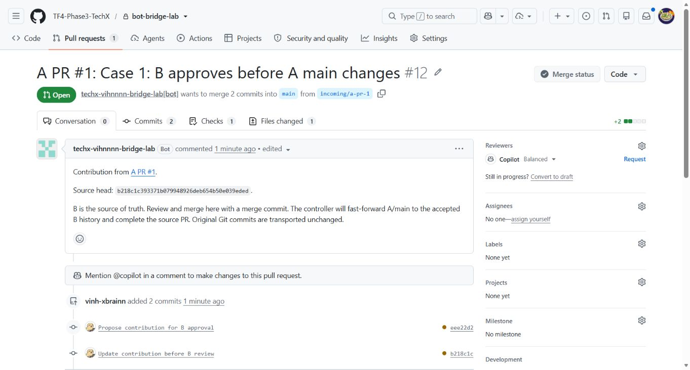
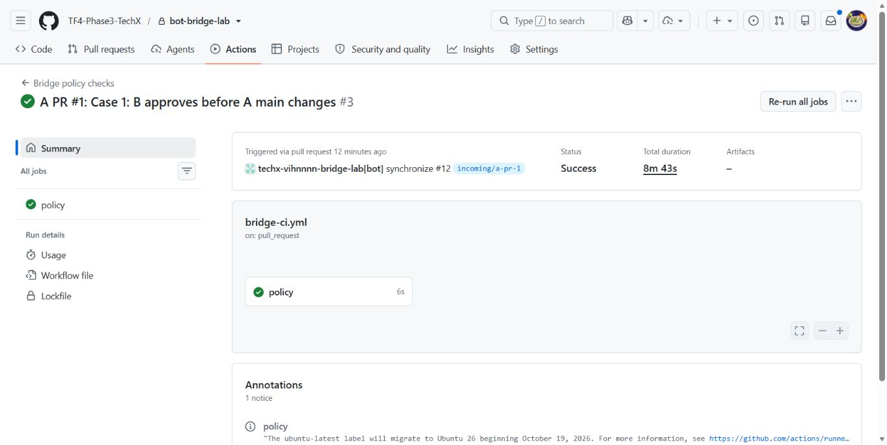
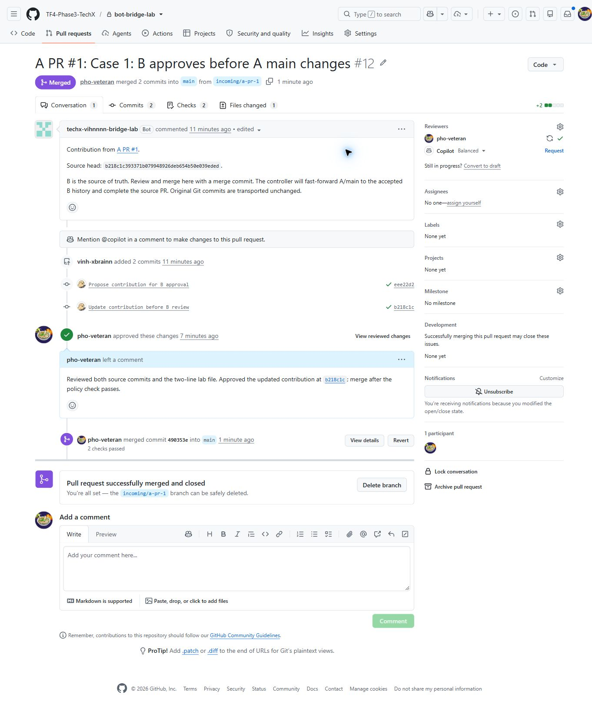
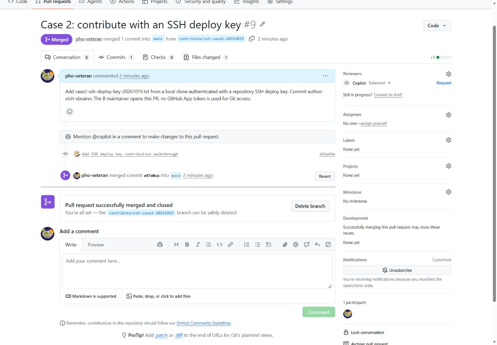

# Lab contribute vào private repo: GitHub App và SSH deploy key

## 1. Vấn đề và giải pháp tổng thể

Team ở org A cần gửi code vào repo của org B. Nếu cấp quyền trực tiếp cho từng người ở B, các tài khoản đó có thể được tính vào số seat của gói trả phí. Yêu cầu là giữ được tác giả commit mà không thêm từng developer vào B.

| Thành phần | Môi trường lab |
|---|---|
| Org A | `Vihnnnn` |
| Developer A | `vinh-xbrainn` |
| Repo A | `Vihnnnn/bot-bridge-lab` |
| Org B | `TF4-Phase3-TechX` |
| Người quản lý B | `pho-veteran` |
| Repo B | `TF4-Phase3-TechX/bot-bridge-lab` |

Các ràng buộc:

- Cả hai repo đều private; developer A không được thêm vào member hoặc collaborator của B.
- Commit tại B giữ nguyên SHA, author và committer của commit gốc; email tác giả liên kết với tài khoản GitHub của developer.
- B là source of truth: `B/main` chứa code đã được chấp nhận. A gửi thay đổi qua PR; chỉ B quyết định merge. Với cách 1, `A/main` là bản đồng bộ của `B/main`, developer không tự merge hoặc push vào `A/main`.
- Member A chỉ clone/pull từ repo A và push feature branch tại A. Bot đọc repo private B bằng App token rồi cập nhật `A/main`; member A không cần remote B, token B hoặc SSH key B trong cách 1.
- Hai org trong lab dùng GitHub Free. Lab mô phỏng quyền truy cập private repo, không đo hóa đơn GitHub Team. Các link repo, PR và Actions yêu cầu quyền truy cập lab; ảnh kết quả được nhúng trực tiếp trong tài liệu này.

Cách 1 dùng **GitHub App + Actions** để chuyển PR từ A sang B và đồng bộ kết quả đã được B chấp nhận về A. Cách 2 dùng **SSH deploy key** của riêng repo B để clone/pull/push; người quản lý B mở PR trên GitHub. Cả hai cách giữ tác giả commit và không thêm tài khoản developer vào B. Credential này không cấp quyền mở giao diện private repo B bằng tài khoản cá nhân của developer.

GitHub App không tiêu thụ user seat. Chi phí chạy Actions phụ thuộc hạn mức và mức sử dụng của org A. [Tài liệu GitHub về App và seat](https://docs.github.com/en/apps/creating-github-apps/about-creating-github-apps/deciding-when-to-build-a-github-app).

**Cách 1 — A gửi PR, B duyệt, bot đồng bộ kết quả về A**

```text
Developer tạo feature branch từ A/main đã đồng bộ với B/main
→ Mở PR vào A/main, giữ PR chưa merge
→ Bot chuyển nguyên commit sang branch tại B và mở PR tương ứng
→ B review; developer sửa tiếp tại A nếu cần
→ B merge PR vào B/main
→ Bot đọc B/main và fast-forward A/main đến cùng commit
→ GitHub ghi nhận PR A đã merge khi commit của PR nằm trong A/main
→ Member A pull main từ repo A để tiếp tục làm việc
```

B chưa merge thì thay đổi vẫn nằm trên feature branch của A và branch PR của B. Khi B từ chối PR, code đó không được đưa vào main của bên nào. Mỗi tính năng dùng một branch riêng để B có thể duyệt độc lập.

Bot không gọi merge PR tại B hoặc tạo một merge commit độc lập tại A. Quyền mong muốn của bot ở B là **đọc code, đẩy branch đóng góp và quản lý PR; không cập nhật B/main**. GitHub không có permission riêng “chỉ mở PR, không merge” cho toàn bộ luồng này; cần kết hợp quyền App với bảo vệ nhánh ở mục 2.4.

Luồng này đã được triển khai và chạy end-to-end ngày 19/10/2026: PR #1 tại A → PR #12 tại B → B merge → bot đồng bộ về A. Ảnh ở mục 3 thuộc đúng lượt chạy mới này.

**Cách 2 — Clone trực tiếp repo B bằng SSH deploy key**

```text
B cài public key vào Deploy keys của repo, bật Allow write access
→ Developer clone repo B bằng SSH private key trên máy
→ Tạo branch, sửa file và commit với tên/email của developer
→ Push branch bằng SSH deploy key
→ Người quản lý B mở và merge PR trên GitHub
→ Local pull main bằng cùng SSH key
```

Cách 2 chỉ cần repo B trên GitHub; bản clone nằm trên máy developer. Deploy key không hết hạn theo giờ và không tạo user seat. Key chỉ dùng cho Git qua SSH, không gọi API để mở PR. [Tài liệu GitHub về deploy key](https://docs.github.com/en/authentication/connecting-to-github-with-ssh/managing-deploy-keys).

Author/email là metadata Git có thể tự cấu hình, nên việc hiển thị tài khoản trên commit chưa chứng minh người đó thực sự tạo commit. SSH deploy key xác thực quyền truy cập repo, không xác thực danh tính từng developer. Lab giữ metadata và dùng merge commit để giữ SHA; không cấu hình ký commit.

## 2. Setup lab GitHub App

### 2.1. Tạo App tại org B

Dùng session Edge đăng nhập `pho-veteran`, mở **TF4-Phase3-TechX → Settings → Developer settings → GitHub Apps → New GitHub App**.

| Trường | Giá trị |
|---|---|
| GitHub App name | `TechX Vihnnnn Bridge Lab` |
| Homepage URL | `https://github.com/TF4-Phase3-TechX` |
| Callback / user authorization / device flow | Không cấu hình |
| Webhook → Active | Bỏ chọn |
| Where can this GitHub App be installed? | `Only on this account` |

Quyền App đang dùng trong lab:

| Permission | Quyền |
|---|---|
| Contents | Read and write |
| Pull requests | Read and write |
| Metadata | Read-only |
| Workflows | Read and write |

`Contents: write` cần để đưa commit và branch vào B vì A/B là hai repo độc lập; `Contents: read` cùng `Pull requests: write` không đủ. Quyền này cũng có thể dùng để merge nếu nhánh chưa được bảo vệ, nên không được coi bảng permission là cơ chế chặn merge. [API tạo Git ref](https://docs.github.com/en/rest/git/refs#create-a-reference), [API merge PR](https://docs.github.com/en/rest/pulls/pulls#merge-a-pull-request).

Lab đã cấp `Workflows: write` để vận chuyển thay đổi workflow. Với triển khai chỉ nhận code ứng dụng, đề xuất bỏ quyền này và để maintainer B xử lý thay đổi `.github/workflows/` qua quy trình riêng; việc repo có sẵn workflow không có nghĩa mọi lần push đều cần quyền này. Không cấp Administration, Actions write, Checks write, Commit statuses write hoặc quyền organization cho App bridge. Bấm **Create GitHub App** khi dựng App mới; quyền lab hiện tại chưa được thay đổi trong lần cập nhật tài liệu này.

### 2.2. Tạo key và cài App

1. Trong trang App, mở **Credentials → Key pairs → New key**, tải file `.pem` và lưu ngoài repo.
2. Chọn **Install App → TF4-Phase3-TechX → Only select repositories**.
3. Chọn duy nhất `bot-bridge-lab`, rồi **Install**.
4. Nếu đổi permission sau khi cài, chấp nhận quyền mới trong installation tại B.

Thông tin App đang dùng:

| Thông tin | Giá trị |
|---|---|
| App ID | `5376504` |
| Client ID | `Iv23li2GwmLXhSNHA2Yh` |
| Installation ID | `172913981` |
| Key trên máy lab | `C:\Users\T14s Gen 2\Desktop\techx-vihnnnn-bridge-lab.2026-10-18.private-key.pem` |

App đã được tạo và cài trong lab. Có thể xem tại [trang cấu hình App](https://github.com/organizations/TF4-Phase3-TechX/settings/apps/techx-vihnnnn-bridge-lab). Khi dựng môi trường khác, dùng tên App riêng và thay các ID/key tương ứng.

### 2.3. Cấu hình Actions cho cách 1

Lab dùng App B hiện có và `GITHUB_TOKEN` tự cấp cho workflow tại A. Không tạo App A riêng và không lưu token cá nhân của developer trong Actions.

| Credential | Vai trò |
|---|---|
| App B: `TechX Vihnnnn Bridge Lab` | Đọc B/main, push branch đóng góp, mở/cập nhật PR tại B; controller không gọi merge, cấu hình chặn quyền merge được đề xuất tại mục 2.4 |
| `GITHUB_TOKEN` của repo A | Đọc PR A, fast-forward A/main theo B, cập nhật comment/trạng thái PR A |

Tại repo A, mở **Settings → Secrets and variables → Actions**:

| Loại | Tên | Giá trị |
|---|---|---|
| Repository variable | `BRIDGE_APP_CLIENT_ID` | `Iv23li2GwmLXhSNHA2Yh` |
| Repository secret | `BRIDGE_APP_PRIVATE_KEY` | Nội dung PEM của App B, gồm dòng BEGIN/END |

Workflow khai báo `contents: write` và `pull-requests: write` cho `GITHUB_TOKEN`; token này chỉ dùng tại A. App token được giới hạn vào duy nhất repo B. Hai credential đều được cấp trong mỗi lượt chạy.

Các file triển khai được duyệt vào B rồi đồng bộ về A:

- [`.github/workflows/bridge-to-b.yml`](https://github.com/Vihnnnn/bot-bridge-lab/blob/main/.github/workflows/bridge-to-b.yml): workflow **PR bridge - B is source of truth**, thay thế workflow push-main cũ.
- [`scripts/pr-bridge.mjs`](https://github.com/Vihnnnn/bot-bridge-lab/blob/main/scripts/pr-bridge.mjs): vận chuyển commit, liên kết PR và đồng bộ main.
- [`scripts/pr-bridge-policy.mjs`](https://github.com/Vihnnnn/bot-bridge-lab/blob/main/scripts/pr-bridge-policy.mjs) và [`tests/pr-bridge-policy.test.mjs`](https://github.com/Vihnnnn/bot-bridge-lab/blob/main/tests/pr-bridge-policy.test.mjs): xử lý và kiểm tra các trạng thái đồng bộ.
- [`.github/workflows/bridge-ci.yml`](https://github.com/TF4-Phase3-TechX/bot-bridge-lab/blob/main/.github/workflows/bridge-ci.yml): kiểm tra cú pháp controller và các policy test trên PR, không dùng secret bridge.

Workflow điều phối chỉ chạy tại A. Sự kiện `pull_request_target` xử lý PR mở mới, cập nhật commit, mở lại, đóng hoặc bỏ draft. Lịch chạy ở phút 7, 22, 37, 52 mỗi giờ đọc trạng thái mới từ B; có thể dùng **Run workflow** để đồng bộ ngay sau khi B merge. Lịch Actions có thể bị trễ; luồng không yêu cầu B và A cập nhật đồng thời.

Job có secret luôn checkout controller từ `main`, không checkout/chạy code của feature branch. Git vận chuyển nguyên object commit, không chạy hook. CI chạy ở job riêng với quyền đọc. Các lượt điều phối dùng cùng concurrency group trong repo A để xử lý tuần tự.

Thiết lập quy trình nhánh:

- A/main: chỉ bot đồng bộ kết quả từ B; developer tạo feature branch và PR.
- B/main: maintainer B review/test rồi dùng **Create a merge commit**, giữ SHA và metadata của commit gốc.
- B có hotfix hoặc PR nội bộ: sau khi được chấp nhận vào B/main, bot cũng đồng bộ về A.

Lab này tự đồng bộ thay đổi code thông thường. Nếu B thay đổi file trong `.github/workflows/`, controller dừng và báo cần maintainer đồng bộ hoặc một App A riêng có Workflows write; không tự tăng quyền cho `GITHUB_TOKEN`. Các file workflow ban đầu được maintainer đồng bộ trong bước setup.

### 2.4. Guard cho luồng A gửi, B quyết định

**Trạng thái lab và điều kiện áp dụng**

Luồng PR và đồng bộ đã test thật; các cấu hình bảo vệ bên dưới là đề xuất, chưa bật hoặc test chặn quyền trên hai repo lab. Private repo của org cần GitHub Team/Enterprise để dùng branch protection. Hai org Free hiện chỉ kiểm chứng hành vi controller, chưa bảo đảm bot không thể ghi B/main hoặc member A không thể ghi A/main nếu dùng credential ngoài controller. Muốn cưỡng chế cả hai đầu thì cả hai org phải có gói hỗ trợ; chi phí này tách biệt với việc không thêm developer A làm seat ở B. [Phạm vi hỗ trợ](https://docs.github.com/en/repositories/configuring-branches-and-merges-in-your-repository/managing-protected-branches/about-protected-branches).

**B/main: chỉ maintainer B được đưa code vào**

Tại B → **Settings → Branches → Add classic branch protection rule**, đặt pattern `main`:

| Thiết lập | Giá trị đề xuất |
|---|---|
| Restrict who can push to matching branches | Chỉ user/team maintainer B; không thêm App bridge |
| Require a pull request before merging | Bật |
| Require approvals | Ít nhất 1 review của B |
| Dismiss stale pull request approvals when new commits are pushed | Bật |
| Restrict who can dismiss pull request reviews | Chỉ maintainer B |
| Require status checks to pass before merging | Chọn CI bắt buộc của dự án và nguồn CI tin cậy |
| Do not allow bypassing the above settings | Bật; không cấp bypass PR cho bot |
| Allow force pushes / Allow deletions | Tắt |

[Cách tạo branch protection rule](https://docs.github.com/en/repositories/configuring-branches-and-merges-in-your-repository/managing-protected-branches/managing-a-branch-protection-rule).

Chỉ yêu cầu review/CI là chưa đủ: sau khi checks pass, bot có Contents write vẫn có thể merge nếu được phép cập nhật nhánh. Danh sách người được push vào `main` phải loại App bridge; hạn chế này áp dụng cả khi merge PR. Chủ org vẫn có thể sửa policy, nên tài khoản quản trị nằm trong phạm vi tin cậy. [Quyền cập nhật protected branch](https://docs.github.com/en/repositories/configuring-branches-and-merges-in-your-repository/managing-protected-branches/about-protected-branches#restrict-who-can-push-to-matching-branches).

Chọn **Create a merge commit**, tắt squash/rebase merge để giữ SHA; không bật yêu cầu linear history cho luồng này. Tắt auto-merge và không dùng merge queue trong cấu hình đề xuất để thao tác nhận code vẫn do maintainer B thực hiện. App chỉ được cài vào repo cần bridge. Controller chỉ đẩy `incoming/a-pr-<số PR A>`; đây là kiểm tra trong controller, không phải phạm vi quyền branch của token. Nếu B có thêm nhánh release hoặc tag cần bảo vệ thì áp dụng rules tương ứng; bảo vệ `main` không bảo vệ mọi ref khác.

**A/main và credential của bộ đồng bộ**

Lab dùng `GITHUB_TOKEN` của repo A để fast-forward. Khi cần cưỡng chế quyền, đề xuất dùng một App đồng bộ A riêng, cài duy nhất tại repo A; chỉ App này được cập nhật `A/main`. Ví dụ dùng ruleset `Restrict updates` cho `main`, chỉ App đồng bộ được bypass rule đó, và ruleset riêng chặn force-push/xóa không có bypass. Không yêu cầu tạo thêm PR ở A cho lần đồng bộ vì B đã quyết định; không mở quyền cho mọi workflow mang danh `github-actions[bot]`. [Quy tắc giới hạn cập nhật nhánh](https://docs.github.com/en/repositories/configuring-branches-and-merges-in-your-repository/managing-rulesets/available-rules-for-rulesets).

Giữ credential App B và App đồng bộ A trong controller do maintainer quản lý, chẳng hạn repo automation riêng mà developer A không có quyền write. Controller đọc PR A qua API và đồng bộ bằng App; member A vẫn chỉ dùng repo A. Đây là thay đổi triển khai cần làm trước khi áp dụng guard đầy đủ, chưa có trong lab.

Lý do: secret repo A hiện tại có thể được workflow khác do người có quyền write tạo ra sử dụng. Chỉ checkout controller từ main hoặc bảo vệ main chưa cô lập được secret khỏi mọi workflow trên feature branch. Khi chuyển controller, phải gỡ secret B khỏi repo đóng góp A và thu hồi/đổi key cũ nếu đã lộ. [GitHub Actions: quyền truy cập secrets](https://docs.github.com/en/actions/reference/security/secure-use).

**Guard khi chạy controller**

- Chỉ xử lý repo/installation, base `main`, PR cùng repo A và branch đích đã định trước; xác minh source head SHA và cặp PR trước khi cập nhật. Không dùng tiêu đề hoặc nội dung PR làm lệnh shell.
- Job có credential không thực thi code, dependency, hook hay artifact từ PR. CI chạy riêng, không có key bridge; pin action theo commit SHA. Lab đã tách job điều phối và CI theo nguyên tắc này. [An toàn với pull_request_target](https://docs.github.com/en/actions/reference/security/securely-using-pull_request_target).
- Đồng bộ A từ ref `B/main` đọc qua API/Git, không dựa vào comment “đã merge”. Chỉ fast-forward, kiểm tra SHA sau push, không tự force/reset khi hai main lệch nhau. Retry đọc lại refs và dùng lại cặp PR, không tạo merge hoặc PR trùng.
- PR A là đầu vào để review, không phải bằng chứng xác thực author. Nếu cần chống giả danh, yêu cầu commit ký từ developer ngay từ đầu và kiểm tra signer; lab hiện chỉ chứng minh giữ metadata/SHA.
- B phải đồng ý chia sẻ toàn bộ code và lịch sử được đồng bộ trong B/main với thành viên repo A. B private chỉ chặn truy cập trực tiếp; không ngăn A đọc bản sao bot đã chuyển về. Không chuyển secret, log CI hoặc review nội bộ ngoài dữ liệu đã cho phép.

**Kiểm tra bắt buộc sau khi bật guard**

Trên repo kiểm thử cùng policy, xác nhận App B vẫn đẩy branch/mở PR được nhưng bị từ chối khi push main, merge PR đã đủ approval/CI, force-push hoặc xóa main. Xác nhận member A không thể push/merge main hoặc dùng credential đồng bộ, trong khi maintainer B merge được và bot cập nhật A về đúng SHA. Thử thêm approval bị vô hiệu sau commit mới, conflict, A/main lệch, token bị thu hồi và chạy lại sau lỗi đồng bộ. Chưa có evidence cho các kiểm tra quyền này; ảnh mục 3 chỉ chứng minh luồng thành công đã chạy.

### 2.5. Chuẩn bị máy cho cách 2

Máy lab dùng **PowerShell, Git và Windows OpenSSH**. Cách 2 không dùng App token; private key SSH được lưu ngoài repo. Các lệnh ở mục 4 chạy trực tiếp trong terminal. Cấu hình SSH được lưu riêng trong bản clone để các lần pull/push tiếp theo không cần cấp token mới.

Lab chưa bật branch protection. Deploy key có quyền write có thể push cả `main`; luồng dưới đây dùng branch và PR theo quy trình thao tác, chưa được cưỡng chế bằng chính sách server.

## 3. Triển khai cách 1 — PR tại A → B duyệt → Đồng bộ main về A

### 3.1. Chuẩn bị cùng một main

B là source of truth. Trước khi tạo đóng góp mới, maintainer đã đưa controller vào B và đồng bộ lịch sử được B chấp nhận về A. Hai main bắt đầu lượt test tại cùng commit `a328651dee4e8a87feb3a7a25b6f1ef15c05e799`.

Developer dùng `vinh-xbrainn` tại A; maintainer dùng `pho-veteran` tại B. Khi chạy lại, lấy A/main mới nhất và dùng tên branch/file mới.

### 3.2. Developer mở PR tại A

Từ A/main, tạo branch `feature/case1-pr-first-20261019`, thêm file `case1-pr-first-20261019.txt`:

```text
Case 1: A proposes a PR; B approves and merges; the bot syncs accepted history back to A.
```

Commit với message `Propose contribution for B approval`, rồi mở PR vào A/main. Không merge PR tại A.

Lượt test tạo [PR A #1](https://github.com/Vihnnnn/bot-bridge-lab/pull/1), tác giả `vinh-xbrainn`, commit đầu tiên `eee22d26d5f4976d9dfef469de18bcbf630abbc6`.

Workflow **PR bridge - B is source of truth** tự chạy từ sự kiện mở PR. [Run tạo PR B](https://github.com/Vihnnnn/bot-bridge-lab/actions/runs/39286166439) chuyển nguyên commit sang B và ghi trạng thái chờ duyệt vào PR A.

### 3.3. Bot mở PR B và nhận sửa đổi từ A

Bot `techx-vihnnnn-bridge-lab[bot]` mở [PR B #12](https://github.com/TF4-Phase3-TechX/bot-bridge-lab/pull/12), branch `incoming/a-pr-1`, base `main`. Nội dung PR chứa liên kết về PR A #1 và source SHA.

Để kiểm tra cập nhật PR, developer thêm dòng thứ hai tại cùng branch A:

```text
Revision 2: this update must reach the same B pull request before approval.
```

Commit `Update contribution before B review` tạo SHA `b218c1c393371b079948926deb654b50e039eded`. [Run cập nhật PR](https://github.com/Vihnnnn/bot-bridge-lab/actions/runs/39286318248) đưa commit mới vào cùng PR B #12; không tạo PR B thứ hai.

Ảnh bên dưới được chụp khi PR B còn mở, có hai commit của `vinh-xbrainn`:



Tại thời điểm này, đã kiểm tra cả A/main và B/main vẫn ở `a328651`; file mới chưa có trên main của bên nào. Tài khoản `vinh-xbrainn` gọi API repo B vẫn nhận 404, nên việc chuyển code không dựa trên cấp quyền cá nhân ở B.

### 3.4. B review, chạy CI và merge

Dùng `pho-veteran` mở PR B #12. Trong **Files changed**, kiểm tra đúng một file với hai dòng mới; trong **Commits**, kiểm tra hai SHA và tác giả gốc.

Maintainer đã gửi review **Approved** cho head `b218c1c`. Check **Bridge policy checks / policy** chạy kiểm tra cú pháp controller và policy test, kết quả **pass** tại [run CI B](https://github.com/TF4-Phase3-TechX/bot-bridge-lab/actions/runs/39286354005). Đây là kiểm tra controller của lab; khi áp dụng vào dự án thật, bổ sung build/test của dự án.



Sau khi CI pass, maintainer chọn **Merge pull request → Confirm merge**. PR #12 được merge bằng `pho-veteran`, tạo commit `490353ed51034262eff39a57d5fa82958f44e14a`.



### 3.5. Bot đồng bộ đúng kết quả B về A

Sau khi B merge, có thể chờ lượt polling hoặc vào **A → Actions → PR bridge - B is source of truth → Run workflow → main**.

Lượt test dùng [workflow_dispatch 39287713598](https://github.com/Vihnnnn/bot-bridge-lab/actions/runs/39287713598). Job reconcile đã hoàn tất với kết quả success. Controller dùng GITHUB_TOKEN tại A để fast-forward A/main đến merge commit của B. Không gọi một lần merge độc lập tại A.

Kết quả đọc lại từ GitHub API:

| Thành phần | Kết quả |
|---|---|
| B/main | `490353ed51034262eff39a57d5fa82958f44e14a` |
| A/main | `490353ed51034262eff39a57d5fa82958f44e14a` |
| PR B #12 | Merged bởi `pho-veteran` |
| PR A #1 | Merged, actor `github-actions[bot]`, cùng merge commit `490353e` của B |
| Comment trạng thái tại A | `github-actions[bot]` xác nhận Accepted và SHA đã đồng bộ |
| Liên kết PR | Một PR A tương ứng một PR B; một comment trạng thái được cập nhật tại A |

Pull lại main của A về local đã nhận đúng file mới và merge commit `490353e`; working tree sạch. Hai commit gốc `eee22d2` và `b218c1c` giữ nguyên SHA, author, committer và được GitHub liên kết với `vinh-xbrainn` ở cả hai repo. Merge commit của B chứa `b218c1c` làm parent; hai main nhận cùng merge commit, không chỉ có nội dung file giống nhau.

Member A thực hiện trong bản clone có `origin` trỏ tới `Vihnnnn/bot-bridge-lab`, sau khi bot báo đồng bộ xong và working tree sạch:

```bash
git remote get-url origin
git switch main
git pull --ff-only origin main
git switch -c feature/next-change
```

Không thêm remote B hoặc dùng credential B trên máy member A. Nếu local main có commit riêng khiến pull thất bại, giữ lại công việc ở feature branch và xử lý sai lệch; không push local main lên A để ghi đè bản đồng bộ.

### 3.6. Hành vi khi có thay đổi hoặc lỗi

| Tình huống | Controller xử lý |
|---|---|
| B chưa merge hoặc yêu cầu sửa | A/main giữ lịch sử B đã chấp nhận; bot cập nhật trạng thái review về PR A |
| B/main có thay đổi mới | Đồng bộ main về A; developer merge main mới vào feature branch và giải quyết conflict tại A trước khi gửi lại |
| B đóng PR không merge | Đóng PR A kèm trạng thái rejected; không tự tạo lại cặp PR đó |
| A đóng PR trước khi B merge | Đóng PR tương ứng tại B, coi là rút đóng góp |
| Developer push thêm commit sau phiên bản B đã merge | Đồng bộ phần được B chấp nhận, chưa hoàn tất PR A; phần mới cần PR mới từ main đã đồng bộ |
| B merge thành công nhưng ghi A lỗi | Workflow báo lỗi; lần chạy sau kiểm tra lại refs và tiếp tục đồng bộ |
| A/main có commit chưa được B chấp nhận | Dừng, yêu cầu maintainer reconcile; không force-push hoặc tự đưa code đó vào B |
| B thay đổi file workflow | Dừng để maintainer đồng bộ hoặc dùng App A có Workflows write |

Branch tại B do bot quản lý. Developer cập nhật branch tại A bằng commit mới, không rebase/force-push lịch sử đã chuyển. Workflow chuyển trạng thái review về A, không sao chép toàn bộ comment hay log nội bộ B.

Luồng mở PR → sửa thêm → B review/CI/merge → đồng bộ A đã được test thật. Các nhánh quyết định về lệch main, từ chối, rút PR và commit mới chưa được B chấp nhận có policy test; chưa chạy từng tình huống lỗi trên hai repo thật.

## 4. Triển khai cách 2 — SSH clone B → Commit → PR → Merge → Pull

### 4.1. Tạo SSH key và cài vào repo B

Trên máy developer, mở PowerShell. Bước tạo key chỉ làm một lần; key dưới đây đã tồn tại trong máy lab, không ghi đè khi chạy lại:

```powershell
New-Item -ItemType Directory -Force -Path "$env:USERPROFILE\.ssh" | Out-Null
$keyPath = "$env:USERPROFILE\.ssh\techx-bot-bridge-lab-deploy-ed25519"
ssh-keygen -t ed25519 -f $keyPath -C 'techx-bot-bridge-lab-deploy'
```

Trong lab, nhấn Enter hai lần ở câu hỏi passphrase để dùng key không có passphrase. Private key ở `C:\Users\T14s Gen 2\.ssh\techx-bot-bridge-lab-deploy-ed25519`, không đưa vào repository. File `.pub` là public key để cài ở B:

```powershell
Get-Content -LiteralPath "$keyPath.pub"
```

Thực hiện:

1. Mở **TF4-Phase3-TechX → Settings → Security and quality → Deploy keys**, chọn **Enabled → Save**. Chính sách này đã được bật cho toàn org theo xác nhận của chủ org; nó cho phép admin các repo tạo/sử dụng deploy key.
2. Mở **bot-bridge-lab → Settings → Deploy keys → Add deploy key**.
3. Title: `Case 2 SSH deploy key lab`. Dán nội dung file `.pub`, chọn **Allow write access**, rồi thêm key.

Key của lượt lab chỉ được cài vào `TF4-Phase3-TechX/bot-bridge-lab`. Fingerprint: `SHA256:NP7QJDS8osbtQQV/KWkK9Rdc4kKL5E5e2H68K2SZBL8`.

Key dùng được lâu dài cho đến khi bị xóa/thu hồi hoặc org tắt deploy keys. Người giữ private key có quyền Git tương ứng trên repo này; key không phân biệt từng người sử dụng.

### 4.2. Clone repo B và cấu hình SSH một lần

Lấy public host keys của GitHub qua HTTPS và lưu riêng để SSH kiểm tra máy chủ:

```powershell
$githubMeta = Invoke-RestMethod -Uri 'https://api.github.com/meta'
$githubMeta.ssh_keys | ForEach-Object { 'github.com ' + $_ } |
  Set-Content -LiteralPath "$env:USERPROFILE\.ssh\techx-lab-known-hosts" -Encoding ASCII
```

Đặt SSH command dùng đúng key của lab, rồi clone. Đường dẫn `~/.ssh/...` tránh lỗi dấu cách trong tên thư mục người dùng:

```powershell
$sshLabCommand = 'C:/Windows/System32/OpenSSH/ssh.exe -F NUL -i ~/.ssh/techx-bot-bridge-lab-deploy-ed25519 -o UserKnownHostsFile=~/.ssh/techx-lab-known-hosts -o IdentitiesOnly=yes -o IdentityAgent=none -o BatchMode=yes -o StrictHostKeyChecking=yes'
$env:GIT_SSH_COMMAND = $sshLabCommand

Set-Location 'C:\Users\T14s Gen 2\Desktop\workspace\org-contribute'
git clone git@github.com:TF4-Phase3-TechX/bot-bridge-lab.git .lab-work/ssh-case2
Set-Location .lab-work/ssh-case2

git config --local core.sshCommand $sshLabCommand
Remove-Item Env:GIT_SSH_COMMAND

git config user.name 'vinh-xbrainn'
git config user.email '335428864+vinh-xbrainn@users.noreply.github.com'
```

Tên/email xác định author và committer; dùng email đã liên kết với tài khoản GitHub của developer. Cấu hình `core.sshCommand` chỉ áp dụng cho bản clone này. Sau bước này, có thể mở terminal mới trong thư mục repo và dùng `git pull`, `git push` mà không cấp token.

Bản clone `.lab-work/ssh-case2` đã tồn tại sau lượt lab. Khi dùng tiếp, chỉ chuyển vào thư mục đó; không chạy lại `git clone`.

### 4.3. Tạo branch, file, commit và push

```powershell
git switch -c contribute/ssh-case2-20261019

Set-Content -LiteralPath 'case2-ssh-deploy-key-20261019.txt' `
  -Value 'Case 2: clone, push and pull with an SSH deploy key; PR opened by the B maintainer.' `
  -Encoding ASCII

git add case2-ssh-deploy-key-20261019.txt
git commit -m 'Add SSH deploy key contribution walkthrough'
git push -u origin contribute/ssh-case2-20261019
```

Lượt chạy ngày 19/10/2026 tạo commit `d62ab6e8f3e0f021e55bf60ab7249e4cc628cb0a`, author và committer đều là `vinh-xbrainn`. GitHub liên kết commit với tài khoản này. Push đã thành công bằng deploy key. Khi tái hiện lượt mới, dùng tên branch và tên file mới.

### 4.4. Người quản lý B mở và merge PR

SSH deploy key không tự mở PR. Trong session Edge của `pho-veteran`, mở repo B, chọn **Pull requests → New pull request**:

- Base: `main`.
- Compare: `contribute/ssh-case2-20261019`.
- Title: `Case 2: contribute with an SSH deploy key`.

Chọn **Create pull request**. Trong **Files changed**, kiểm tra file `case2-ssh-deploy-key-20261019.txt`; trong **Commits**, kiểm tra commit `d62ab6e` của `vinh-xbrainn`. Chọn **Create a merge commit → Confirm merge** để giữ SHA commit gốc.

Lượt này tạo [PR #9](https://github.com/TF4-Phase3-TechX/bot-bridge-lab/pull/9). Người mở và merge PR là `pho-veteran`; tác giả commit đóng góp là `vinh-xbrainn`. PR đã merge, tạo merge commit `e97d0cb0e26c025ce18386caf6a20c5ec9323f24`.



### 4.5. Pull về local

Trong thư mục `.lab-work/ssh-case2`, chạy:

```powershell
git switch main
git pull --ff-only origin main
git log -2 --format='%h | %an | %s'
Get-Content -LiteralPath case2-ssh-deploy-key-20261019.txt
```

Pull bằng cùng SSH key đã thành công. Local `main` nhận file mới và có lịch sử:

```text
e97d0cb | Nguyen Thanh Vinh | Merge pull request #9 from TF4-Phase3-TechX/contribute/ssh-case2-20261019
d62ab6e | vinh-xbrainn | Add SSH deploy key contribution walkthrough
```

Commit gốc vẫn giữ SHA, author và committer; working tree sau pull không có thay đổi chưa commit.
