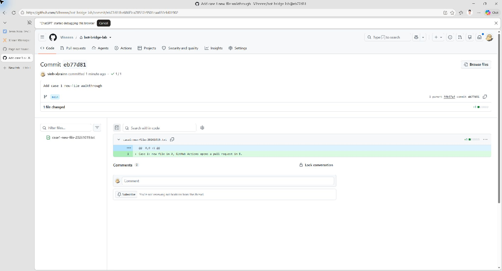
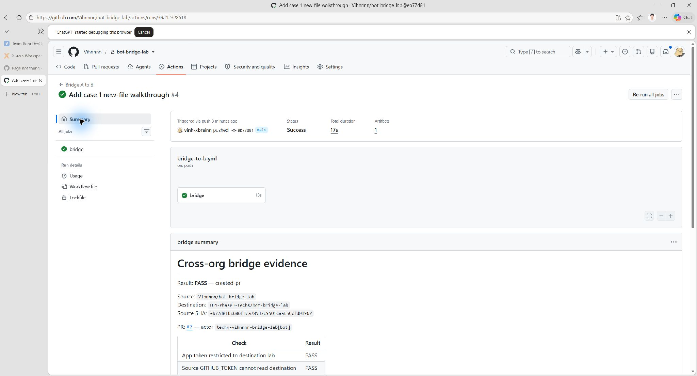
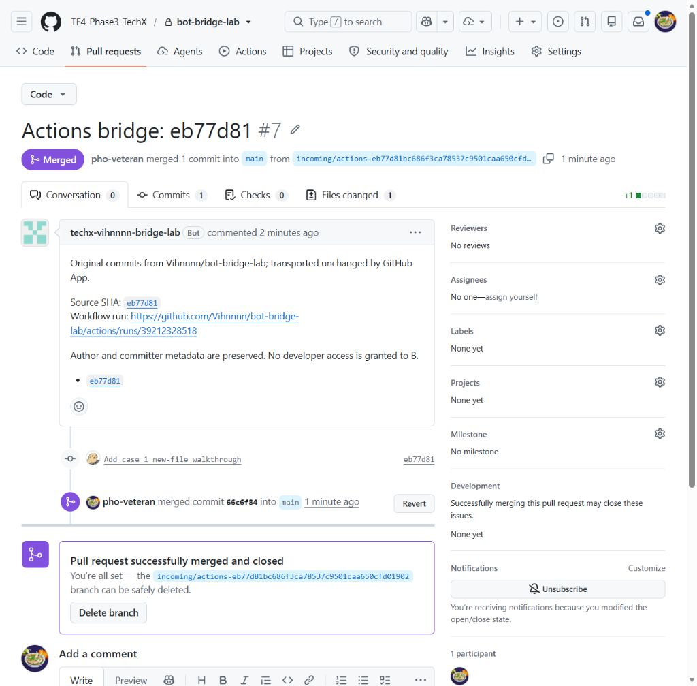
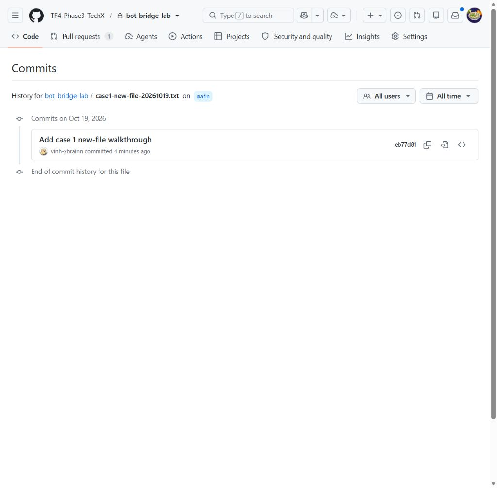

# Lab contribute vào private repo: GitHub App và SSH deploy key

## 1. Vấn đề và giải pháp tổng thể

Team ở org A cần gửi code vào repo của org B. Nếu cấp quyền trực tiếp cho từng người ở B, các tài khoản đó có thể được tính vào số seat của gói trả phí. Yêu cầu là giữ được tác giả commit mà không thêm từng developer vào B.

| Thành phần | Môi trường lab |
|---|---|
| Org A | `Vihnnnn` |
| Developer A | `vinh-xbrainn` |
| Repo A | `Vihnnnn/bot-bridge-lab` |
| Org B | `TF4-Phase3-TechX` |
| Người quản lý B | `pho-veteran` |
| Repo B | `TF4-Phase3-TechX/bot-bridge-lab` |

Các ràng buộc:

- Cả hai repo đều private; developer A không được thêm vào member hoặc collaborator của B.
- Commit tại B giữ nguyên SHA, author và committer của commit gốc; email tác giả liên kết với tài khoản GitHub của developer.
- B nhận thay đổi qua PR và merge bằng tài khoản có quyền ở B.
- Hai org trong lab dùng GitHub Free. Lab mô phỏng quyền truy cập private repo, không đo hóa đơn GitHub Team. Các link repo, PR và Actions yêu cầu quyền truy cập lab; ảnh kết quả được nhúng trực tiếp trong tài liệu này.

Cách 1 dùng **GitHub App** cài vào repo B để push code và mở PR qua Actions. Cách 2 dùng **SSH deploy key** của riêng repo B để clone/pull/push; người quản lý B mở PR trên GitHub. Cả hai cách giữ tác giả commit và không thêm tài khoản developer vào B. Credential này không cấp quyền mở giao diện private repo B bằng tài khoản cá nhân của developer.

GitHub App không tiêu thụ user seat. Chi phí chạy Actions phụ thuộc hạn mức và mức sử dụng của org A. [Tài liệu GitHub về App và seat](https://docs.github.com/en/apps/creating-github-apps/about-creating-github-apps/deciding-when-to-build-a-github-app).

**Cách 1 — Hai repo, chuyển code bằng GitHub Actions**

```text
Developer tạo file và commit vào main của A
→ Actions tại A cấp token cho App
→ App push nguyên commit sang một branch tại B và mở PR
→ Người quản lý B merge PR
→ Commit gốc xuất hiện trong lịch sử main của B
```

**Cách 2 — Clone trực tiếp repo B bằng SSH deploy key**

```text
B cài public key vào Deploy keys của repo, bật Allow write access
→ Developer clone repo B bằng SSH private key trên máy
→ Tạo branch, sửa file và commit với tên/email của developer
→ Push branch bằng SSH deploy key
→ Người quản lý B mở và merge PR trên GitHub
→ Local pull main bằng cùng SSH key
```

Cách 2 chỉ cần repo B trên GitHub; bản clone nằm trên máy developer. Deploy key không hết hạn theo giờ và không tạo user seat. Key chỉ dùng cho Git qua SSH, không gọi API để mở PR. [Tài liệu GitHub về deploy key](https://docs.github.com/en/authentication/connecting-to-github-with-ssh/managing-deploy-keys).

Author/email là metadata Git có thể tự cấu hình, nên việc hiển thị tài khoản trên commit chưa chứng minh người đó thực sự tạo commit. SSH deploy key xác thực quyền truy cập repo, không xác thực danh tính từng developer. Lab giữ metadata và dùng merge commit để giữ SHA; không cấu hình ký commit.

## 2. Setup lab GitHub App

### 2.1. Tạo App tại org B

Dùng session Edge đăng nhập `pho-veteran`, mở **TF4-Phase3-TechX → Settings → Developer settings → GitHub Apps → New GitHub App**.

| Trường | Giá trị |
|---|---|
| GitHub App name | `TechX Vihnnnn Bridge Lab` |
| Homepage URL | `https://github.com/TF4-Phase3-TechX` |
| Callback / user authorization / device flow | Không cấu hình |
| Webhook → Active | Bỏ chọn |
| Where can this GitHub App be installed? | `Only on this account` |

Trong **Repository permissions**, chọn:

| Permission | Quyền |
|---|---|
| Contents | Read and write |
| Pull requests | Read and write |
| Metadata | Read-only |
| Workflows | Read and write |

Workflows cần cho cách 1 vì lịch sử được chuyển có file trong `.github/workflows/`. Không cần cấp thêm quyền organization hoặc account. Bấm **Create GitHub App**.

### 2.2. Tạo key và cài App

1. Trong trang App, mở **Credentials → Key pairs → New key**, tải file `.pem` và lưu ngoài repo.
2. Chọn **Install App → TF4-Phase3-TechX → Only select repositories**.
3. Chọn duy nhất `bot-bridge-lab`, rồi **Install**.
4. Nếu đổi permission sau khi cài, chấp nhận quyền mới trong installation tại B.

Thông tin App đang dùng:

| Thông tin | Giá trị |
|---|---|
| App ID | `5376504` |
| Client ID | `Iv23li2GwmLXhSNHA2Yh` |
| Installation ID | `172913981` |
| Key trên máy lab | `C:\Users\T14s Gen 2\Desktop\techx-vihnnnn-bridge-lab.2026-10-18.private-key.pem` |

App đã được tạo và cài trong lab. Có thể xem tại [trang cấu hình App](https://github.com/organizations/TF4-Phase3-TechX/settings/apps/techx-vihnnnn-bridge-lab). Khi dựng môi trường khác, dùng tên App riêng và thay các ID/key tương ứng.

### 2.3. Cấu hình Actions cho cách 1

Tại repo A, mở **Settings → Secrets and variables → Actions**:

| Loại | Tên | Giá trị |
|---|---|---|
| Repository variable | `BRIDGE_APP_CLIENT_ID` | Client ID của App |
| Repository secret | `BRIDGE_APP_PRIVATE_KEY` | Toàn bộ nội dung PEM, gồm dòng BEGIN/END |

Repo A có hai file triển khai:

- [`.github/workflows/bridge-to-b.yml`](https://github.com/Vihnnnn/bot-bridge-lab/blob/main/.github/workflows/bridge-to-b.yml): chạy khi `main` được cập nhật, checkout lịch sử Git và cấp App token cho repo B.
- [`scripts/bridge-actions.mjs`](https://github.com/Vihnnnn/bot-bridge-lab/blob/main/scripts/bridge-actions.mjs): chuyển nguyên commit sang branch của B rồi mở PR.

Workflow dùng `GITHUB_TOKEN` để đọc A, App token để ghi B. Job chỉ chạy khi repository là `Vihnnnn/bot-bridge-lab` và branch là `main`, nên bản workflow được chuyển sang B không chạy bridge ngược lại.

Bridge này yêu cầu hai repo có chung commit gốc. Khi khởi tạo mới, tạo commit đầu tiên ở A rồi chuyển nguyên commit đó sang B đang trống; không tạo README độc lập ở cả hai repo. Hai repo lab đã có chung lịch sử gốc.

Private key nằm trong secret Actions của A; người có thể sửa code chạy cùng secret cần được B tin cậy. App không cần cài vào org A.

### 2.4. Chuẩn bị máy cho cách 2

Máy lab dùng **PowerShell, Git và Windows OpenSSH**. Cách 2 không dùng App token; private key SSH được lưu ngoài repo. Các lệnh ở mục 4 chạy trực tiếp trong terminal. Cấu hình SSH được lưu riêng trong bản clone để các lần pull/push tiếp theo không cần cấp token mới.

Lab chưa bật branch protection. Deploy key có quyền write có thể push cả `main`; luồng dưới đây dùng branch và PR theo quy trình thao tác, chưa được cưỡng chế bằng chính sách server.

## 3. Triển khai cách 1 — Repo A → Actions → PR ở B

### 3.1. Tạo file mới và cập nhật main của A

Dùng tài khoản `vinh-xbrainn` tạo file `case1-new-file-20261019.txt` tại repo A với nội dung:

```text
Case 1: new file in A, GitHub Actions opens a pull request in B.
```

Commit vào `main` với message `Add case 1 new-file walkthrough`. Có thể thao tác trên GitHub bằng **Add file → Create new file → Commit changes → Commit directly to the main branch**.

Trong lượt chạy ngày 19/10/2026, commit mới là `eb77d81bc686f3ca78537c9501caa650cfd01902`.



### 3.2. Workflow chạy sau khi main cập nhật

Mở **Actions → Bridge A to B**, chọn run của commit vừa tạo. Workflow checkout A, cấp App token, push commit sang branch `incoming/actions-<SHA>` tại B và mở PR vào `main` của B.

Run của lượt này là [39212328518](https://github.com/Vihnnnn/bot-bridge-lab/actions/runs/39212328518), trạng thái **Success**. Phần Summary hiển thị commit `eb77d81` và PR #7.



### 3.3. Mở PR tại B và merge

Chuyển sang session Edge đăng nhập `pho-veteran`, mở [PR #7](https://github.com/TF4-Phase3-TechX/bot-bridge-lab/pull/7).

Trong **Files changed**, kiểm tra file `case1-new-file-20261019.txt`. Trong **Commits**, kiểm tra SHA `eb77d81` và tác giả `vinh-xbrainn`. Người tạo PR là `techx-vihnnnn-bridge-lab[bot]`.

Chọn **Create a merge commit → Confirm merge** để giữ nguyên SHA commit gốc. PR #7 đã được merge bằng tài khoản `pho-veteran`, tạo merge commit `66c6f84`.



### 3.4. Kiểm tra commit history tại B

Mở file `case1-new-file-20261019.txt` trên `main` của B rồi chọn **History**. Lịch sử file hiển thị commit `eb77d81`, tác giả `vinh-xbrainn`, giống commit tại A.



## 4. Triển khai cách 2 — SSH clone B → Commit → PR → Merge → Pull

### 4.1. Tạo SSH key và cài vào repo B

Trên máy developer, mở PowerShell. Bước tạo key chỉ làm một lần; key dưới đây đã tồn tại trong máy lab, không ghi đè khi chạy lại:

```powershell
New-Item -ItemType Directory -Force -Path "$env:USERPROFILE\.ssh" | Out-Null
$keyPath = "$env:USERPROFILE\.ssh\techx-bot-bridge-lab-deploy-ed25519"
ssh-keygen -t ed25519 -f $keyPath -C 'techx-bot-bridge-lab-deploy'
```

Trong lab, nhấn Enter hai lần ở câu hỏi passphrase để dùng key không có passphrase. Private key ở `C:\Users\T14s Gen 2\.ssh\techx-bot-bridge-lab-deploy-ed25519`, không đưa vào repository. File `.pub` là public key để cài ở B:

```powershell
Get-Content -LiteralPath "$keyPath.pub"
```

Thực hiện:

1. Mở **TF4-Phase3-TechX → Settings → Security and quality → Deploy keys**, chọn **Enabled → Save**. Chính sách này đã được bật cho toàn org theo xác nhận của chủ org; nó cho phép admin các repo tạo/sử dụng deploy key.
2. Mở **bot-bridge-lab → Settings → Deploy keys → Add deploy key**.
3. Title: `Case 2 SSH deploy key lab`. Dán nội dung file `.pub`, chọn **Allow write access**, rồi thêm key.

Key của lượt lab chỉ được cài vào `TF4-Phase3-TechX/bot-bridge-lab`. Fingerprint: `SHA256:NP7QJDS8osbtQQV/KWkK9Rdc4kKL5E5e2H68K2SZBL8`.

Key dùng được lâu dài cho đến khi bị xóa/thu hồi hoặc org tắt deploy keys. Người giữ private key có quyền Git tương ứng trên repo này; key không phân biệt từng người sử dụng.

### 4.2. Clone repo B và cấu hình SSH một lần

Lấy public host keys của GitHub qua HTTPS và lưu riêng để SSH kiểm tra máy chủ:

```powershell
$githubMeta = Invoke-RestMethod -Uri 'https://api.github.com/meta'
$githubMeta.ssh_keys | ForEach-Object { 'github.com ' + $_ } |
  Set-Content -LiteralPath "$env:USERPROFILE\.ssh\techx-lab-known-hosts" -Encoding ASCII
```

Đặt SSH command dùng đúng key của lab, rồi clone. Đường dẫn `~/.ssh/...` tránh lỗi dấu cách trong tên thư mục người dùng:

```powershell
$sshLabCommand = 'C:/Windows/System32/OpenSSH/ssh.exe -F NUL -i ~/.ssh/techx-bot-bridge-lab-deploy-ed25519 -o UserKnownHostsFile=~/.ssh/techx-lab-known-hosts -o IdentitiesOnly=yes -o IdentityAgent=none -o BatchMode=yes -o StrictHostKeyChecking=yes'
$env:GIT_SSH_COMMAND = $sshLabCommand

Set-Location 'C:\Users\T14s Gen 2\Desktop\workspace\org-contribute'
git clone git@github.com:TF4-Phase3-TechX/bot-bridge-lab.git .lab-work/ssh-case2
Set-Location .lab-work/ssh-case2

git config --local core.sshCommand $sshLabCommand
Remove-Item Env:GIT_SSH_COMMAND

git config user.name 'vinh-xbrainn'
git config user.email '335428864+vinh-xbrainn@users.noreply.github.com'
```

Tên/email xác định author và committer; dùng email đã liên kết với tài khoản GitHub của developer. Cấu hình `core.sshCommand` chỉ áp dụng cho bản clone này. Sau bước này, có thể mở terminal mới trong thư mục repo và dùng `git pull`, `git push` mà không cấp token.

Bản clone `.lab-work/ssh-case2` đã tồn tại sau lượt lab. Khi dùng tiếp, chỉ chuyển vào thư mục đó; không chạy lại `git clone`.

### 4.3. Tạo branch, file, commit và push

```powershell
git switch -c contribute/ssh-case2-20261019

Set-Content -LiteralPath 'case2-ssh-deploy-key-20261019.txt' `
  -Value 'Case 2: clone, push and pull with an SSH deploy key; PR opened by the B maintainer.' `
  -Encoding ASCII

git add case2-ssh-deploy-key-20261019.txt
git commit -m 'Add SSH deploy key contribution walkthrough'
git push -u origin contribute/ssh-case2-20261019
```

Lượt chạy ngày 19/10/2026 tạo commit `d62ab6e8f3e0f021e55bf60ab7249e4cc628cb0a`, author và committer đều là `vinh-xbrainn`. GitHub liên kết commit với tài khoản này. Push đã thành công bằng deploy key. Khi tái hiện lượt mới, dùng tên branch và tên file mới.

### 4.4. Người quản lý B mở và merge PR

SSH deploy key không tự mở PR. Trong session Edge của `pho-veteran`, mở repo B, chọn **Pull requests → New pull request**:

- Base: `main`.
- Compare: `contribute/ssh-case2-20261019`.
- Title: `Case 2: contribute with an SSH deploy key`.

Chọn **Create pull request**. Trong **Files changed**, kiểm tra file `case2-ssh-deploy-key-20261019.txt`; trong **Commits**, kiểm tra commit `d62ab6e` của `vinh-xbrainn`. Chọn **Create a merge commit → Confirm merge** để giữ SHA commit gốc.

Lượt này tạo [PR #9](https://github.com/TF4-Phase3-TechX/bot-bridge-lab/pull/9). Người mở và merge PR là `pho-veteran`; tác giả commit đóng góp là `vinh-xbrainn`. PR đã merge, tạo merge commit `e97d0cb0e26c025ce18386caf6a20c5ec9323f24`.


### 4.5. Pull về local

Trong thư mục `.lab-work/ssh-case2`, chạy:

```powershell
git switch main
git pull --ff-only origin main
git log -2 --format='%h | %an | %s'
Get-Content -LiteralPath case2-ssh-deploy-key-20261019.txt
```

Pull bằng cùng SSH key đã thành công. Local `main` nhận file mới và có lịch sử:

```text
e97d0cb | Nguyen Thanh Vinh | Merge pull request #9 from TF4-Phase3-TechX/contribute/ssh-case2-20261019
d62ab6e | vinh-xbrainn | Add SSH deploy key contribution walkthrough
```

Commit gốc vẫn giữ SHA, author và committer; working tree sau pull không có thay đổi chưa commit.
