# Proposal contribute giữa hai private repo bằng GitHub Apps và Actions

## 1. Vấn đề và giải pháp tổng thể

Team ở org A cần gửi code vào private repo của org B, giữ tác giả commit mà không thêm từng developer làm member/collaborator tại B. Với gói trả phí, các tài khoản được cấp quyền trực tiếp có thể làm tăng số seat.

| Thành phần | Môi trường lab |
|---|---|
| Repo A | `Vihnnnn/bot-bridge-lab` — private |
| Developer A | `vinh-xbrainn` |
| Repo B | `TF4-Phase3-TechX/bot-bridge-lab` — private |
| Maintainer B | `pho-veteran` |
| Repo controller | `TF4-Phase3-TechX/bot-bridge-controller` — private, do B quản lý |

Các ràng buộc:

- Không thêm developer A vào B. Commit đóng góp phải giữ nguyên SHA, author và committer khi vận chuyển và khi vào main. Bot ghi trong body PR yêu cầu B chọn **Create a merge commit**, không squash/rebase PR contribution; không khóa phương thức merge bằng repo settings hoặc branch protection.
- B là source of truth và quyết định merge. A/main là bản đồng bộ từ B/main; member A chỉ làm feature branch, mở PR, rồi pull kết quả từ repo A.
- Hai org dùng GitHub Free. Lab kiểm chứng luồng trên private repo, không đo hóa đơn Team. Branch protection cho private repo chưa được enforce; cấu hình cần bổ sung được ghi tại mục 2.4.
- Link repo/PR/Actions private cần tài khoản có quyền truy cập. Các ảnh trong tài liệu public là ảnh của lượt lab đã được công bố.

**Giải pháp — Hai repo đóng góp và một controller riêng**

```text
Member A clone/pull A/main → tạo feature branch → mở PR A, không merge
→ Notifier A nhận sự kiện PR, dispatch controller; App B push branch đóng góp và mở PR B
→ Maintainer B review/test và merge vào B/main
→ Sự kiện push tại B/main chạy notifier, App dispatch gọi controller
→ App A đồng bộ A/main về đúng SHA của B/main; lưu recovery và thay main nếu A lệch
→ GitHub ghi nhận PR A đã merge vì commit đã nằm trong A/main
→ Member A pull từ repo A
```

B chưa merge thì đóng góp vẫn nằm trên branch. B từ chối thì đóng góp không vào main. Bot không gọi API merge tại B và không tạo merge commit độc lập tại A. B dùng **Create a merge commit** để giữ nguyên commit gốc trong main.

Luồng hợp nhất ban đầu đã chạy thật ngày **20/10/2026**, dùng cùng cặp PR **A #6 / B #18**: mở PR → thêm commit → Request changes → sửa và trao đổi comment hai chiều → approve → B merge → Actions reconcile A/main → PR A hoàn tất. Evidence của bản cập nhật kích hoạt theo sự kiện tại A/B nằm ở mục 2.6. Controller và key vận chuyển code nằm trong repo riêng do B quản lý; key dispatch nằm tại A và B; developer A chỉ dùng repo A.

App B cần `Contents: write` để chuyển commit sang branch của repo B độc lập. GitHub không có permission đủ cho luồng này mà chỉ cho mở PR, tuyệt đối không cho merge. Để cưỡng chế “B quyết định”, phải kết hợp quyền App với bảo vệ B/main ở mục 2.4.

GitHub App không tiêu thụ user seat. Notifier chạy tại repo A/B phát sinh sự kiện; controller chạy tại **org B**. Chi phí Actions phụ thuộc hạn mức và sử dụng của từng org. Chi phí gói hỗ trợ branch protection là khoản riêng. [GitHub App và seat](https://docs.github.com/en/apps/creating-github-apps/about-creating-github-apps/deciding-when-to-build-a-github-app).

Giải pháp giữ metadata tác giả, nhưng author/email tự cấu hình được nên chưa chứng minh danh tính người tạo commit. Nếu cần chống giả mạo, phải yêu cầu ký commit và xác minh signer; lab chưa cấu hình ký commit. App token không cấp cho tài khoản cá nhân A quyền mở giao diện private repo B.

Một cặp PR được giữ xuyên suốt các lần sửa. Code đi A → B; review của B đi về A; comment hội thoại đồng bộ A ↔ B. Chỉ lịch sử đã được B merge mới được đưa vào A/main.

## 2. Setup lab GitHub App

### 2.0. Cơ chế thực thi và phạm vi bàn giao

GitHub App cung cấp **danh tính và quyền**, script quy định **hành vi**, còn GitHub Actions **chạy script** trên runner. Cài App vào repo chưa tạo ra chức năng bridge; phải triển khai cả code controller và các workflow.

| Thành phần | Trách nhiệm |
|---|---|
| App B | Cấp token để script đọc B, đẩy branch contribution và thao tác PR B |
| App A | Cấp token để script đọc PR A, đồng bộ A/main và cập nhật PR/comment A |
| App dispatch | Cấp token chỉ có Actions write tại controller để notifier A/B gọi workflow |
| Script trong controller | Ghép cặp PR; chuyển commit; sao chép review/comment; xử lý accepted/rejected; đồng bộ A/main theo B/main |
| GitHub Actions | Khởi chạy script, cấp token trong job và ghi kết quả/log |

Mỗi lượt chạy, Actions dùng private key trong secrets để tạo installation token giới hạn repo và quyền. Script nhận token qua biến môi trường để gọi GitHub API và Git; action tạo token thu hồi token ở bước kết thúc job. Không cấp key vận chuyển code cho developer A; repo A có key dispatch với phạm vi Actions tại controller như mục 2.3. Không cần máy chủ bot chạy liên tục. [Cách dùng GitHub App trong Actions](https://docs.github.com/en/apps/creating-github-apps/authenticating-with-a-github-app/making-authenticated-api-requests-with-a-github-app-in-a-github-actions-workflow).

| Sự kiện | Cơ chế hiện tại |
|---|---|
| B/main có commit mới, gồm merge PR | Notifier tại B tự dispatch controller; thời gian thực thi phụ thuộc hàng đợi Actions |
| A mở PR, thêm commit hoặc comment; B review/comment/đóng PR không merge | Notifier tại repo phát sinh sự kiện tự dispatch controller; không chờ polling |
| Developer A chạy `git pull` | Chỉ tải trạng thái đã đồng bộ tại A; không kích hoạt controller |

Hướng dẫn triển khai trung lập nằm trong [Setup GitHub App cho A và B](github-app-setup.md). A và B là hai repo code; **controller là repo private thứ ba**, do B quản lý. Không chuyển key vận chuyển code vào A hoặc job chạy contribution để giảm số repo.

Bộ mã trung lập đã có ngay trong repo docs: [controller và tests](templates/controller), cùng [workflow notifier dùng cho A/B](templates/B/.github/workflows/notify-controller.yml). [File setup](github-app-setup.md) chỉ rõ nơi copy và thay placeholder. Controller hiện tại là `96fe79080f1eacf45de82bcb72119923df92c260`, có 26 tests; notifier được đưa vào B/main tại `1985f3afc6992aa04fc3665465e32f10a97f0e69` rồi đồng bộ về A. Không công bố private key.

### 2.1. Tạo hai App vận chuyển code và giới hạn quyền

Trong session `pho-veteran`, mở **TF4-Phase3-TechX → Settings → Developer settings → GitHub Apps → New GitHub App**. Tạo hai App do B quản lý:

| Thiết lập | App B — chuyển đóng góp | App A — đồng bộ kết quả |
|---|---|---|
| Tên | `TechX Vihnnnn Bridge Lab` | `TechX A Sync Lab` |
| Homepage | `https://github.com/TF4-Phase3-TechX` | `https://github.com/TF4-Phase3-TechX` |
| Nơi được phép cài | Only on this account | Any account, để cài vào org A |
| Contents | Read and write | Read and write |
| Pull requests | Read and write | Read and write |
| Metadata | Read-only | Read-only |
| Workflows | No access | Read and write |
| Webhook Active | Bỏ chọn | Bỏ chọn |
| Callback / user authorization / device flow | Không cấu hình | Không cấu hình |

App B đọc B/main, push branch đóng góp, mở/cập nhật PR. `Contents: read` không đủ để đưa commit vào repo B. Không cấp Administration, Actions write, Checks write, Commit statuses write hoặc quyền organization. [API tạo Git ref](https://docs.github.com/en/rest/git/refs#create-a-reference), [API merge PR](https://docs.github.com/en/rest/pulls/pulls#merge-a-pull-request).

App A đọc PR A, cập nhật comment/trạng thái và đồng bộ A/main. Quyền Workflows write của App A cho phép đồng bộ cả thay đổi workflow đã được B chấp nhận. App B đã bỏ quyền này; contribution từ A thay đổi `.github/workflows/` bị controller chặn và cần maintainer B xử lý riêng.

### 2.2. Tạo key và cài đúng repo

1. Với mỗi App, mở **Credentials → Key pairs → New key**. Lưu file `.pem` ngoài repo; không commit key.
2. App B: **Install App → TF4-Phase3-TechX → Only select repositories → bot-bridge-lab → Install**.
3. App A: trong session `vinh-xbrainn`, mở [trang cài App A](https://github.com/apps/techx-a-sync-lab/installations/new), chọn **Vihnnnn → Only select repositories → bot-bridge-lab → Install**. Hoàn tất Confirm access nếu GitHub yêu cầu.
4. Khi đổi permission, kiểm tra installation đã nhận đúng quyền trước khi chạy controller.

| Thông tin đã kiểm tra | App B | App A |
|---|---|---|
| App ID | `5376504` | `5389681` |
| Client ID | `Iv23li2GwmLXhSNHA2Yh` | `Iv23liiZuDkx4OtpwZcz` |
| Installation ID | `172913981` | `173234412` |
| Repo được cài | `TF4-Phase3-TechX/bot-bridge-lab` | `Vihnnnn/bot-bridge-lab` |

“Any account” chỉ cho phép chủ org khác cài App A; không tự cấp quyền cho App vào mọi org. Controller vẫn kiểm tra đúng installation, org và repo đã định trước.

### 2.3. Chạy Actions trong controller riêng

Tạo private repo **`TF4-Phase3-TechX/bot-bridge-controller`**, chỉ maintainer B được quản lý. Tại repo này, mở **Settings → Secrets and variables → Actions**:

| Loại | Tên | Giá trị |
|---|---|---|
| Variable | `BRIDGE_APP_CLIENT_ID` | `Iv23li2GwmLXhSNHA2Yh` |
| Secret | `BRIDGE_APP_PRIVATE_KEY` | PEM của App B, gồm dòng BEGIN/END |
| Variable | `SOURCE_APP_CLIENT_ID` | `Iv23liiZuDkx4OtpwZcz` |
| Secret | `SOURCE_APP_PRIVATE_KEY` | PEM của App A, gồm dòng BEGIN/END |
| Variable | `BRIDGE_ENABLED` | `true` sau khi cài App và kiểm tra cấu hình |

Các file đã triển khai trong controller:

- [`.github/workflows/controller.yml`](https://github.com/TF4-Phase3-TechX/bot-bridge-controller/blob/main/.github/workflows/controller.yml): workflow **Isolated bridge - B decides**.
- [`scripts/pr-bridge.mjs`](https://github.com/TF4-Phase3-TechX/bot-bridge-controller/blob/main/scripts/pr-bridge.mjs): đọc PR, vận chuyển commit và đồng bộ main.
- [`scripts/pr-bridge-policy.mjs`](https://github.com/TF4-Phase3-TechX/bot-bridge-controller/blob/main/scripts/pr-bridge-policy.mjs): giới hạn API mutation, ref push và xử lý trạng thái.
- [`scripts/pr-bridge-reviews.mjs`](https://github.com/TF4-Phase3-TechX/bot-bridge-controller/blob/main/scripts/pr-bridge-reviews.mjs): sao chép review đã submit và comment theo dòng của B về A.
- [`scripts/pr-bridge-comments.mjs`](https://github.com/TF4-Phase3-TechX/bot-bridge-controller/blob/main/scripts/pr-bridge-comments.mjs): sao chép comment hội thoại hai chiều, giữ nguồn và chống vòng lặp.
- [`tests`](https://github.com/TF4-Phase3-TechX/bot-bridge-controller/tree/main/tests): 26 test gồm policy/boundary, review, hội thoại, metadata sự kiện, Git recovery/lease và guard không chấp nhận commit gốc bị viết lại.

Khi **B/main có push mới**, gồm merge PR và commit trực tiếp, workflow tại B tự dispatch controller. Không cần maintainer bấm Run workflow hoặc đợi lịch để đồng bộ B/main về A/main. GitHub nhận sự kiện ngay; thời điểm job bắt đầu và hoàn tất vẫn phụ thuộc hàng đợi Actions.

Mở PR, thêm commit, sửa trạng thái PR, review hoặc comment tại A/B đều có notifier theo sự kiện. Lịch **7, 22, 37, 52 mỗi giờ** chỉ là dự phòng, không phải đường chạy chính. Khi cần phục hồi, maintainer B vẫn có thể Run workflow tại controller. Trước bản cập nhật này API chưa ghi nhận run schedule, nên các lượt test mới kiểm chứng bằng chuỗi notifier → App dispatch → controller, không dùng lịch hoặc thao tác dispatch tay làm bằng chứng tự động.

Job `policy` kiểm tra code trước; job `reconcile` chỉ chạy trên main của đúng repo controller, khi bật `BRIDGE_ENABLED` và sự kiện là schedule/dispatch. Các lượt reconcile chạy tuần tự. `GITHUB_TOKEN` chỉ có Contents read để checkout controller; hai App tạo installation token giới hạn đúng một repo trong mỗi lượt chạy. Không lưu PAT cá nhân vào Actions.

Job có key chỉ checkout main của controller do B quản lý. PR A được đọc như dữ liệu và Git objects, không checkout/chạy code, hook hoặc dependency từ contribution. CI chạy riêng không nhận key bridge; các action được pin bằng commit SHA.

Lab đã tắt workflow cũ `bridge-to-b.yml` tại A và B. Repo A hiện có **một Actions secret**, `CONTROLLER_DISPATCH_APP_PRIVATE_KEY`, cùng variable Client ID; đó là key dispatch, không phải key App A/B vận chuyển code. Hai key vận chuyển code vẫn chỉ ở controller. Tài khoản developer A không có quyền trực tiếp vào B/controller; người kiểm soát workflow dùng secret dispatch có quyền Actions trên controller.

**App thứ ba chỉ dùng để kích hoạt controller**

1. B tạo `TechX Controller Dispatch Lab`: chỉ `Actions: read and write`, `Metadata: read`; các quyền khác No access, webhook tắt, chỉ cho cài tại org B.
2. Cài App với **Only select repositories → bot-bridge-controller**. Không cài App dispatch tại repo code A hoặc B.
3. Tại **cả repo A và B → Settings → Secrets and variables → Actions**, lưu variable `CONTROLLER_DISPATCH_APP_CLIENT_ID` = `Iv23li4rfDPJcho8vRzt`, secret `CONTROLLER_DISPATCH_APP_PRIVATE_KEY` = PEM của App dispatch. Key hai App vận chuyển code vẫn chỉ ở controller.
4. Deploy controller có inputs `source_repo`, `source_sha`, `source_run_id`, `source_event`, `source_pr` trước; sau đó B thêm [`.github/workflows/notify-controller.yml`](https://github.com/TF4-Phase3-TechX/bot-bridge-lab/blob/main/.github/workflows/notify-controller.yml) vào main.

App dispatch đã cài: App ID `5390691`, installation `173256492`; API xác nhận chỉ thấy `TF4-Phase3-TechX/bot-bridge-controller`.

```text
PR/review/comment tại A/B, hoặc B/main push
→ Repo nguồn: Notify controller on contribution events
→ Token App dispatch, chỉ repo controller / Actions write
→ POST controller.yml/dispatches, ref=main
→ Controller: policy → reconcile
→ Đọc B/main thực tế → đồng bộ A/main (recovery và thay main nếu lệch) → cập nhật PR A
```

Notifier không checkout/chạy contribution, dependency hoặc Git hook. `GITHUB_TOKEN` có `permissions: {}`; endpoint controller, workflow và ref cố định. Metadata chỉ để truy vết; controller đọc lại PR và B/main thực tế. `pull_request_target` xử lý opened/synchronize/reopened/closed/ready_for_review/edited từ base main; `issue_comment`, `pull_request_review` và `pull_request_review_comment` xử lý trao đổi. Sự kiện PR/comment/review từ Bot bị skip; push main chỉ dispatch tại B, không dispatch tại A.

`Actions: write` áp dụng toàn repo controller, **không phải quyền chỉ chạy một workflow**. Key dispatch đã được cho phép đặt tại A. Người sửa/chạy workflow dùng secret này có thể thao tác Actions và đọc log/artifact controller theo quyền App. Bảo vệ workflow A/B và controller, không thêm workflow controller thực thi code/lệnh tùy ý từ input. Notifier dùng `pull_request_target` nhưng tuyệt đối không checkout head hoặc chạy code contribution; key vận chuyển code không có tại A/B.

Push do `GITHUB_TOKEN` tạo thường không kích hoạt workflow tiếp theo. Automation ghi B/main phải dùng GitHub App token phù hợp hoặc gọi dispatch rõ ràng; lab kiểm tra push và merge bằng tài khoản maintainer. Nếu push có chỉ thị skip CI hoặc Actions bị tắt thì notifier cũng không đảm bảo chạy; lịch controller là phương án phục hồi. [Quy tắc kích hoạt bằng token](https://docs.github.com/en/actions/concepts/security/github_token).

**Kiểm tra khi cài notifier:** commit trực tiếp `5c1db8e` tại B/main tự tạo [notifier run 39366960115](https://github.com/TF4-Phase3-TechX/bot-bridge-lab/actions/runs/39366960115), rồi [controller run 39366971430](https://github.com/TF4-Phase3-TechX/bot-bridge-controller/actions/runs/39366971430) sau 8 giây. Cả hai Success; A/main được fast-forward về đúng SHA của B. Phần 3 kiểm tra tiếp trường hợp merge PR.

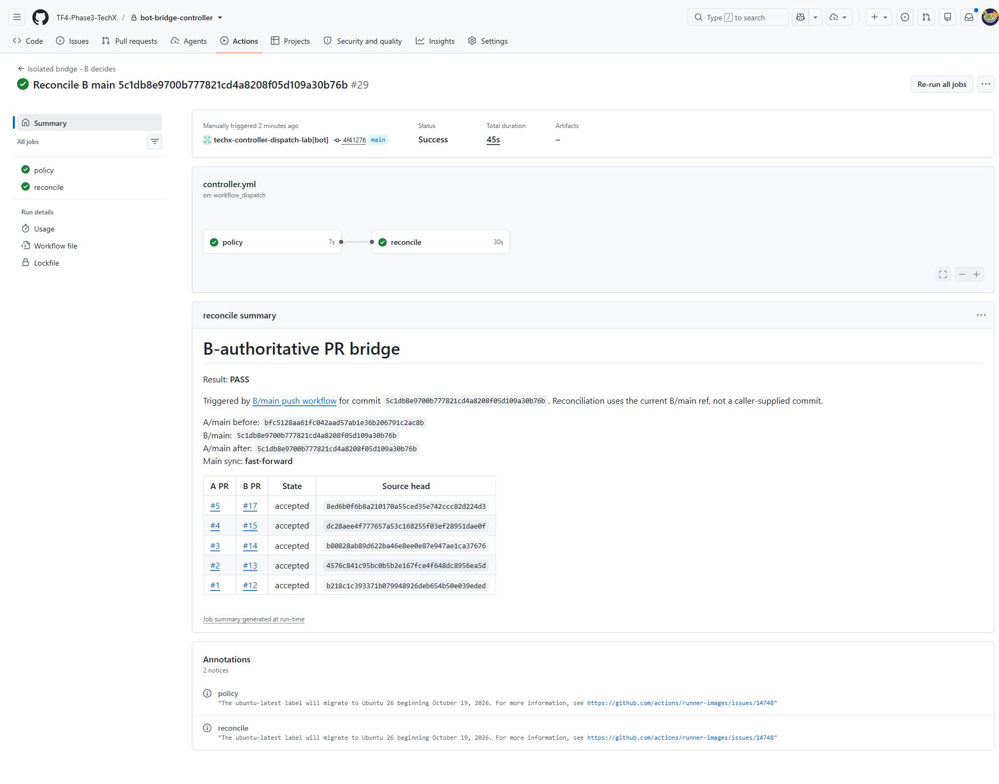

### 2.4. Guard đã triển khai và bảo vệ nhánh cần bổ sung

**Đã triển khai và kiểm tra**

| Kiểm tra | Kết quả |
|---|---|
| Token từng App chỉ thấy một repo private đã chọn | Pass |
| App A đọc repo B; App B đọc repo A | Cả hai nhận HTTP 404 |
| Tài khoản `vinh-xbrainn` đọc B và controller | Cả hai nhận HTTP 404 |
| Xin token App B với Workflows write | GitHub từ chối HTTP 422 |
| Repo A chỉ có credential dispatch | 1 secret dispatch; không có key vận chuyển code |
| Controller không cho gọi merge endpoint, ghi ref ngoài phạm vi hoặc push B/main | 7 test policy/boundary pass; đây là guard trong code |

Controller chỉ push `incoming/a-pr-<số PR A>` tại B; tại A chỉ cập nhật `main` và `recovery/a-main-<SHA>`. Nó kiểm tra source SHA, base main, repo và tác giả App của PR ghép cặp trước khi cập nhật. Khi A lệch, bot lưu SHA cũ và thay main bằng B/main trong cùng atomic push, dùng force-with-lease. Nếu A đổi đồng thời, cả thao tác bị từ chối. Không force-push B/main hoặc feature branch.

**B/main: chỉ maintainer B được đưa code vào**

Hai org Free chưa enforce branch protection cho private repo. Vì App B có Contents write, credential này vẫn có thể ghi main/merge nếu được dùng ngoài controller. Muốn cưỡng chế bằng GitHub, cần gói hỗ trợ như Team/Enterprise; muốn cưỡng chế cả A và B thì cần hỗ trợ ở cả hai org. [Phạm vi branch protection](https://docs.github.com/en/repositories/configuring-branches-and-merges-in-your-repository/managing-protected-branches/about-protected-branches).

Tại B → **Settings → Branches → Add classic branch protection rule**, pattern `main`:

| Thiết lập đề xuất | Giá trị |
|---|---|
| Restrict who can push to matching branches | Chỉ maintainer/team B; không thêm App bridge |
| Require a pull request before merging | Bật |
| Require approvals | Ít nhất 1 review của B |
| Dismiss stale approvals when new commits are pushed | Bật |
| Restrict who can dismiss reviews | Chỉ maintainer B |
| Require status checks | CI bắt buộc của dự án, nguồn check tin cậy |
| Do not allow bypassing the above settings | Bật; không cấp bypass cho App bridge |
| Allow force pushes / Allow deletions | Tắt |

Chỉ yêu cầu review/CI chưa chặn bot merge sau khi checks pass. Danh sách được cập nhật main phải loại App B; hạn chế push cũng áp dụng khi merge PR. [Cấu hình protection](https://docs.github.com/en/repositories/configuring-branches-and-merges-in-your-repository/managing-protected-branches/managing-a-branch-protection-rule), [giới hạn người push](https://docs.github.com/en/repositories/configuring-branches-and-merges-in-your-repository/managing-protected-branches/about-protected-branches#restrict-who-can-push-to-matching-branches).

Body PR bot tạo có phần **Merge instruction: preserve contributor identity**, yêu cầu maintainer chọn **Create a merge commit** để giữ commit gốc. Không yêu cầu tắt squash/rebase trong repo settings hoặc thêm branch protection để ép phương thức merge tại B. Đây là hướng dẫn cho người merge, không phải cơ chế ngăn chặn; nếu maintainer chọn phương thức khác, controller chỉ phát hiện thiếu commit gốc sau merge. Các guard quyền bot và bảo vệ B/main ở trên vẫn là phần riêng. Nếu có release branch hoặc tag cần bảo vệ, bổ sung rule cho các ref đó; rule main không bảo vệ mọi ref.

**A/main: chỉ App A đồng bộ từ B**

App A đã được cài riêng. Đề xuất ruleset `Restrict updates` cho main, chỉ App A được bypass rule này. Cho phép riêng App A force-push A/main để phục hồi; nếu dùng ruleset chặn force-push thì bypass rule đó chỉ cho App A. Giữ rule chặn xóa riêng không bypass. Không cần mở thêm PR đồng bộ tại A vì B đã quyết định. Member A không được push/merge main; không cho toàn bộ `github-actions[bot]` quyền bypass. [Quy tắc ruleset](https://docs.github.com/en/repositories/configuring-branches-and-merges-in-your-repository/managing-rulesets/available-rules-for-rulesets).

**Controller và phạm vi tin cậy**

- Giữ hai key trong controller do B quản lý; bảo vệ main của controller và review thay đổi workflow/script. Người có quyền sửa controller/secret hoặc chính sách org thuộc phạm vi quản trị tin cậy. Không đặt lại key B ở repo A. [Bảo vệ GitHub Actions](https://docs.github.com/en/actions/reference/security/secure-use).
- Token App không giới hạn theo branch; guard trong script không thay thế branch protection. Nếu key từng bị lộ, phải thu hồi/đổi key; việc xóa secret tại A không thu hồi các bản key đã sao chép.
- B phải chấp nhận chia sẻ code và lịch sử reachable từ B/main với thành viên repo A. B private chặn truy cập trực tiếp, nhưng A vẫn đọc được bản sao đã đồng bộ. Controller sao chép review đã submit và comment theo dòng của B về A, cùng comment hội thoại hai chiều của người có quyền write trở lên tại repo nguồn. B phải chấp nhận chia sẻ những nội dung này trên PR contribution; không dùng các PR đó để trao đổi nội dung chỉ dành nội bộ B. Log CI không được sao chép.
- Nếu cần xác thực tác giả, bổ sung ký commit và kiểm tra signer; giữ tên/email không chống giả mạo.

**Guard cho review và comment**

- Chỉ sao chép hội thoại của tài khoản người dùng được API xác nhận có quyền write/admin tại repo nguồn. Không dựa riêng vào `author_association`, vì App có thể thấy thành viên org là `CONTRIBUTOR`. API kiểm tra quyền dùng Metadata read hiện có. [API repository permission](https://docs.github.com/en/rest/collaborators/collaborators#get-repository-permissions-for-a-user). Bỏ qua comment do bot tạo để tránh vòng lặp A → B → A. Dùng ID comment nguồn để cập nhật bản sao; chỉ sửa comment do đúng App của đích đăng.
- Bản sao ghi người viết gốc, link nguồn và thời gian; nội dung được đặt trong khối văn bản để không kích hoạt ảnh, mention hoặc lệnh Markdown. Comment không có quyền approve hay merge. Quyết định review lấy từ API review của B, quyết định nhận code lấy từ B/main.
- Chỉnh sửa comment nguồn được cập nhật ở lượt sau; xóa comment nguồn chưa xóa bản sao. Không đồng bộ emoji reaction, trạng thái Resolve conversation, file đính kèm hoặc log CI. Reply trong review được chuyển theo review tương ứng; hội thoại từ A nên viết tại tab Conversation.
- Nội dung vượt giới hạn một comment làm run báo lỗi để maintainer tách nội dung, không âm thầm cắt bớt findings. Review giữ SHA và diff gốc; vị trí cũ được đánh dấu `outdated`. Approval của bản cũ không được diễn giải là approval của head mới.
- Nếu B từ chối và đóng PR không merge, bot đóng PR A với trạng thái rejected; không tự mở lại cặp đó. Nếu A có commit mới sau lúc B merge, controller không đánh dấu những commit chưa được B nhận là hoàn tất; cần PR mới cho phần còn lại.
- Nếu B nhận hotfix trong khi A còn làm feature, bot vẫn đồng bộ B/main về A/main. Developer pull A/main rồi merge main vào feature, tự xử lý conflict và push lại qua cùng PR. Bot không tự giải quyết conflict hoặc force-push feature branch; A/main vẫn phản chiếu B/main theo chính sách mới.

Sau khi bật policy trên gói hỗ trợ, cần test thực tế: App B mở PR được nhưng không push/merge/force-push/xóa main; member A không push/merge main; maintainer B vẫn merge được và App A đồng bộ được. Test thêm stale approval, conflict, main lệch, token bị thu hồi và retry. **Các kiểm tra từ chối do branch protection này chưa chạy trong lab Free.**

### 2.5. Developer yêu cầu đối chiếu lại

Developer có thể viết comment trên PR A; sự kiện comment tự gọi controller. Không cần truy cập B/controller hoặc chờ lịch. Comment `/bridge sync` nếu dùng cũng chỉ là một comment kích hoạt cùng cơ chế, không được parse thành lệnh và không cấp quyền merge/force-sync.

`git pull` chỉ tải A/main về local. Maintainer B vẫn có thể chạy **Actions → Isolated bridge - B decides → Run workflow → main** để phục hồi nếu notifier lỗi. Kiểm tra cả notifier tại repo nguồn và run controller; HTTP dispatch thành công chưa chứng minh reconcile đã xong.

### 2.6. Kiểm tra bản kích hoạt theo sự kiện tại A/B

Ngày **20/10/2026**, đã đặt key dispatch tại A và triển khai notifier cho cả A/B. Các lượt dưới đây xuất phát từ thao tác PR/review/comment, không gọi controller bằng tay:

| Thao tác thật | Evidence |
|---|---|
| Mở A #9 → bot mở B #21 | [Notifier A 39371103621](https://github.com/Vihnnnn/bot-bridge-lab/actions/runs/39371103621) → [controller 39371114149 Success](https://github.com/TF4-Phase3-TechX/bot-bridge-controller/actions/runs/39371114149) |
| Push commit mới vào branch A #9 → cập nhật cùng PR B | [Notifier A 39371201020](https://github.com/Vihnnnn/bot-bridge-lab/actions/runs/39371201020) → [controller 39371209422 Success](https://github.com/TF4-Phase3-TechX/bot-bridge-controller/actions/runs/39371209422) |
| Mở A #10 → bot mở B #23 | [Controller 39371582081 Success](https://github.com/TF4-Phase3-TechX/bot-bridge-controller/actions/runs/39371582081), nguồn `pull_request_target` / A #10 |
| B #23 Request changes với nội dung và comment theo dòng → A nhận findings | [Review B](https://github.com/TF4-Phase3-TechX/bot-bridge-lab/pull/23#pullrequestreview-5580880225) → [controller 39371649798 Success](https://github.com/TF4-Phase3-TechX/bot-bridge-controller/actions/runs/39371649798) → [bản sao tại A](https://github.com/Vihnnnn/bot-bridge-lab/pull/10#issuecomment-6283651028) |

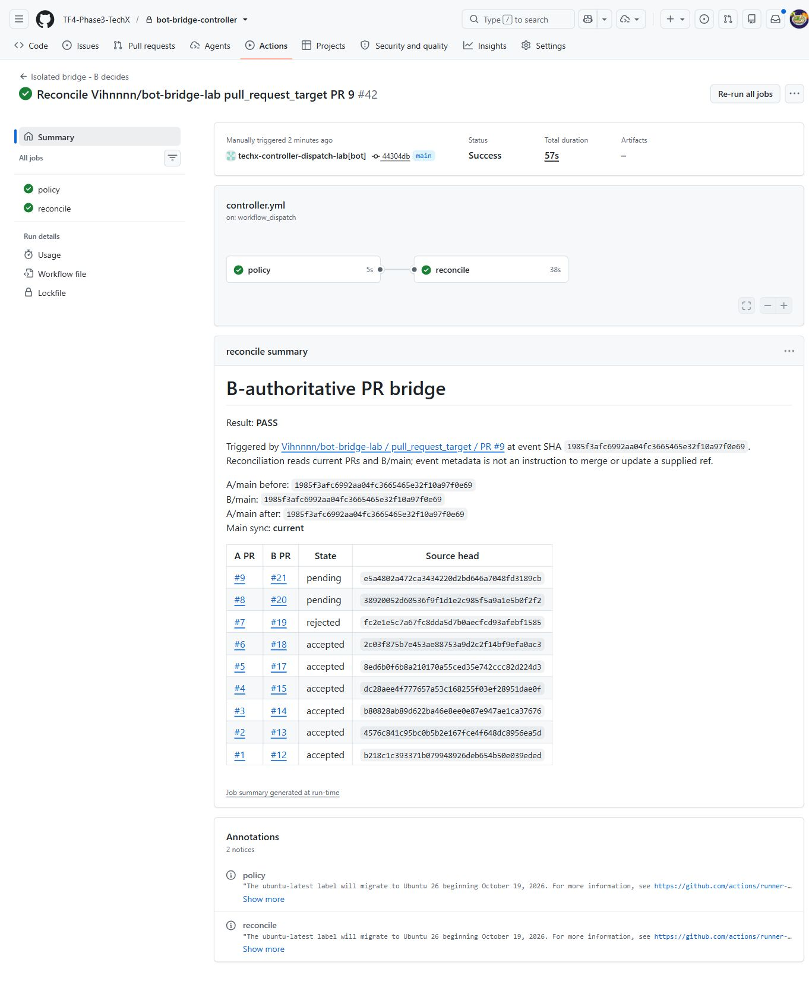

A nhận cả nội dung yêu cầu, tên file, dòng, SHA đã review và diff context. Developer đã push commit sửa `177394a` rồi comment addressed findings; ảnh dưới chụp trước khi B chấp nhận revision mới.

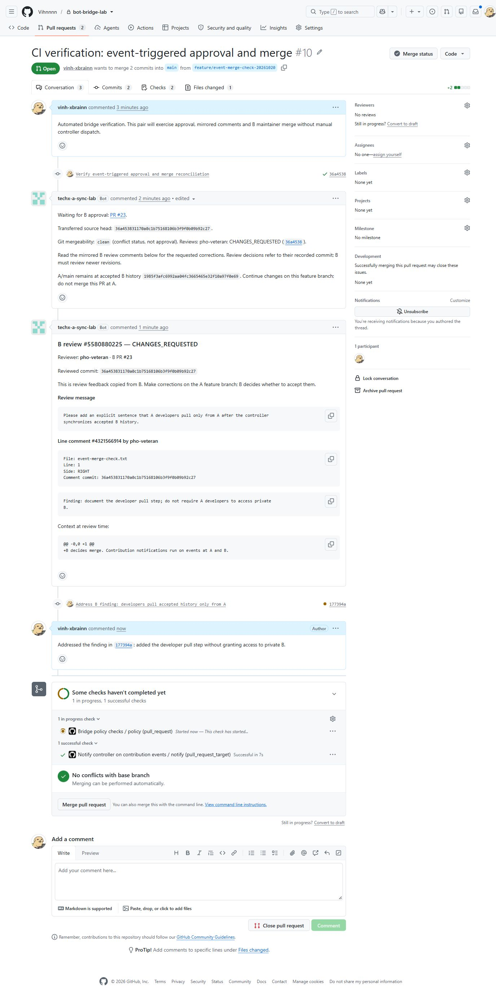

**Đóng PR không merge:** maintainer đóng [B #21](https://github.com/TF4-Phase3-TechX/bot-bridge-lab/pull/21) lúc 04:45:45 UTC; [A #9](https://github.com/Vihnnnn/bot-bridge-lab/pull/9) tự đóng lúc 04:46:11 UTC. Cả hai có `merged=false`. Không có thao tác dispatch tay; khoảng thời gian quan sát là 26 giây, không phải cam kết độ trễ.

**Guard ở bản trước khi A/main bị ghi trực tiếp:** trong lúc test A #10 / B #23, A/main nhận commit `0ec5302` chưa qua B. [Notifier A 39371847911](https://github.com/Vihnnnn/bot-bridge-lab/actions/runs/39371847911) vẫn tự kích hoạt [controller 39371857516](https://github.com/TF4-Phase3-TechX/bot-bridge-controller/actions/runs/39371857516); controller dừng với `A/main contains history not accepted by B`. Đây là lỗi baseline của lượt test cũ, không phải notifier chưa chạy; bản mới xử lý theo mục 2.7.

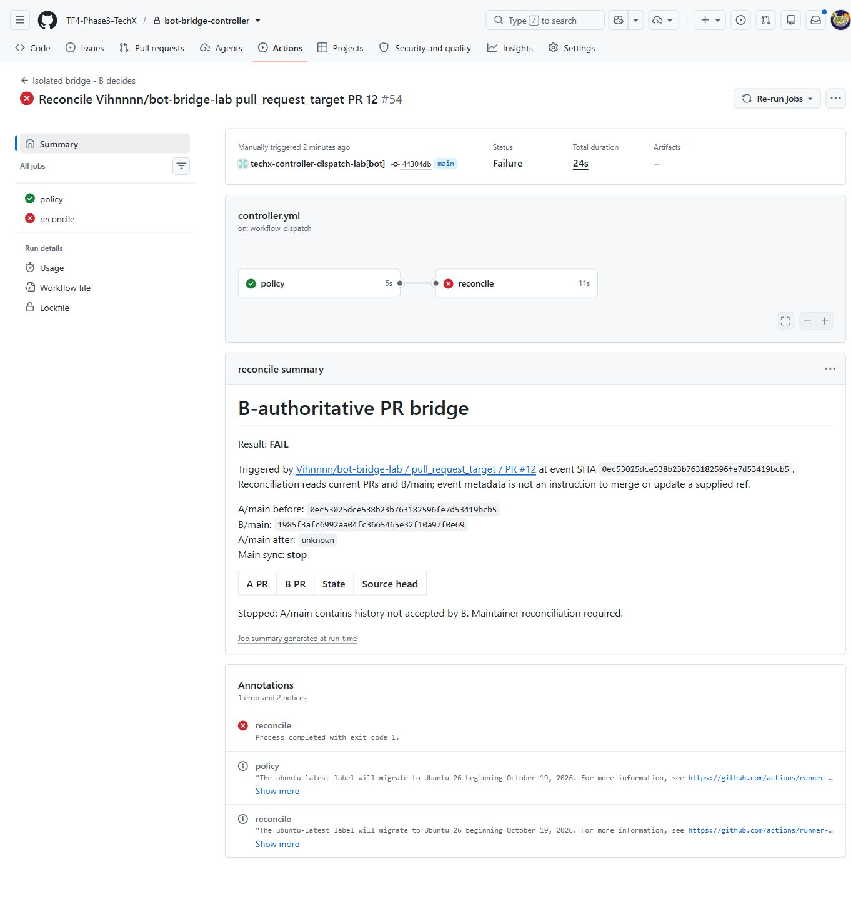

**Phục hồi baseline ở bản trước:** maintainer lưu commit lệch ở branch `recovery/a-main-before-b-sync-0ec53025dce5`, rồi đưa riêng A/main về B/main `1985f3a` bằng force-with-lease, kiểm tra SHA cũ trước khi ghi. Thao tác hoàn tất lúc **11:58:16 ngày 20/10/2026 (UTC+7)**. Bản tiếp theo tại mục 2.7 đã tự động hóa recovery và thay A/main. [Comment tại A #10](https://github.com/Vihnnnn/bot-bridge-lab/pull/10#issuecomment-6283740451) kích hoạt lại luồng sự kiện; protection A/main cần ngăn developer ghi/merge trực tiếp trong môi trường vận hành.

**Tiếp tục cùng cặp A #10 / B #23 sau phục hồi:**

| Bước | Kết quả đã kiểm tra |
|---|---|
| Comment A gọi lại controller | [Run 39372387829 Success](https://github.com/TF4-Phase3-TechX/bot-bridge-controller/actions/runs/39372387829) chuyển commit sửa `177394a` và comment addressed sang B #23 |
| B approve revision mới | [Approval của pho-veteran](https://github.com/TF4-Phase3-TechX/bot-bridge-lab/pull/23#pullrequestreview-5580932872), sau khi CI của revision mới pass |
| Đồng bộ trao đổi hai chiều | [Approval tại A](https://github.com/Vihnnnn/bot-bridge-lab/pull/10#issuecomment-6283762111), [comment B → A](https://github.com/Vihnnnn/bot-bridge-lab/pull/10#issuecomment-6283762641), [comment A → B](https://github.com/TF4-Phase3-TechX/bot-bridge-lab/pull/23#issuecomment-6283762422); đã kiểm tra đủ trước khi merge |
| Maintainer B merge | B #23 merged bởi `pho-veteran`, merge commit `7f0d494f0ed32b5a36ad8b7c5b93916fc166ded7` |
| Bot đồng bộ A | [Controller 39372486310 Success](https://github.com/TF4-Phase3-TechX/bot-bridge-controller/actions/runs/39372486310): A/main fast-forward từ `1985f3a` tới `7f0d494`; A #10 / B #23 là `accepted` |
| A hoàn tất và developer pull | A #10 có `merged=true`, hoàn tất lúc **12:01:09 (UTC+7)**. Local chạy `git switch main` rồi `git pull --ff-only origin main` từ A; SHA local = A/main = B/main = `7f0d494` |

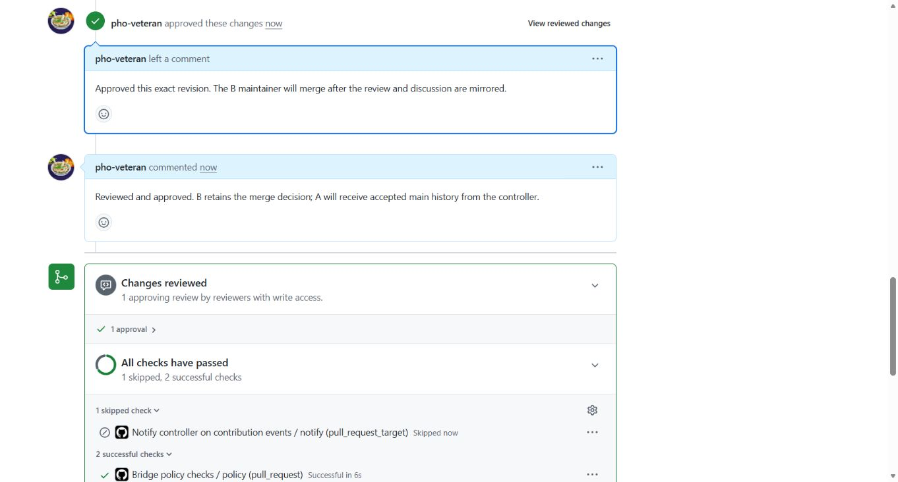

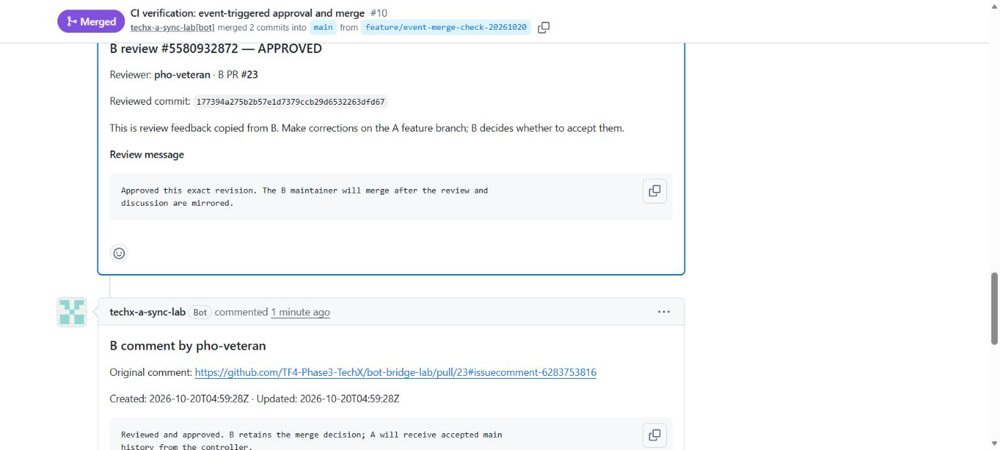

Merge B tạo [notifier push 39372614624](https://github.com/TF4-Phase3-TechX/bot-bridge-lab/actions/runs/39372614624) và [notifier PR closed 39372614679](https://github.com/TF4-Phase3-TechX/bot-bridge-lab/actions/runs/39372614679), đều Success. Trong lượt này, controller từ comment B đang chạy đã đọc thấy B/main mới và đồng bộ A trước. Run dispatch do push `39372626920` bị thay thế khi còn chờ bởi [run từ PR closed 39372632079 — Success](https://github.com/TF4-Phase3-TechX/bot-bridge-controller/actions/runs/39372632079); không dùng run bị cancelled làm bằng chứng reconcile thành công. Toàn bộ bước sau phục hồi được kích hoạt bằng sự kiện, không bấm Run workflow.

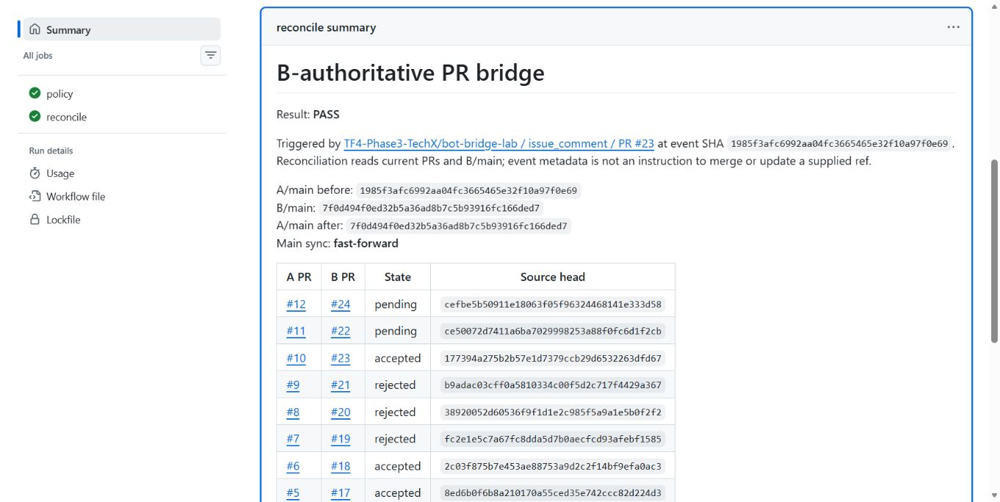

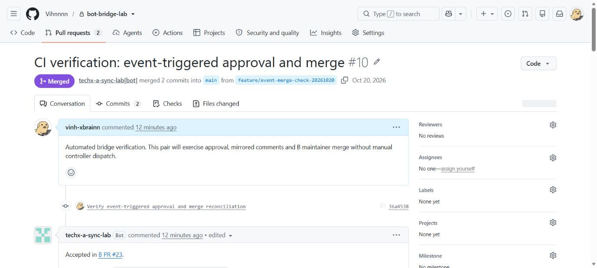

Hai commit `36a4538` và `177394a` vẫn nằm nguyên SHA trong lịch sử main. Không merge PR tại A, không tạo merge commit độc lập ở A. Branch recovery giữ commit ngoài luồng; commit đó không được tự nhập vào B/main.

GitHub hiển thị controller là `workflow_dispatch` vì App gọi API này; kiểm tra actor App dispatch và phần **trigger** trong summary để truy về notifier nguồn. Một đợt sự kiện gần nhau có thể thay thế run đang chờ theo concurrency; lượt controller tiếp theo đọc lại toàn bộ trạng thái hiện tại. Không coi một run bị cancelled là evidence thành công.

### 2.7. A/main luôn theo B/main và phạm vi đồng bộ

Bản hiện tại đọc B/main thực tế ở mỗi lượt reconcile. Nếu A/main lệch, App A lưu SHA cũ vào `recovery/a-main-<SHA>` và thay A/main bằng B/main trong cùng atomic push, với lease kiểm tra SHA cũ. Không tự merge hai main. Branch contribution không bị reset. App A cần được phép force-push riêng A/main và tạo branch recovery; App B vẫn không được ghi main.

**Test thật ngày 20/10/2026:** baseline `7fcea9e`; tạo commit rỗng riêng tại A (`2212dd6`) rồi commit rỗng tại B (`29cf9f7`). Sự kiện B/main tự gọi [controller run 39379674461 — Success](https://github.com/TF4-Phase3-TechX/bot-bridge-controller/actions/runs/39379674461). Kết quả A/main = B/main = `29cf9f7176a9918d94ad6864b140f65f1681f9f1`; branch `recovery/a-main-2212dd6fc0da282a02a5942459ec0437f7790b0c` giữ đúng commit lệch. Tree trước và sau giống nhau, không sửa nội dung code. 22 test pass, gồm kiểm tra atomic recovery, lease khi A thay đổi đồng thời và backup ref bị chiếm.

- PR tạo trực tiếp ở B không tạo PR tại A. Ví dụ B #25 đã merge và code có trong cả hai main; đây là đồng bộ main, không phải đồng bộ PR B → A.
- Contribution PR đi A → B. Chỉ review/comment của cặp PR đó mới được sao chép hai chiều.
- Chỉ hỗ trợ **Create a merge commit**. Kết quả merge và source head gốc phải thuộc B/main trước khi controller đánh dấu accepted. Nếu head khớp PR đã merge nhưng commit gốc thiếu, báo `identity-not-preserved`; không tự đóng PR A còn mở. Nếu A có revision mới chưa được nhận, giữ PR mở với `new-commits-pending`.

### 2.8. Kiểm tra constraint identity với squash

Lượt thử ngày 20/10/2026: [A #13](https://github.com/Vihnnnn/bot-bridge-lab/pull/13) → [B #26](https://github.com/TF4-Phase3-TechX/bot-bridge-lab/pull/26) được squash thành commit `ac93dd547195067cc988534e82f3c04ef1408d27`. A/main đã đồng bộ đúng SHA này và PR A đóng, nhưng author chính của commit kết quả là `techx-vihnnnn-bridge-lab[bot]`; `vinh-xbrainn` chỉ được ghi trong `Co-authored-by`. **Lượt thử không đạt constraint identity**, không phải evidence nghiệm thu luồng được hỗ trợ.

Lượt rebase [A #14](https://github.com/Vihnnnn/bot-bridge-lab/pull/14) / [B #27](https://github.com/TF4-Phase3-TechX/bot-bridge-lab/pull/27) đã dừng trước khi merge. Không công bố kết quả rebase thành công. Rebase có thể giữ author nhưng thay SHA và committer; hướng dẫn bàn giao yêu cầu người merge dùng merge commit để giữ nguyên commit gốc.

B đã bật lại squash/rebase; không khóa phương thức merge. Yêu cầu giữ identity được ghi trong body PR để maintainer thực hiện. Controller đã bỏ acceptance dựa riêng vào head khớp PR B; 26 test kiểm tra cả trường hợp commit gốc bị viết lại. Lịch sử lượt squash đã chạy được giữ lại để truy vết, không viết lại B/main để che kết quả thử.

[CI controller 39381361482](https://github.com/TF4-Phase3-TechX/bot-bridge-controller/actions/runs/39381361482) đã pass bản guard identity mới.
- CI contribution Success chỉ nói code pass kiểm tra. Notifier Success chỉ nói đã gửi yêu cầu; cần xem job `reconcile` trong repo controller, SHA trước/sau và trạng thái từng cặp PR. `pending`, `rejected` hoặc `blocked-workflow-change` không đồng nghĩa bot đã mở PR mới hay merge code.

Ba App tách ba quyền: App A ghi A, App B ghi branch/PR B, App dispatch gọi Actions controller. Key dispatch nằm tại A/B; key vận chuyển code chỉ ở controller. Có thể gộp còn hai App, nhưng khi đưa key của App đã gộp vào A thì A có thể xin token cho các quyền/installation khác của App đó. Vì vậy bản này giữ App dispatch riêng.

Không cần fork để khởi tạo A: maintainer clone lịch sử main hiện có của B và push main sang repo A private trống, rồi triển khai Apps/controller/notifier. Không chép file thành một initial commit mới. Các lệnh bootstrap và cấu hình quyền nằm trong [setup trung lập](github-app-setup.md).

## 3. Triển khai — Một luồng từ contribution đến B merge và A reconcile

Lượt test ngày **20/10/2026** dùng duy nhất [PR A #6](https://github.com/Vihnnnn/bot-bridge-lab/pull/6) và [PR B #18](https://github.com/TF4-Phase3-TechX/bot-bridge-lab/pull/18). Mỗi ảnh dưới đây thuộc cặp PR này hoặc Actions xử lý cặp PR này.

Ảnh diff sửa và comment “đã xử lý” được chụp lại sau khi luồng hoàn tất để thấy đủ nội dung; badge Merged trên các ảnh đó là trạng thái lúc chụp. Commit, review và comment trong timeline ghi lại đúng thứ tự các bước.

```text
A mở PR → bot mở PR B
→ A thêm commit → bot cập nhật cùng PR B
→ B Request changes → bot đưa đầy đủ findings về A
→ A sửa diff + comment đã xử lý → bot chuyển code và comment sang B
→ B approve + phản hồi → bot đưa approval và comment về A
→ Maintainer B merge → B/main push kích hoạt notifier
→ App dispatch tự gọi Actions controller → reconcile A/main từ B/main
→ PR A hoàn tất → developer pull từ repo A
```

Các ảnh và PR A #6 / B #18 dưới đây ghi lại lượt test trước khi bổ sung notifier A: PR/commit/review/comment đã dùng dispatch tay, chỉ B/main push là tự động. Đây là evidence lịch sử; bản đang chạy đã chuyển toàn bộ các mốc đó sang trigger sự kiện, xem mục 2.6 về lượt test mới. Không dùng các ảnh cũ để chứng minh trigger A mới.

### Bước 1 — Developer tạo branch, commit và mở PR A

Đầu lượt test, A/main và B/main cùng ở `5c1db8e9700b777821cd4a8208f05d109a30b76b`. Developer dùng tài khoản `vinh-xbrainn`:

```powershell
git clone https://github.com/Vihnnnn/bot-bridge-lab.git
Set-Location bot-bridge-lab
git switch main
git pull --ff-only origin main
git switch -c feature/automatic-review-flow-20261020

@(
  'Decision owner: TODO.'
  'Main sync: TODO.'
) | Set-Content -LiteralPath automatic-review-flow.txt -Encoding ASCII

git add automatic-review-flow.txt
git commit -m 'Propose review workflow responsibilities'
git push -u origin feature/automatic-review-flow-20261020
```

Git author/email phải là thông tin của developer. Lượt lab dùng email đã liên kết với `vinh-xbrainn`; không dùng tên bot thay cho tác giả. Khi tái hiện, dùng branch/file mới; SHA sẽ khác.

Tại A chọn **Pull requests → New pull request**, base `main`, compare branch vừa push. Mở PR, không merge tại A. Commit đầu của lượt test là **`dd4552b`**.

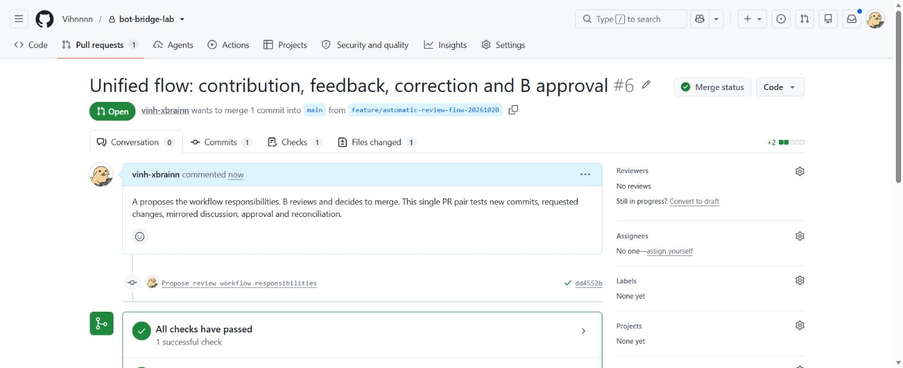

### Bước 2 — Bot mở PR tương ứng tại B

Controller đọc PR A, chuyển nguyên commit sang branch `incoming/a-pr-6` và mở **PR B #18**. App A báo trạng thái chờ B tại PR A. [Run chuyển PR đầu tiên](https://github.com/TF4-Phase3-TechX/bot-bridge-controller/actions/runs/39367026771) đã thành công.

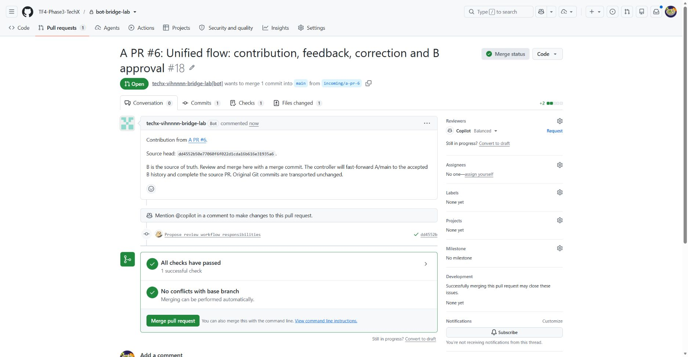

Hai main vẫn ở baseline. Mở PR và push feature branch chưa đưa contribution vào main.

### Bước 3 — A thêm commit, bot cập nhật cùng PR B

Developer tiếp tục ngay trên branch đang mở:

```powershell
Add-Content -LiteralPath automatic-review-flow.txt -Value 'Review communication: mirrored comments between paired PRs.' -Encoding ASCII
git add automatic-review-flow.txt
git commit -m 'Add review communication detail while PR is open'
git push origin feature/automatic-review-flow-20261020
```

Commit thứ hai là **`f09883b`**:

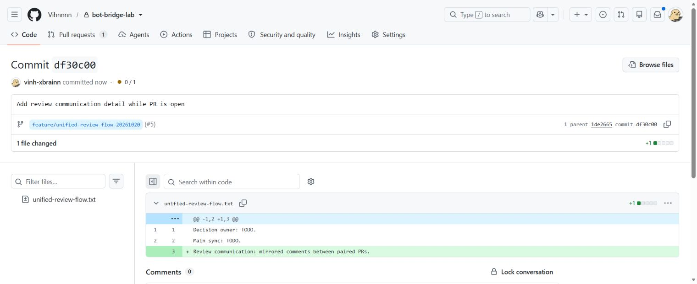

[Run cập nhật commit](https://github.com/TF4-Phase3-TechX/bot-bridge-controller/actions/runs/39367127332) đẩy head mới sang **cùng PR B #18**. Không mở thêm PR và không force-push.

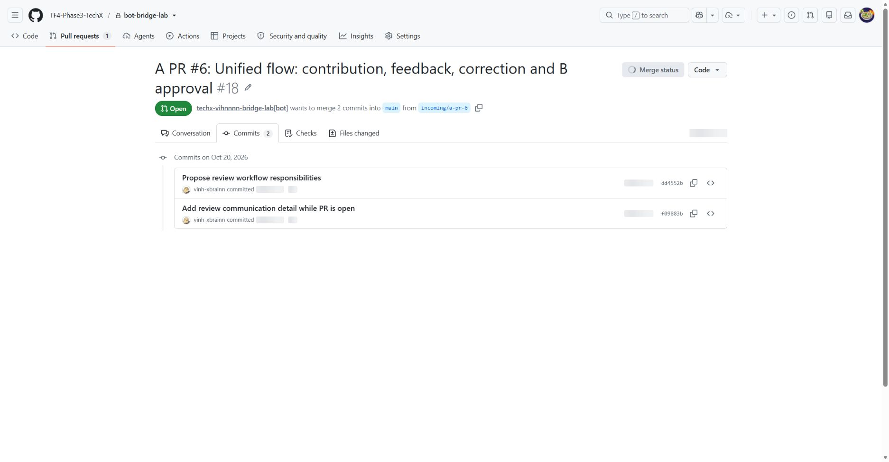

### Bước 4 — B Request changes với hai findings cụ thể

Maintainer B kiểm tra diff tại head `f09883b` rồi chọn **Review changes → Request changes**:

1. Dòng 1: xác định maintainer B là người quyết định merge.
2. Dòng 2: mô tả bot fast-forward A/main từ B/main đã được chấp nhận; developer chỉ pull A.

Review yêu cầu developer sửa cả hai TODO và gửi SHA bản sửa trong comment PR. `pho-veteran` đã gửi review tổng thể cùng hai comment theo dòng.

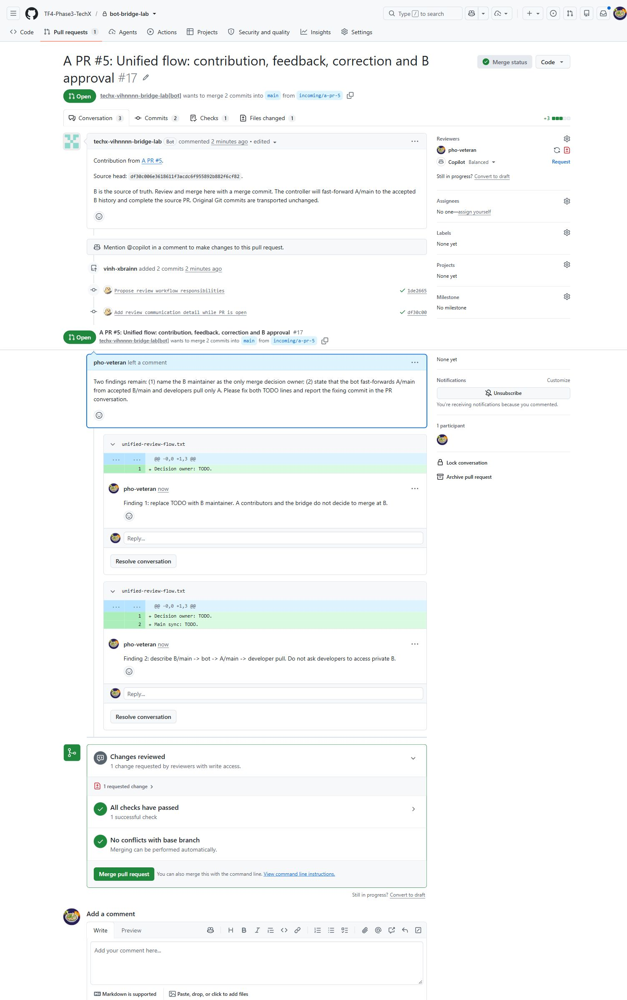

### Bước 5 — A đọc đầy đủ review ngay tại PR A

Controller chuyển review đã submit về A. App A đăng comment gồm trạng thái, reviewer, SHA đã review, toàn bộ nội dung tổng thể, file, dòng và đoạn diff của từng finding.

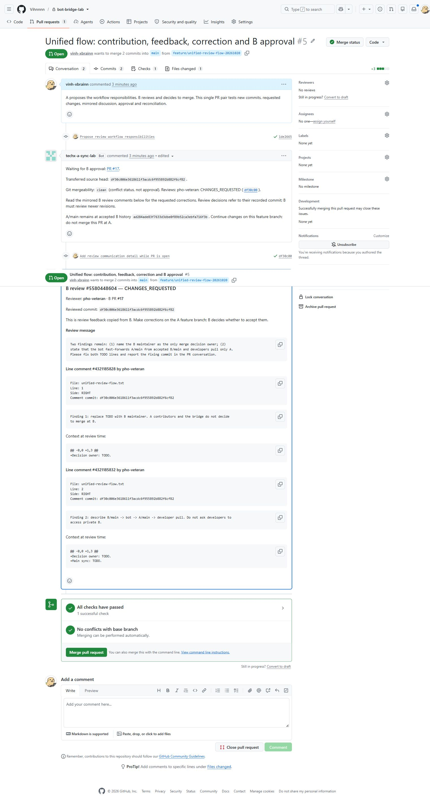

Developer không cần mở private repo B để hiểu việc phải làm. Đây là bản sao do App A đăng, không phải GitHub review trực tiếp của `pho-veteran` tại A. `Git mergeability: clean` chỉ nói không conflict; không đồng nghĩa được approve.

### Bước 6 — A sửa diff và comment “đã xử lý findings”

Developer sửa cùng branch:

```powershell
@(
  'Decision owner: B maintainer.'
  'Main sync: the bot fast-forwards A/main from accepted B/main; developers pull only A.'
  'Review communication: mirrored comments between paired PRs.'
) | Set-Content -LiteralPath automatic-review-flow.txt -Encoding ASCII

git diff
git add automatic-review-flow.txt
git commit -m 'Address both B review findings and clarify main synchronization'
git push origin feature/automatic-review-flow-20261020
git rev-parse HEAD
```

Commit sửa của lượt test là **`2c03f875b7e453ae88753a9d2c2f14bf9efa0ac3`**:

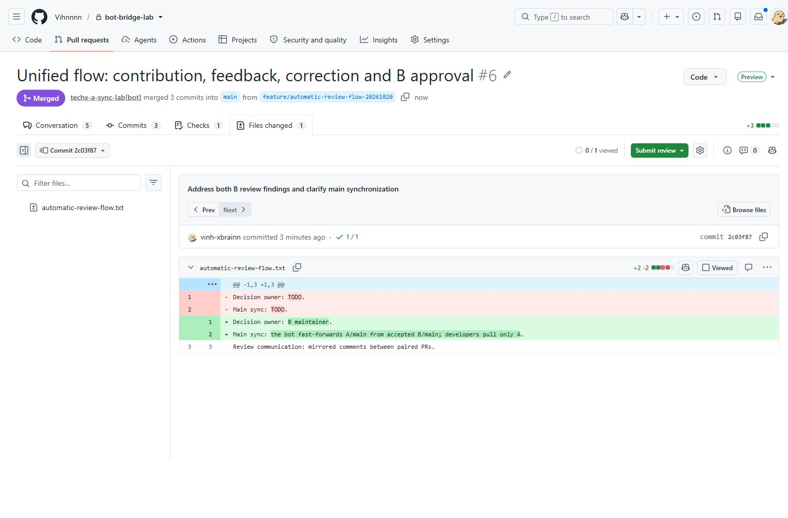

Trong **Conversation** của PR A, developer gửi comment ghi rõ findings đã xử lý, nội dung từng sửa đổi và SHA bản sửa; không chỉ viết “done”.

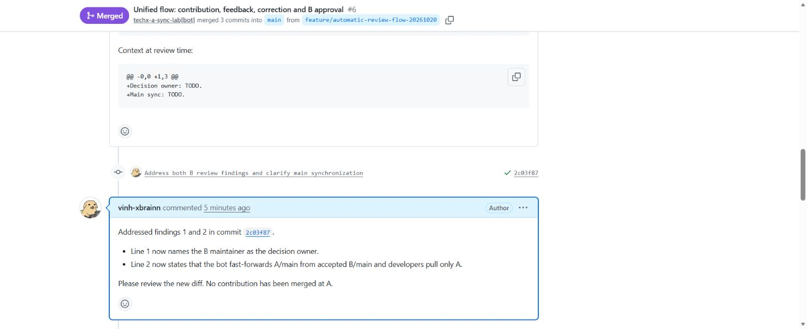

Controller đưa commit mới và comment này sang PR B #18. Comment tại B ghi rõ người viết gốc là `vinh-xbrainn`, kèm liên kết comment nguồn. App đăng bản sao bằng identity của App, không giả danh developer.

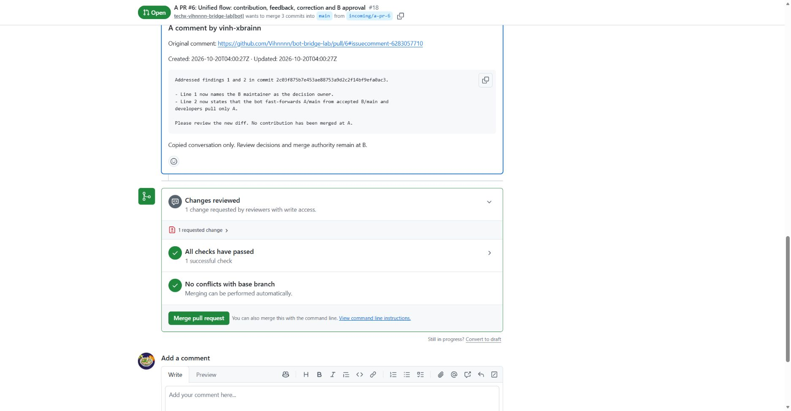

### Bước 7 — B approve bản sửa, comment và approval được đưa về A

B kiểm tra diff mới, comment của A và CI trên đúng head. `pho-veteran` gửi **Approve**, đồng thời comment xác nhận hai findings đã xử lý và B sẽ thực hiện merge.

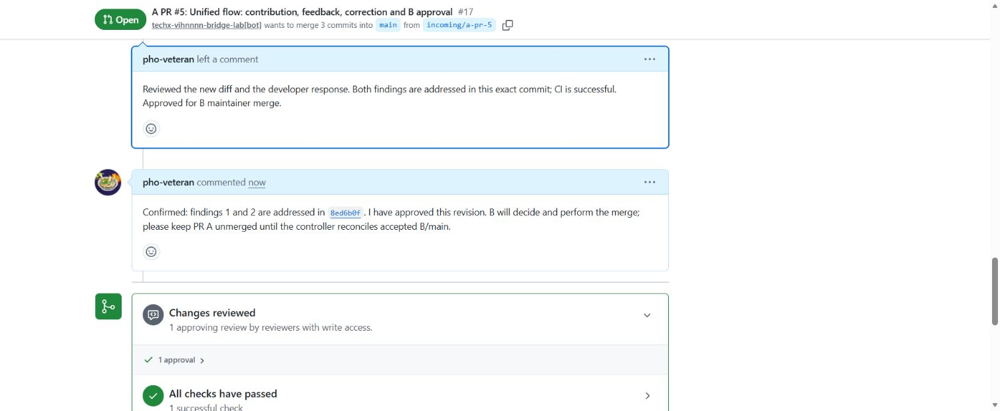

Lượt controller tiếp theo đưa cả **review APPROVED** và **comment phản hồi của B** về A. PR A vẫn chưa được developer merge; approval chỉ là quyết định review, chưa thay đổi main.

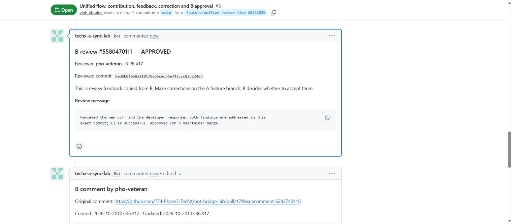

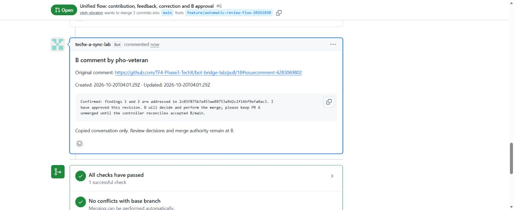

Comment hội thoại được sao chép **A ↔ B**; review đã submit và comment theo dòng của B được sao chép **B → A**. Bản sao ghi tác giả gốc và ngữ cảnh, nhưng không cấp quyền cho người A tại B. Comment “approve”, “merge” hoặc `/bridge sync` không phải lệnh điều khiển bot.

### Bước 8 — Maintainer B merge

Sau khi xác nhận đúng bản sửa, maintainer B chọn **Create a merge commit → Confirm merge**. Trong lab, thao tác dùng API với tài khoản `pho-veteran`, phương thức `merge` và expected head SHA. Bot không gọi merge endpoint.

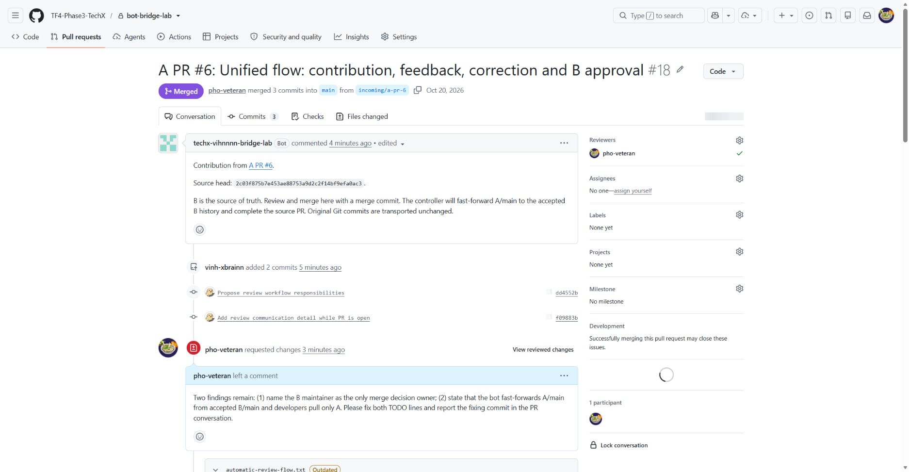

Merge commit là **`40d3fb87978565ff8f9a2fd563887e7d8bdfcf3e`**. B/main là lịch sử đã được chấp nhận. Sự kiện push của merge này tự kích hoạt workflow notifier tại B; notifier gọi controller để cập nhật A/main.

### Bước 9 — B/main push tự kích hoạt Actions reconcile

Merge PR B #18 tạo sự kiện `push` tại B/main. [Workflow notifier tại B — run 39367442048](https://github.com/TF4-Phase3-TechX/bot-bridge-lab/actions/runs/39367442048) tự chạy và dùng App dispatch gọi `controller.yml` trên main. Không bấm Run workflow sau merge.

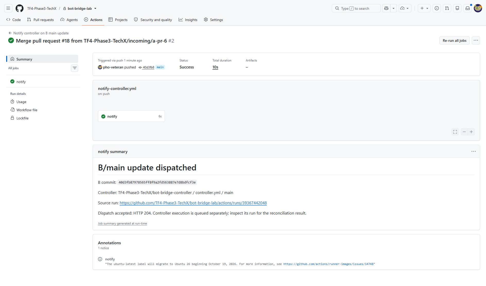

Workflow tại repo controller đọc ref B/main thực tế và kiểm tra A/main có thể fast-forward. App A đẩy đúng merge SHA của B vào A/main; không tạo merge commit độc lập tại A.

[Run 39367452216](https://github.com/TF4-Phase3-TechX/bot-bridge-controller/actions/runs/39367452216) hoàn tất **Success**; job policy pass 16 test và job reconcile báo cặp A #6 / B #18 là `accepted`.

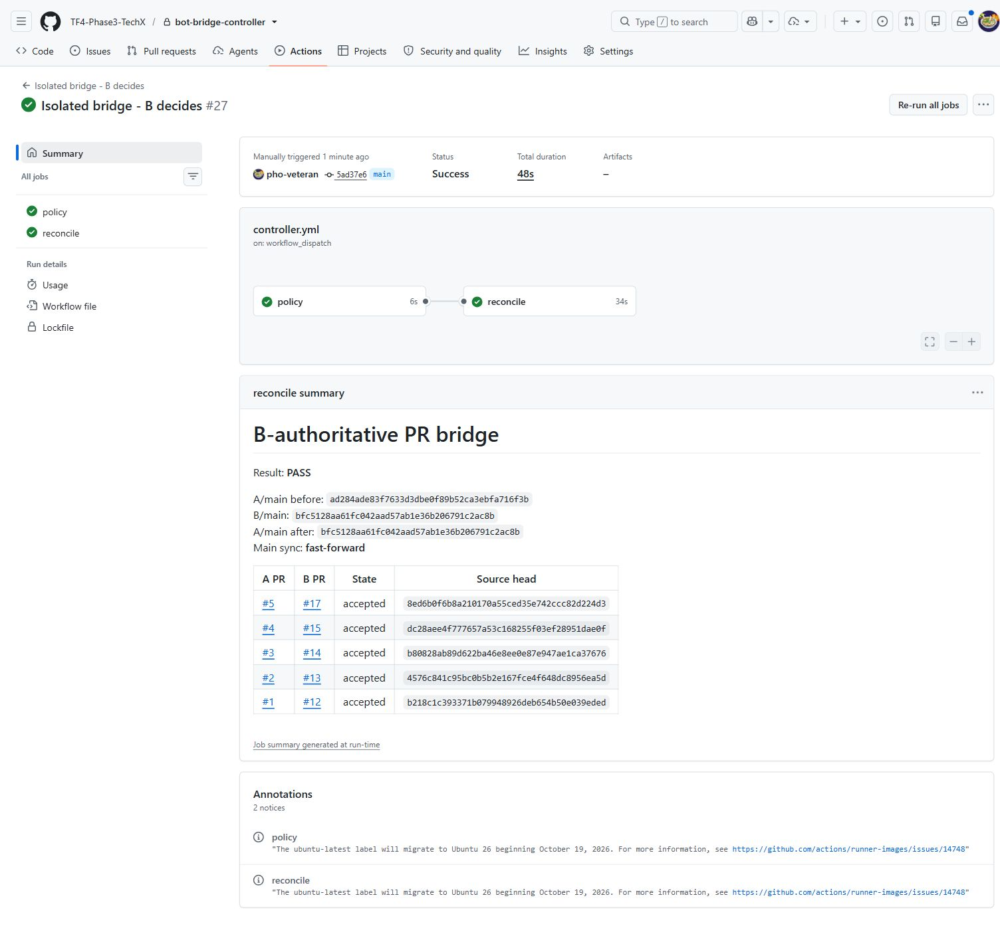

GitHub hiển thị “Manually triggered” cho event `workflow_dispatch`, kể cả khi API được bot gọi. Trong run này, actor là **`techx-controller-dispatch-lab[bot]`**; summary liên kết trực tiếp tới push workflow tại B và ghi SHA nguồn. Đây là chuỗi tự động, không phải maintainer dispatch.

Thời gian API ghi nhận ngày 20/10/2026, múi giờ Việt Nam:

| Mốc | Thời gian |
|---|---|
| B notifier được tạo bởi push sau merge | 11:02:26 |
| Controller được App dispatch tạo | 11:02:33 |
| Job reconcile hoàn tất Success | 11:03:22 |

Controller được tạo **7 giây** sau notifier; toàn chuỗi tới lúc reconcile hoàn tất là **56 giây** trong lượt test. Đây là số đo thực tế, không phải cam kết độ trễ. Không chờ lịch polling; thời gian chạy còn phụ thuộc hàng đợi Actions.

Trong lượt test A #6 / B #18 trước đây, notifier chỉ xử lý B/main và A có 0 secrets. Ở bản hiện tại, notifier nhận sự kiện PR/review/comment tại cả A/B; A có một key dispatch. Push đồng bộ A/main và thông báo do bot tạo vẫn bị skip để tránh vòng lặp.

### Bước 10 — PR A hoàn tất, developer pull từ A

Khi commit của feature đã nằm trong A/main, GitHub ghi nhận PR A là **Merged** (`state: closed`, `merged: true`). Comment của bot xác nhận B đã chấp nhận và SHA đã đồng bộ. Developer A không bấm merge PR A.

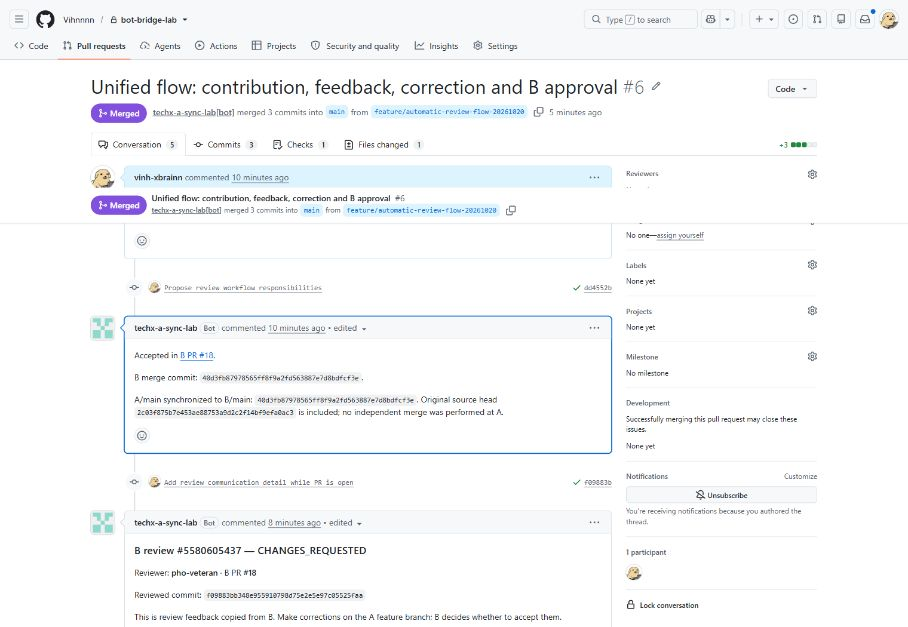

Developer nhận code:

```powershell
git switch main
git pull --ff-only origin main
git log -4 --format='%h | %an | %s'
Get-Content -LiteralPath automatic-review-flow.txt
git remote -v
```

Đã chạy pull thật bằng tài khoản `vinh-xbrainn`: local HEAD, A/main và B/main đều bằng **`40d3fb87978565ff8f9a2fd563887e7d8bdfcf3e`**, working tree sạch. Kết quả log:

```text
40d3fb8 | Nguyen Thanh Vinh | Merge pull request #18 from TF4-Phase3-TechX/incoming/a-pr-6
2c03f87 | vinh-xbrainn | Address both B review findings and clarify main synchronization
f09883b | vinh-xbrainn | Add review communication detail while PR is open
dd4552b | vinh-xbrainn | Propose review workflow responsibilities
```

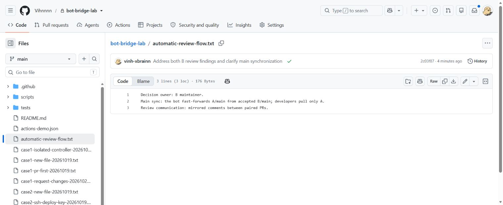

Các commit đóng góp gốc giữ nguyên SHA và author `vinh-xbrainn`; commit merge thuộc maintainer B. Bản clone chỉ có origin A. Lịch sử review và comment vẫn còn ở hai PR để tra cứu sau khi đóng.

### Edge case — B đóng PR mà không merge

Lượt test ngày 20/10/2026 dùng cặp [A #7](https://github.com/Vihnnnn/bot-bridge-lab/pull/7) / [B #19](https://github.com/TF4-Phase3-TechX/bot-bridge-lab/pull/19). Commit `fc2e1e5` thêm một đề xuất bỏ bước chấp thuận của maintainer B, để kiểm tra B từ chối contribution.

**1. A mở PR; controller tạo PR tương ứng tại B.** A vẫn ở trạng thái chờ quyết định của B, chưa cập nhật main.

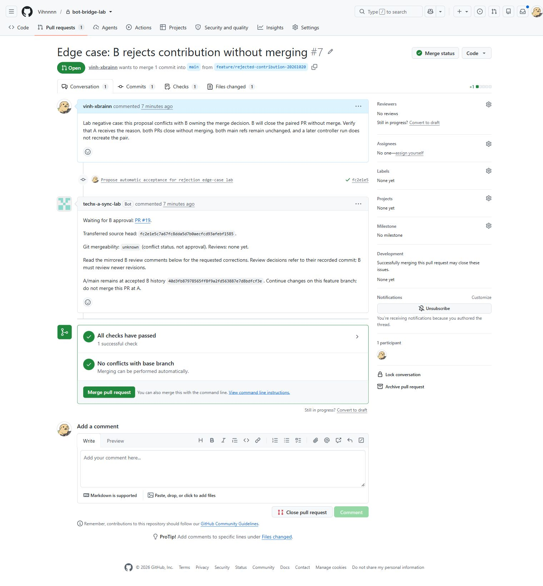

**2. Maintainer B ghi lý do rồi đóng PR không merge.** [Comment của B](https://github.com/TF4-Phase3-TechX/bot-bridge-lab/pull/19#issuecomment-6283311161) giải thích đề xuất vi phạm yêu cầu B giữ quyền quyết định, yêu cầu A không merge và dùng PR mới nếu có phương án khác. GitHub hiển thị **Closed with unmerged commits**.

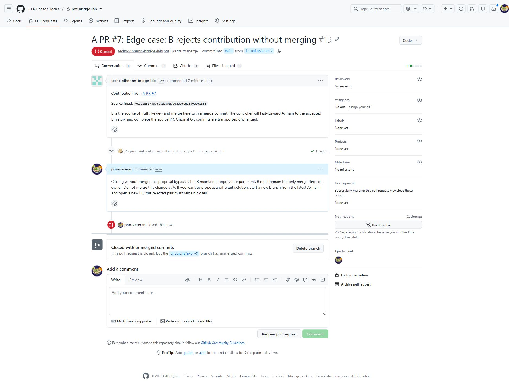

**3. Controller đưa lý do về A và đóng PR A.** [Bản sao comment tại A](https://github.com/Vihnnnn/bot-bridge-lab/pull/7#issuecomment-6283316652) chứa đầy đủ nội dung, tác giả và link nguồn. Bot cập nhật trạng thái `rejected`, rồi đóng PR A; cả hai PR có `state: closed`, `merged: false`. Close không tự sinh lời giải thích, nên maintainer cần viết comment lý do.

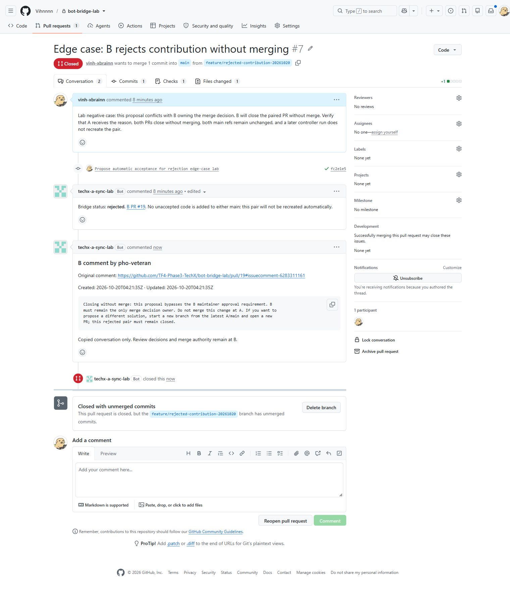

**4. Kiểm tra main và chạy lại controller.** [Run xử lý 39369155193](https://github.com/TF4-Phase3-TechX/bot-bridge-controller/actions/runs/39369155193) Success, summary ghi A #7 / B #19 là `rejected`. A/main và B/main trước/sau đều là `40d3fb87978565ff8f9a2fd563887e7d8bdfcf3e`.

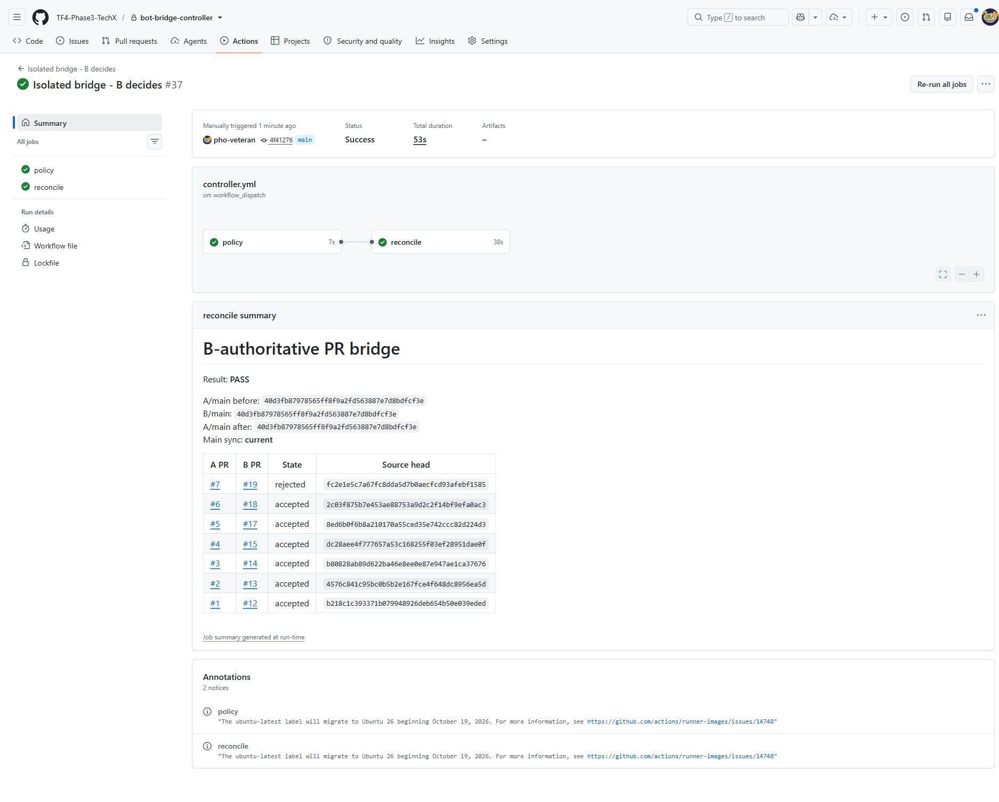

[Run tiếp theo 39369234420](https://github.com/TF4-Phase3-TechX/bot-bridge-controller/actions/runs/39369234420) cũng Success. API xác nhận chỉ có một PR B ghép với A #7, vẫn đóng; chỉ có một bản sao comment lý do. Commit bị từ chối không nằm trong lịch sử hai main; file `rejected-contribution.txt` không tồn tại trên main ở cả hai repo. Developer đã pull A/main, local vẫn cùng SHA và không có file này.

Lượt test A #7 / B #19 ở trên dùng maintainer dispatch và là evidence lịch sử. Bản hiện tại đã nhận sự kiện PR closed tại B: notifier tự gọi controller mà không cần push main. Request changes giữ PR mở để sửa tiếp; rejected kết thúc cặp PR, không tự tạo lại. Đề xuất khác cần branch và PR mới từ A/main đã cập nhật.
