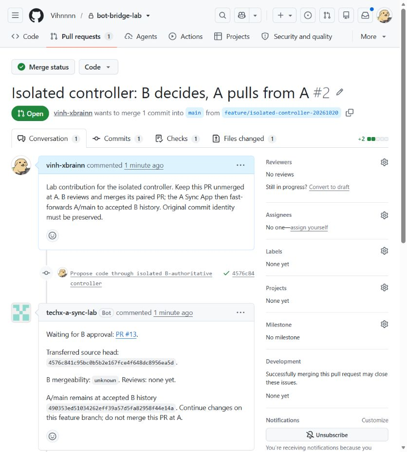
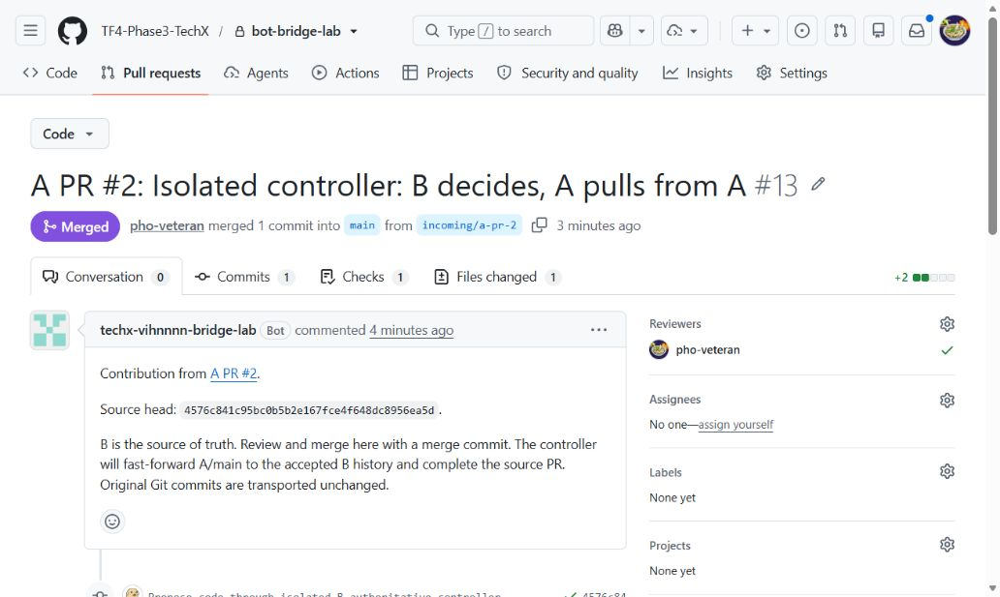
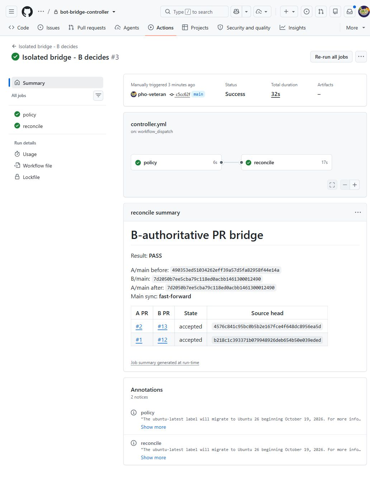
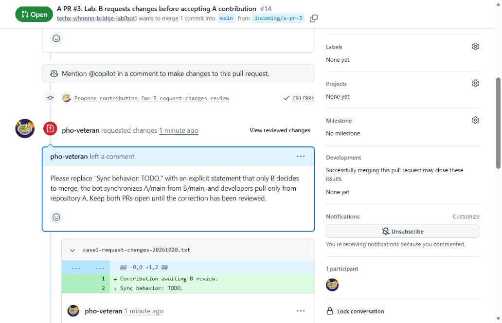
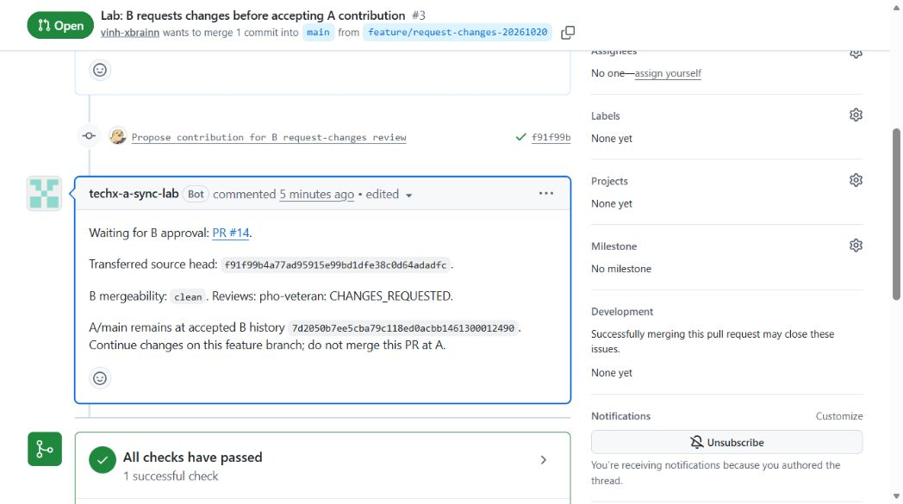

# Proposal contribute giữa hai private repo bằng GitHub Apps và Actions

## 1. Vấn đề và giải pháp tổng thể

Team ở org A cần gửi code vào private repo của org B, giữ tác giả commit mà không thêm từng developer làm member/collaborator tại B. Với gói trả phí, các tài khoản được cấp quyền trực tiếp có thể làm tăng số seat.

| Thành phần | Môi trường lab |
|---|---|
| Repo A | `Vihnnnn/bot-bridge-lab` — private |
| Developer A | `vinh-xbrainn` |
| Repo B | `TF4-Phase3-TechX/bot-bridge-lab` — private |
| Maintainer B | `pho-veteran` |
| Repo controller | `TF4-Phase3-TechX/bot-bridge-controller` — private, do B quản lý |

Các ràng buộc:

- Không thêm developer A vào B. Commit gốc giữ SHA, author và committer; email liên kết với tài khoản GitHub của developer.
- B là source of truth và quyết định merge. A/main là bản đồng bộ từ B/main; member A chỉ làm feature branch, mở PR, rồi pull kết quả từ repo A.
- Hai org dùng GitHub Free. Lab kiểm chứng luồng trên private repo, không đo hóa đơn Team. Branch protection cho private repo chưa được enforce; cấu hình cần bổ sung được ghi tại mục 2.4.
- Link repo/PR/Actions private cần tài khoản có quyền truy cập. Các ảnh trong tài liệu public là ảnh của lượt lab đã được công bố.

**Giải pháp — Hai repo đóng góp và một controller riêng**

```text
Member A clone/pull A/main → tạo feature branch → mở PR A, không merge
→ Controller đọc PR A, App B push branch đóng góp và mở PR B
→ Maintainer B review/test và merge vào B/main
→ App A fast-forward A/main về đúng SHA của B/main
→ GitHub ghi nhận PR A đã merge vì commit đã nằm trong A/main
→ Member A pull từ repo A
```

B chưa merge thì đóng góp vẫn nằm trên branch. B từ chối thì đóng góp không vào main. Bot không gọi API merge tại B và không tạo merge commit độc lập tại A. B dùng **Create a merge commit** để giữ nguyên commit gốc.

Luồng mới đã chạy thật ngày **20/10/2026**: PR A **#2** → PR B **#13** → B merge → App A đồng bộ → local pull từ A. Controller và key nằm trong repo riêng của B; member A không cần credential hoặc remote B.

App B cần `Contents: write` để chuyển commit sang branch của repo B độc lập. GitHub không có permission đủ cho luồng này mà chỉ cho mở PR, tuyệt đối không cho merge. Để cưỡng chế “B quyết định”, phải kết hợp quyền App với bảo vệ B/main ở mục 2.4.

GitHub App không tiêu thụ user seat. Actions của luồng mới chạy tại repo controller ở **org B**; chi phí phụ thuộc hạn mức và sử dụng của org này. Chi phí gói hỗ trợ branch protection là khoản riêng. [GitHub App và seat](https://docs.github.com/en/apps/creating-github-apps/about-creating-github-apps/deciding-when-to-build-a-github-app).

Giải pháp giữ metadata tác giả, nhưng author/email tự cấu hình được nên chưa chứng minh danh tính người tạo commit. Nếu cần chống giả mạo, phải yêu cầu ký commit và xác minh signer; lab chưa cấu hình ký commit. App token không cấp cho tài khoản cá nhân A quyền mở giao diện private repo B.

Ba use case chính:

| Use case | Quyết định tại B | Kết quả tại A |
|---|---|---|
| 1. A gửi contribution, B chấp nhận | Review và merge PR B | Bot cập nhật A/main, member A pull |
| 2. B yêu cầu sửa hoặc từ chối | Review lại bản sửa hoặc đóng PR B | A sửa cùng branch hoặc nhận trạng thái rejected |
| 3. B/main có thay đổi mới | Merge hotfix/PR khác tại B | Bot cập nhật A/main; A reconcile feature branch nếu cần |

## 2. Setup lab GitHub App

### 2.1. Tạo hai App và giới hạn quyền

Trong session `pho-veteran`, mở **TF4-Phase3-TechX → Settings → Developer settings → GitHub Apps → New GitHub App**. Tạo hai App do B quản lý:

| Thiết lập | App B — chuyển đóng góp | App A — đồng bộ kết quả |
|---|---|---|
| Tên | `TechX Vihnnnn Bridge Lab` | `TechX A Sync Lab` |
| Homepage | `https://github.com/TF4-Phase3-TechX` | `https://github.com/TF4-Phase3-TechX` |
| Nơi được phép cài | Only on this account | Any account, để cài vào org A |
| Contents | Read and write | Read and write |
| Pull requests | Read and write | Read and write |
| Metadata | Read-only | Read-only |
| Workflows | No access | Read and write |
| Webhook Active | Bỏ chọn | Bỏ chọn |
| Callback / user authorization / device flow | Không cấu hình | Không cấu hình |

App B đọc B/main, push branch đóng góp, mở/cập nhật PR. `Contents: read` không đủ để đưa commit vào repo B. Không cấp Administration, Actions write, Checks write, Commit statuses write hoặc quyền organization. [API tạo Git ref](https://docs.github.com/en/rest/git/refs#create-a-reference), [API merge PR](https://docs.github.com/en/rest/pulls/pulls#merge-a-pull-request).

App A đọc PR A, cập nhật comment/trạng thái và fast-forward A/main. Quyền Workflows write của App A cho phép đồng bộ cả thay đổi workflow đã được B chấp nhận. App B đã bỏ quyền này; contribution từ A thay đổi `.github/workflows/` bị controller chặn và cần maintainer B xử lý riêng.

### 2.2. Tạo key và cài đúng repo

1. Với mỗi App, mở **Credentials → Key pairs → New key**. Lưu file `.pem` ngoài repo; không commit key.
2. App B: **Install App → TF4-Phase3-TechX → Only select repositories → bot-bridge-lab → Install**.
3. App A: trong session `vinh-xbrainn`, mở [trang cài App A](https://github.com/apps/techx-a-sync-lab/installations/new), chọn **Vihnnnn → Only select repositories → bot-bridge-lab → Install**. Hoàn tất Confirm access nếu GitHub yêu cầu.
4. Khi đổi permission, kiểm tra installation đã nhận đúng quyền trước khi chạy controller.

| Thông tin đã kiểm tra | App B | App A |
|---|---|---|
| App ID | `5376504` | `5389681` |
| Client ID | `Iv23li2GwmLXhSNHA2Yh` | `Iv23liiZuDkx4OtpwZcz` |
| Installation ID | `172913981` | `173234412` |
| Repo được cài | `TF4-Phase3-TechX/bot-bridge-lab` | `Vihnnnn/bot-bridge-lab` |

“Any account” chỉ cho phép chủ org khác cài App A; không tự cấp quyền cho App vào mọi org. Controller vẫn kiểm tra đúng installation, org và repo đã định trước.

### 2.3. Chạy Actions trong controller riêng

Tạo private repo **`TF4-Phase3-TechX/bot-bridge-controller`**, chỉ maintainer B được quản lý. Tại repo này, mở **Settings → Secrets and variables → Actions**:

| Loại | Tên | Giá trị |
|---|---|---|
| Variable | `BRIDGE_APP_CLIENT_ID` | `Iv23li2GwmLXhSNHA2Yh` |
| Secret | `BRIDGE_APP_PRIVATE_KEY` | PEM của App B, gồm dòng BEGIN/END |
| Variable | `SOURCE_APP_CLIENT_ID` | `Iv23liiZuDkx4OtpwZcz` |
| Secret | `SOURCE_APP_PRIVATE_KEY` | PEM của App A, gồm dòng BEGIN/END |
| Variable | `BRIDGE_ENABLED` | `true` sau khi cài App và kiểm tra cấu hình |

Các file đã triển khai trong controller:

- [`.github/workflows/controller.yml`](https://github.com/TF4-Phase3-TechX/bot-bridge-controller/blob/main/.github/workflows/controller.yml): workflow **Isolated bridge - B decides**.
- [`scripts/pr-bridge.mjs`](https://github.com/TF4-Phase3-TechX/bot-bridge-controller/blob/main/scripts/pr-bridge.mjs): đọc PR, vận chuyển commit và đồng bộ main.
- [`scripts/pr-bridge-policy.mjs`](https://github.com/TF4-Phase3-TechX/bot-bridge-controller/blob/main/scripts/pr-bridge-policy.mjs): giới hạn API mutation, ref push và xử lý trạng thái.
- [`tests`](https://github.com/TF4-Phase3-TechX/bot-bridge-controller/tree/main/tests): 7 test cho trạng thái và giới hạn thao tác.

Controller chạy lịch ở phút **7, 22, 37, 52 mỗi giờ** hoặc được maintainer B bấm **Actions → Isolated bridge - B decides → Run workflow → main**. Cả chuyển PR sang B lẫn đồng bộ về A đều qua polling; mở PR tại A không kích hoạt ngay controller. Actions có thể bị trễ lịch.

Job `policy` kiểm tra code trước; job `reconcile` chỉ chạy trên main của đúng repo controller, khi bật `BRIDGE_ENABLED` và sự kiện là schedule/dispatch. Các lượt reconcile chạy tuần tự. `GITHUB_TOKEN` chỉ có Contents read để checkout controller; hai App tạo installation token giới hạn đúng một repo trong mỗi lượt chạy. Không lưu PAT cá nhân vào Actions.

Job có key chỉ checkout main của controller do B quản lý. PR A được đọc như dữ liệu và Git objects, không checkout/chạy code, hook hoặc dependency từ contribution. CI chạy riêng không nhận key bridge; các action được pin bằng commit SHA.

Lab đã tắt workflow cũ `bridge-to-b.yml` tại cả A và B, gỡ secret/variable bridge cũ tại A. API xác nhận **repo A có 0 Actions secrets**. Member A không có quyền đọc repo controller. Các file controller cũ có thể còn trong lịch sử repo lab, nhưng luồng đang chạy dùng repo controller riêng ở trên.

### 2.4. Guard đã triển khai và bảo vệ nhánh cần bổ sung

**Đã triển khai và kiểm tra**

| Kiểm tra | Kết quả |
|---|---|
| Token từng App chỉ thấy một repo private đã chọn | Pass |
| App A đọc repo B; App B đọc repo A | Cả hai nhận HTTP 404 |
| Tài khoản `vinh-xbrainn` đọc B và controller | Cả hai nhận HTTP 404 |
| Xin token App B với Workflows write | GitHub từ chối HTTP 422 |
| Repo A không chứa Actions secret | 0 secret |
| Controller không cho gọi merge endpoint, ghi ref ngoài phạm vi hoặc push B/main | 7 test policy/boundary pass; đây là guard trong code |

Controller chỉ push `incoming/a-pr-<số PR A>` tại B và `main` tại A; không force-push. Nó kiểm tra source SHA, base main, repo và tác giả App của PR ghép cặp trước khi cập nhật. Nội dung PR không được dùng làm lệnh shell. Khi A/main không còn là ancestor của B/main, controller dừng để maintainer reconcile.

**B/main: chỉ maintainer B được đưa code vào**

Hai org Free chưa enforce branch protection cho private repo. Vì App B có Contents write, credential này vẫn có thể ghi main/merge nếu được dùng ngoài controller. Muốn cưỡng chế bằng GitHub, cần gói hỗ trợ như Team/Enterprise; muốn cưỡng chế cả A và B thì cần hỗ trợ ở cả hai org. [Phạm vi branch protection](https://docs.github.com/en/repositories/configuring-branches-and-merges-in-your-repository/managing-protected-branches/about-protected-branches).

Tại B → **Settings → Branches → Add classic branch protection rule**, pattern `main`:

| Thiết lập đề xuất | Giá trị |
|---|---|
| Restrict who can push to matching branches | Chỉ maintainer/team B; không thêm App bridge |
| Require a pull request before merging | Bật |
| Require approvals | Ít nhất 1 review của B |
| Dismiss stale approvals when new commits are pushed | Bật |
| Restrict who can dismiss reviews | Chỉ maintainer B |
| Require status checks | CI bắt buộc của dự án, nguồn check tin cậy |
| Do not allow bypassing the above settings | Bật; không cấp bypass cho App bridge |
| Allow force pushes / Allow deletions | Tắt |

Chỉ yêu cầu review/CI chưa chặn bot merge sau khi checks pass. Danh sách được cập nhật main phải loại App B; hạn chế push cũng áp dụng khi merge PR. [Cấu hình protection](https://docs.github.com/en/repositories/configuring-branches-and-merges-in-your-repository/managing-protected-branches/managing-a-branch-protection-rule), [giới hạn người push](https://docs.github.com/en/repositories/configuring-branches-and-merges-in-your-repository/managing-protected-branches/about-protected-branches#restrict-who-can-push-to-matching-branches).

Dùng **Create a merge commit**; tắt squash/rebase merge và không yêu cầu linear history để giữ SHA gốc. Đề xuất tắt auto-merge, không dùng merge queue trong luồng này. Nếu có release branch hoặc tag cần bảo vệ, bổ sung rule cho các ref đó; rule main không bảo vệ mọi ref.

**A/main: chỉ App A đồng bộ từ B**

App A đã được cài riêng. Đề xuất ruleset `Restrict updates` cho main, chỉ App A được bypass rule này. Tạo ruleset riêng chặn force-push/xóa và không cấp bypass. Không cần mở thêm PR đồng bộ tại A vì B đã quyết định. Member A không được push/merge main; không cho toàn bộ `github-actions[bot]` quyền bypass. [Quy tắc ruleset](https://docs.github.com/en/repositories/configuring-branches-and-merges-in-your-repository/managing-rulesets/available-rules-for-rulesets).

**Controller và phạm vi tin cậy**

- Giữ hai key trong controller do B quản lý; bảo vệ main của controller và review thay đổi workflow/script. Người có quyền sửa controller/secret hoặc chính sách org thuộc phạm vi quản trị tin cậy. Không đặt lại key B ở repo A. [Bảo vệ GitHub Actions](https://docs.github.com/en/actions/reference/security/secure-use).
- Token App không giới hạn theo branch; guard trong script không thay thế branch protection. Nếu key từng bị lộ, phải thu hồi/đổi key; việc xóa secret tại A không thu hồi các bản key đã sao chép.
- B phải chấp nhận chia sẻ code và lịch sử reachable từ B/main với thành viên repo A. B private chặn truy cập trực tiếp, nhưng A vẫn đọc được bản sao đã đồng bộ. Controller chuyển trạng thái review cần thiết, không sao chép toàn bộ comment hoặc log nội bộ B.
- Nếu cần xác thực tác giả, bổ sung ký commit và kiểm tra signer; giữ tên/email không chống giả mạo.

Sau khi bật policy trên gói hỗ trợ, cần test thực tế: App B mở PR được nhưng không push/merge/force-push/xóa main; member A không push/merge main; maintainer B vẫn merge được và App A đồng bộ được. Test thêm stale approval, conflict, main lệch, token bị thu hồi và retry. **Các kiểm tra từ chối do branch protection này chưa chạy trong lab Free.**

### 2.5. Kích hoạt reconcile thủ công

**Hiện tại — maintainer B kích hoạt**

Maintainer B vào **bot-bridge-controller → Actions → Isolated bridge - B decides → Run workflow → main**, hoặc chạy CLI bằng tài khoản có quyền tại controller:

```powershell
gh workflow run controller.yml --repo TF4-Phase3-TechX/bot-bridge-controller --ref main
```

Member A chưa tự chạy được lệnh này: họ không có quyền vào repo controller. GitHub yêu cầu quyền write để người dùng chạy workflow thủ công. `git pull` của developer chỉ tải A/main về local, không kích hoạt bot cập nhật A/main từ B. [Chạy workflow thủ công](https://docs.github.com/en/actions/how-tos/manage-workflow-runs/manually-run-a-workflow).

**Đề xuất — developer yêu cầu từ PR A**

```text
Developer comment /bridge sync trên PR A
→ Webhook của App A gửi sự kiện đến endpoint do B quản lý
→ Endpoint xác minh sự kiện và quyền người yêu cầu
→ Credential riêng của endpoint dispatch controller.yml trên main
→ Controller đối chiếu trạng thái thật tại B, đồng bộ theo guard hiện có
→ App A cập nhật kết quả vào PR A
→ Developer pull origin main
```

Endpoint chỉ chấp nhận đúng lệnh, repo/installation đã cấu hình và người được phép yêu cầu sync. Xác minh chữ ký `X-Hub-Signature-256`, kiểm tra lại comment/người gửi qua API, chống xử lý trùng delivery và giới hạn tần suất. Repo controller, tên workflow và ref `main` được cố định phía server; comment không được chọn repo, ref hoặc lệnh thực thi. [Xác minh webhook](https://docs.github.com/en/webhooks/using-webhooks/validating-webhook-deliveries).

Dùng credential riêng chỉ cài tại controller với Actions write để dispatch; giữ credential ở endpoint do B quản lý, không đặt ở A và không mở rộng quyền App B vận chuyển code. Actions write là quyền cấp repo, không tự giới hạn vào một workflow; endpoint phải cưỡng chế danh sách thao tác được phép. Developer chỉ có quyền yêu cầu chạy lại, không có quyền merge, force-sync hay bỏ qua trạng thái review. [API workflow dispatch](https://docs.github.com/en/rest/actions/workflows#create-a-workflow-dispatch-event).

Đây là phần mở rộng **chưa triển khai**: cần endpoint chạy được từ Internet, cấu hình webhook App A và credential dispatch. Lệnh `/bridge sync` hiện chưa có tác dụng trong lab. Nếu chỉ bổ sung đọc lệnh qua lịch polling thì không cần endpoint, nhưng vẫn phải đợi lịch; đó không phải kích hoạt ngay. Thời gian chạy sau dispatch cũng phụ thuộc hàng đợi GitHub Actions.

## 3. Triển khai — Ba use case chính

Các use case dùng chung cấu hình ở mục 2. Developer chỉ làm việc tại A; maintainer B quyết định code được nhận vào main. Mỗi feature dùng branch riêng. Controller polling khoảng 15 phút hoặc maintainer B dispatch thủ công.

### 3.1. Use case 1 — A gửi contribution, B review và chấp nhận

**Tình huống:** A phát triển thay đổi mới từ main đã đồng bộ, B review và chấp nhận contribution. Luồng này đã được test end-to-end ngày 20/10/2026; ba ảnh dưới đây thuộc chính lượt chạy đó.

```text
A tạo branch/file → commit → push → mở PR A
→ Bot mở PR B → B review/CI/merge
→ Bot fast-forward A/main → PR A được ghi nhận đã merge
→ Member A pull từ A
```

#### Bước 1 — Clone A và tạo contribution

Đầu lượt test 20/10/2026, A/main và B/main cùng ở `490353ed51034262eff39a57d5fa82958f44e14a`. Developer dùng tài khoản `vinh-xbrainn` có quyền repo A. Các lệnh PowerShell tương ứng:

```powershell
git clone https://github.com/Vihnnnn/bot-bridge-lab.git
Set-Location bot-bridge-lab
git switch main
git pull --ff-only origin main
git switch -c feature/isolated-controller-20261020
git config user.name 'vinh-xbrainn'
git config user.email '335428864+vinh-xbrainn@users.noreply.github.com'

@(
  'A proposes code. B decides whether to merge. The isolated controller syncs accepted B history to A.'
  'Members of A pull only from repository A.'
) | Set-Content -LiteralPath case1-isolated-controller-20261020.txt -Encoding ASCII

git add case1-isolated-controller-20261020.txt
git commit -m 'Propose code through isolated B-authoritative controller'
git push -u origin feature/isolated-controller-20261020
```

Lượt lab tạo commit **`4576c841c95bc0b5b2e167fce4f648dc8956ea5d`**, author và committer đều là `vinh-xbrainn`. Khi tái hiện, dùng branch/file mới và email của chính developer; commit SHA mới sẽ khác.

#### Bước 2 — Mở PR A, giữ chưa merge

Tại repo A, chọn **Pull requests → New pull request**, base `main`, compare branch vừa push. Title của lượt test: `Isolated controller: B decides, A pulls from A`.

[PR A #2](https://github.com/Vihnnnn/bot-bridge-lab/pull/2) được mở bởi `vinh-xbrainn`. Member A không merge PR này. Chờ lịch controller, hoặc maintainer B chạy workflow thủ công trong repo controller.

[Run chuyển PR 39357238773](https://github.com/TF4-Phase3-TechX/bot-bridge-controller/actions/runs/39357238773) thành công: App B mở [PR B #13](https://github.com/TF4-Phase3-TechX/bot-bridge-lab/pull/13) từ branch `incoming/a-pr-2`, head đúng `4576c84`. App A cập nhật comment ở A với trạng thái chờ B.



Ở bước này, API xác nhận hai main vẫn ở `490353e`; contribution chưa vào main của bên nào.

#### Bước 3 — B review và merge PR

Maintainer B kiểm tra PR #13: một file mới, hai dòng thêm, head `4576c84` và tác giả commit gốc. [CI B 39357275418](https://github.com/TF4-Phase3-TechX/bot-bridge-lab/actions/runs/39357275418) pass. Đây là policy CI của lab; dự án thật cần thêm build/test của dự án.

Trong lượt test, `pho-veteran` gửi review **Approved** rồi merge bằng API với expected head SHA và phương thức `merge`. Khi thao tác bằng UI, chọn **Create a merge commit → Confirm merge**. App B chỉ tạo PR; quyết định merge dùng tài khoản maintainer B.

PR #13 được merge lúc **09:09:52 ngày 20/10/2026, giờ Việt Nam**, tạo commit **`7d2050b7ee5cba79c118ed0acbb1461300012490`**.



#### Bước 4 — App A đồng bộ kết quả B

Sau B merge, maintainer chạy **bot-bridge-controller → Actions → Isolated bridge - B decides → Run workflow → main**. Trong vận hành có thể chờ lịch polling thay cho thao tác này.

[Run đồng bộ 39357421342](https://github.com/TF4-Phase3-TechX/bot-bridge-controller/actions/runs/39357421342) hoàn tất **Success**. Job policy pass 7 test; reconcile dùng App A fast-forward A/main đến merge commit của B, không tạo một lần merge riêng tại A.



Kết quả kiểm tra lại bằng GitHub API:

| Thành phần | Kết quả |
|---|---|
| B/main | `7d2050b7ee5cba79c118ed0acbb1461300012490` |
| A/main | `7d2050b7ee5cba79c118ed0acbb1461300012490` |
| PR B #13 | Merged bởi `pho-veteran` |
| PR A #2 | Merged, actor `techx-a-sync-lab[bot]`, cùng merge SHA của B |
| Commit đóng góp | `4576c841c95bc0b5b2e167fce4f648dc8956ea5d` giữ nguyên tại cả A và B |
| Author / committer của commit đóng góp | `vinh-xbrainn`, email liên kết đúng tài khoản GitHub |

Summary Actions cũng liệt kê cặp PR cũ khi quét repository; evidence của lượt mới là hàng **A #2 / B #13**.

#### Bước 5 — Member A pull từ repo A

Trong bản clone A, sau khi bot báo đã đồng bộ và working tree sạch:

```powershell
git remote -v
git switch main
git pull --ff-only origin main
git log -2 --format='%h | %an | %s'
Get-Content -LiteralPath case1-isolated-controller-20261020.txt
```

Đã chạy thật bằng credential của `vinh-xbrainn`. Bản clone chỉ có origin `https://github.com/Vihnnnn/bot-bridge-lab.git`, không có remote B. Pull nhận đúng file, HEAD bằng `7d2050b`, working tree sạch:

```text
7d2050b | Nguyen Thanh Vinh | Merge pull request #13 from TF4-Phase3-TechX/incoming/a-pr-2
4576c84 | vinh-xbrainn | Propose code through isolated B-authoritative controller
```

Để làm thay đổi tiếp theo, tạo feature branch mới từ main đã cập nhật. Nếu local main có commit riêng làm `--ff-only` thất bại, giữ công việc ở feature branch và reconcile; không push đè A/main.

### 3.2. Use case 2 — B yêu cầu sửa hoặc từ chối contribution

**Tình huống:** PR A đã được bot chuyển sang B nhưng chưa được B chấp nhận. B có thể yêu cầu sửa để review tiếp hoặc đóng PR để từ chối.

```text
PR A đang mở ↔ PR B đang mở
→ B review và yêu cầu sửa
→ Bot cập nhật trạng thái review ở PR A
→ Developer thêm commit trên cùng feature branch A
→ Bot cập nhật cùng branch và PR B
→ B review lại
   → Chấp nhận: merge tại B → bot đồng bộ A/main → member A pull A
   → Từ chối: đóng PR B không merge → bot đóng PR A, ghi rejected
```

**Bước 1 — B gửi kết quả review**

Maintainer B mở PR B, kiểm tra diff và gửi review **Request changes** nếu cần sửa. Controller đưa trạng thái review về comment trên PR A ở lượt polling tiếp theo.

Controller hiện chỉ chuyển trạng thái và người review, không sao chép nội dung review hoặc comment theo dòng. Vì member A không đọc được private repo B, maintainer cần chuyển hướng dẫn sửa cụ thể qua kênh trao đổi mà hai bên cùng truy cập. Việc trao đổi này nằm ngoài phần tự động của lab.

**Lượt test Request changes ngày 20/10/2026**

[PR A #3](https://github.com/Vihnnnn/bot-bridge-lab/pull/3) chứa file `case1-request-changes-20261020.txt`, commit `f91f99b4a77ad95915e99bd1dfe38c0d64adadfc` của `vinh-xbrainn`. [Run 39360920642](https://github.com/TF4-Phase3-TechX/bot-bridge-controller/actions/runs/39360920642) chuyển commit và mở [PR B #14](https://github.com/TF4-Phase3-TechX/bot-bridge-lab/pull/14).

Maintainer `pho-veteran` gửi review **Request changes** cho đúng head, yêu cầu thay dòng `Sync behavior: TODO.` bằng mô tả B quyết định merge, bot đồng bộ A/main từ B/main và developer chỉ pull repo A. Review có cả nội dung tổng thể và comment tại dòng 2.



Sau [run 39361034447](https://github.com/TF4-Phase3-TechX/bot-bridge-controller/actions/runs/39361034447) thành công, App A cập nhật comment tại PR #3:

```text
Reviews: pho-veteran: CHANGES_REQUESTED.
```



API xác nhận cả hai PR vẫn mở, chưa merge; A/main và B/main vẫn cùng `7d2050b7ee5cba79c118ed0acbb1461300012490`. Contribution chưa vào main. Trạng thái ở A là **comment của bot**, không phải một GitHub review do maintainer B trực tiếp gửi tại A.

`B mergeability: clean` trong comment chỉ phản ánh khả năng merge không conflict, không có nghĩa B đã approve. UI B vẫn cho phép merge trong lab Free vì chưa có branch protection bắt buộc approval; Request changes tự nó chưa cưỡng chế việc chặn merge ở đây.

**Bước 2 — A sửa trên cùng branch**

Để tiếp tục chính PR A #3 đang chờ sửa, dùng branch/file của lượt Request changes:

```powershell
git switch feature/request-changes-20261020
# Sửa file theo nội dung review rồi kiểm tra diff.
git diff
git add case1-request-changes-20261020.txt
git commit -m 'Address B review feedback'
git push origin feature/request-changes-20261020
```

Không tạo PR A mới cho mỗi lần sửa. Không rebase/force-push branch đã được bot chuyển; thêm commit mới để bot có thể push tiếp theo lịch sử hiện có.

**Bước 3 — Bot cập nhật PR B, B quyết định**

Đợi lịch controller hoặc để maintainer B chạy **Isolated bridge - B decides**. Bot đẩy head mới vào `incoming/a-pr-<số PR A>` và cập nhật source SHA trong cùng PR B. B kiểm tra CI và review đúng head mới trước khi merge.

Nếu B chấp nhận, tiếp tục bước đồng bộ và pull của use case 1. Khi có branch protection, bật **Dismiss stale approvals** để commit mới làm mất approval cũ; lab Free chưa enforce điều kiện này.

Nếu B từ chối, maintainer chọn **Close pull request** tại B, không merge. Lượt controller tiếp theo đóng PR A và ghi `rejected`. Contribution bị từ chối không vào main; A/main vẫn đồng bộ các thay đổi khác mà B đã chấp nhận. Bot không tự tạo lại PR B của cặp đã từ chối. Muốn gửi phương án mới, tạo branch và PR A mới từ A/main đã cập nhật.

**Kết quả cần kiểm tra**

| Nhánh quyết định | Kết quả mong đợi |
|---|---|
| A push bản sửa khi B PR còn mở | Vẫn cùng một cặp PR; B head trùng source head mới |
| B chưa chấp nhận contribution | Contribution chưa xuất hiện trong A/main hoặc B/main |
| B merge bản sửa | Bot đồng bộ cùng merge SHA về A; giữ các commit gốc |
| B đóng PR không merge | PR A đóng với trạng thái rejected; bot không tự mở lại cặp PR |

**Phạm vi evidence:** đã chạy thật A mở PR → bot mở PR B → B Request changes kèm comment theo dòng → bot chuyển trạng thái về A, giữ hai main không đổi. Hai PR được giữ mở ở trạng thái chờ sửa. Bước sửa → review lại hoặc từ chối vẫn là hướng dẫn, chưa được thực hiện trong lượt test này; policy test có kiểm tra `pending`/`rejected`.

### 3.3. Use case 3 — B/main có thay đổi mới, A cập nhật và reconcile branch đang làm

**Tình huống:** B merge hotfix, PR nội bộ hoặc contribution khác trong khi developer A đang làm một feature. Thay đổi tại B phải về A trước khi developer tích hợp vào branch của mình.

```text
Maintainer B merge thay đổi vào B/main
→ Controller đọc B/main
→ Nếu A/main là ancestor của B/main: App A fast-forward A/main
→ Member A pull main từ repo A
→ Member A merge main mới vào feature branch, xử lý conflict nếu có
→ Push feature branch tại A
→ Bot cập nhật PR B → B review và quyết định merge
```

**Bước 1 — B chấp nhận thay đổi**

Maintainer B review/test và merge PR tại B. PR này có thể là hotfix do chính team B tạo, không bắt buộc phải có PR tương ứng tại A.

**Bước 2 — Bot đồng bộ main**

Đợi lịch hoặc chạy workflow tại repo controller. Controller đồng bộ từ ref B/main thực tế trước khi xử lý các cặp PR; việc đồng bộ main không phụ thuộc có contribution A đang mở hay không.

Nếu A/main bằng B/main, không cần push. Nếu A/main nằm trong lịch sử B/main, App A fast-forward đến SHA đã đọc từ B. Nếu B tiếp tục nhận commit sau đó, lượt sau đồng bộ tiếp. Nếu lịch sử A/main đã rẽ nhánh, controller dừng và báo lỗi.

**Bước 3 — Member A nhận code và cập nhật feature branch**

Chạy khi working tree sạch. Ví dụ feature branch đang làm là `feature/isolated-controller-20261020`:

```powershell
git switch main
git pull --ff-only origin main
git switch feature/isolated-controller-20261020
git merge main
```

Nếu Git báo conflict, sửa các file được liệt kê, chọn nội dung đúng rồi hoàn tất merge:

```powershell
git status
# Sửa từng file conflict, sau đó stage đúng các file đã xử lý.
git add <file-da-giai-quyet>
git commit
```

`<file-da-giai-quyet>` là chỗ thay bằng đường dẫn thực tế. Chỉ cần bước hoàn tất merge này nếu có conflict. Nếu chưa thể giải quyết, dùng `git merge --abort` để trở lại trước lần merge rồi trao đổi với maintainer.

Chạy kiểm tra của dự án, sau đó:

```powershell
git push origin feature/isolated-controller-20261020
```

Member A vẫn chỉ truy cập repo A. Bot cập nhật branch PR tại B; maintainer B review lại kết quả tích hợp trước khi merge. Bot không tự giải quyết conflict và không đưa commit riêng của A vào B/main.

**Khi main bị rẽ nhánh ngoài quy trình**

Phân biệt local main của một developer bị lệch với remote A/main bị lệch:

| Sai lệch | Cách xử lý |
|---|---|
| Chỉ local main có commit riêng | Giữ commit bằng branch riêng; dùng bản clone sạch từ A/main để tiếp tục, đưa phần công việc cần gửi thành feature branch/PR |
| Remote A/main có commit chưa được B chấp nhận | Controller dừng. Maintainer lưu lại các commit riêng và quyết định gửi chúng qua quy trình B review hoặc khôi phục A/main theo B sau khi bảo toàn công việc |
| B/main bị rewrite khiến fast-forward không còn hợp lệ | Controller dừng để maintainer kiểm tra; không tự reset/force-push A |
| B đã merge nhưng ghi A tạm thời thất bại | Run báo lỗi; sau khi xử lý nguyên nhân, chạy lại để đọc refs và đồng bộ tiếp |

Việc khôi phục một remote main đã rẽ nhánh là thao tác quản trị riêng, không phải cơ chế tự động của bot. Bảo vệ main tại A và chặn force-push tại B giúp ngăn sai lệch này.

**Kết quả cần kiểm tra:** sau một lượt đồng bộ thành công, A/main trùng SHA B/main mà controller đã đọc; feature branch giữ contribution của developer cùng thay đổi được B chấp nhận; member A không dùng remote hoặc credential B.

**Phạm vi evidence:** thao tác fast-forward B → A và pull từ A đã chạy thật trong use case 1. Policy test kiểm tra main bằng nhau, được fast-forward hoặc phải dừng khi lệch. Chưa có lượt end-to-end riêng cho hotfix B đồng thời với feature A, giải quyết conflict, hoặc khôi phục main bị lệch.
