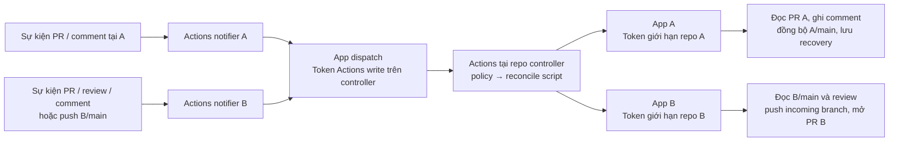
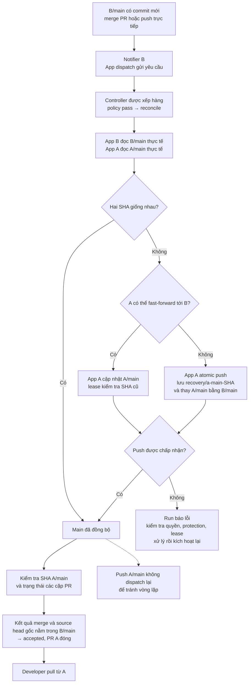

# Setup GitHub App để A đóng góp vào B

## 1. Phạm vi và cơ chế

A và B là hai repo private ở hai organization. Developer làm việc tại A; maintainer B quyết định review và merge. B/main là source of truth. Bot đồng bộ lịch sử đã được B chấp nhận về A/main; developer chỉ clone/pull repo A.

Cơ chế gồm:

- **GitHub App:** danh tính và quyền truy cập.
- **Script controller:** logic chuyển commit, ghép cặp PR, đồng bộ trao đổi và xử lý trạng thái.
- **GitHub Actions:** chạy script trên runner, tạo token và ghi log.

Cài App không tự tạo chức năng bridge. Phải có bộ mã controller và workflow tương ứng. Mỗi lượt chạy lấy installation token bằng private key trong Actions secrets; token được truyền qua biến môi trường và action thu hồi ở cuối job. Không dùng token cố định cho developer. [Xác thực GitHub App trong Actions](https://docs.github.com/en/apps/creating-github-apps/authenticating-with-a-github-app/making-authenticated-api-requests-with-a-github-app-in-a-github-actions-workflow).

```text
Developer → feature branch và PR tại A → notifier A gọi controller
Controller → chuyển commit sang branch và mở PR tại B
B review ↔ A sửa code và trao đổi → notifier mỗi bên gọi controller
Maintainer B merge → B/main thay đổi
Notifier tại B → dispatch controller
Controller → đồng bộ A/main đúng B/main → hoàn tất PR A
Developer → pull A/main
```

Ngoài hai repo code A và B, triển khai thêm **một repo controller private do B quản lý**. Repo này giữ code điều phối và key của hai App vận chuyển code. Developer A không cần quyền vào B hoặc controller.

**Vì sao dùng 3 App?** App A vận chuyển lịch sử về A, App B vận chuyển contribution sang B, còn App dispatch gọi Actions tại controller. Key dispatch nằm tại A/B; hai key vận chuyển code chỉ nằm trong controller. Không bắt buộc về mặt kỹ thuật phải có 3 App. Nếu gộp dispatch vào App A/B thì key ở repo A có thể xin token cho các installation và quyền được cấp của App đó, không chỉ quyền dispatch mà workflow đang yêu cầu. Tách App giữ phạm vi key tại A chỉ ở Actions controller; quyền này vẫn cho phép thao tác Actions toàn repo controller. [Phạm vi installation token](https://docs.github.com/en/apps/creating-github-apps/authenticating-with-a-github-app/generating-an-installation-access-token-for-a-github-app).

Bộ mã triển khai nằm ngay trong thư mục [templates](templates) của repo tài liệu này:

| Bộ mẫu | Copy tới đâu |
|---|---|
| [templates/controller](templates/controller) | Toàn bộ nội dung vào root repo controller, gồm cả `.github` và `.gitignore` |
| [Workflow notifier của B](templates/B/.github/workflows/notify-controller.yml) | `.github/workflows/notify-controller.yml` tại repo B |
| Repo A | Nhận cùng workflow notifier qua đồng bộ B/main → A/main; đặt credential dispatch tại A |

Đây là source và workflow hoàn chỉnh, cần thay placeholder và cấu hình App/secrets trước khi bật. Các workflow được đặt dưới `templates/` nên không tự chạy trong repo tài liệu.

### Sơ đồ quyền và kích hoạt

GitHub phát sinh sự kiện → Actions chạy workflow → workflow lấy token của App → script dùng token gọi API/Git. App không tự chạy script khi được cài. Bản này không dùng webhook server.



Key dispatch ở A/B. Key App A/B chỉ ở controller. Các mũi tên App biểu diễn lấy và sử dụng token; không phải một tiến trình riêng chạy bên trong App.

### Vòng đời PR contribution

```mermaid
sequenceDiagram
    actor Dev as Developer A
    participant A as Repo A + Actions notifier
    participant C as Controller Actions
    participant B as Repo B + Actions notifier
    actor Maint as Maintainer B
    Dev->>A: Push feature branch, mở PR vào main
    A->>C: PR event → App dispatch → workflow_dispatch
    Note over C: Script lấy token App A và App B
    C->>B: App B push incoming branch, mở PR B
    C->>A: App A ghi link và trạng thái cặp PR
    Dev->>A: Push commit mới trên cùng branch
    A->>C: synchronize event → App dispatch
    C->>B: App B cập nhật cùng PR B
    Maint->>B: Request changes + nội dung + line comments
    B->>C: Review event → App dispatch
    C->>A: App A sao chép findings, file, dòng, SHA
    Dev->>A: Push bản sửa + comment addressed findings
    A->>C: PR / comment events → App dispatch
    C->>B: App B chuyển commit và comment
    Maint->>B: Approve + comment
    B->>C: Review / comment events → App dispatch
    C->>A: App A sao chép approval và comment
    Note over A,B: Approval không tự merge; B quyết định
    alt B chấp nhận
        Maint->>B: Create a merge commit vào B/main
        B->>C: Push main / PR closed → App dispatch
        C->>A: App A đồng bộ main từ B, hoàn tất PR A
        Dev->>A: Pull main từ A
    else B từ chối
        Maint->>B: Comment lý do + close không merge
        B->>C: Comment / PR closed → App dispatch
        C->>A: App A sao chép lý do, đóng PR A
        Note over A,B: Code bị từ chối không vào main; không tự tạo lại cặp PR
    end
```

Comment hội thoại của cặp PR được sao chép hai chiều. Native approval vẫn nằm tại B; A nhận bản sao comment có nguồn. PR được tạo trực tiếp tại B không tạo PR ở A.

### Reconcile main theo B



PR/review/comment cũng kích hoạt cùng controller, nên một lượt đang chạy có thể xử lý luôn B/main vừa đổi. Chỉ hỗ trợ **Create a merge commit** để giữ nguyên SHA, author và committer của các commit đóng góp. Không tạo merge commit độc lập tại A.

## 2. Chuẩn bị

Ghi lại các giá trị trước khi cấu hình:

| Ký hiệu | Giá trị cần điền |
|---|---|
| `A_OWNER/A_REPO` | Organization và tên repo A |
| `B_OWNER/B_REPO` | Organization và tên repo B |
| `B_OWNER/CONTROLLER_REPO` | Repo controller do B quản lý |
| `APP_A_SLUG` | Slug trong URL `github.com/apps/<slug>` của App A; giữ hậu tố `[bot]` đã có trong script |
| `APP_B_SLUG` | Slug trong URL `github.com/apps/<slug>` của App B; giữ hậu tố `[bot]` đã có trong script |
| Nhánh chính | `main` tại cả ba repo |

Các tên trên là placeholder, cần thay bằng giá trị thật trong cấu hình và code.

Yêu cầu:

1. Admin hai organization phối hợp tạo/cài App; maintainer B được quản lý controller.
2. Actions được bật tại A, B và controller; chính sách org cho phép các action sử dụng trong workflow.
3. A/main và B/main ban đầu có cùng lịch sử Git, ưu tiên cùng SHA. Khởi tạo A từ lịch sử B bằng tài khoản được phép đọc B và ghi A; không tạo hai initial commit độc lập.
4. A/main là bản phản chiếu của B/main. Nếu A/main lệch, controller lưu SHA cũ vào `recovery/a-main-<SHA>` và thay A/main bằng B/main với atomic push và force-with-lease. Không tự giải quyết conflict trên feature branch.
5. Bot ghi trong body PR yêu cầu maintainer chọn **Create a merge commit** để giữ nguyên SHA, author và committer của developer; không squash/rebase PR contribution này. Đây là quy ước cho người merge, không yêu cầu tắt phương thức merge trong repo settings hoặc thêm branch protection để ép phương thức merge tại B. Chính sách bảo vệ B/main khỏi bot push/merge là phần riêng bên dưới.
6. Tải source bằng **Code → Download ZIP** hoặc clone repo tài liệu này. Máy chuẩn bị có Git và Node.js 24; các lệnh copy bên dưới dùng PowerShell. GitHub Actions chạy trên Ubuntu và dùng Node.js có sẵn trên runner.

Author/email trong Git có thể tự khai báo. Giữ metadata không chứng minh danh tính người tạo commit; nếu cần xác thực, yêu cầu ký commit và kiểm tra signer.

### Khởi tạo A khi B đã có code, không dùng fork

Tạo repo A **private và trống**, không thêm README/license/initial commit. Maintainer thực hiện bootstrap một lần bằng môi trường có quyền đọc B và ghi A. Có thể dùng tài khoản được cấp quyền tương ứng hoặc installation token của App B/App A; không cấp token B cho developer A. Nếu dùng hai token, cấu hình credential manager theo URL để mỗi remote dùng đúng credential, không nhúng token vào URL hoặc lệnh được lưu.

```sh
git clone --no-checkout --single-branch --branch main https://github.com/B_OWNER/B_REPO.git bootstrap-A
cd bootstrap-A
git remote rename origin b
git remote add a https://github.com/A_OWNER/A_REPO.git
git push a refs/heads/main:refs/heads/main
git rev-parse main
git ls-remote a refs/heads/main
git ls-remote b refs/heads/main
```

Clone này lấy đầy đủ lịch sử tổ tiên của main, không chỉ chép file; author và SHA cũ giữ nguyên. A là repo độc lập, không cần thuộc fork network. Chỉ push main, không dùng `--mirror` để đẩy mọi ref hoặc xóa ref ngoài ý muốn. Git LFS/submodule nếu có cần chuẩn bị thêm quyền và dữ liệu tương ứng; các lệnh trên chỉ bootstrap Git history.

Credential bootstrap cần được phép ghi cả workflow nếu B đã có `.github/workflows/`. Trước lần push đầu tiên, kiểm tra các workflow hiện có ở B theo mục 7: workflow được sao sang A có thể chạy ngay tại A khi được push bằng App/PAT.

Sau khi main hai bên trùng SHA: tạo controller, cài Apps/secrets, triển khai controller, thêm notifier tại B; controller đưa notifier về A. Chỉ cho developer bắt đầu feature branch sau khi bootstrap hoàn tất. Nếu B/main tiếp tục tiến lên trong lúc setup, reconcile sẽ đọc B/main mới nhất. Controller hiện tại yêu cầu A/main tồn tại, chưa tự bootstrap repo A trống.

## 3. Tạo và cài ba GitHub App

B mở **Organization settings → Developer settings → GitHub Apps → New GitHub App**. Chọn tên riêng cho từng App, homepage của tổ chức, tắt webhook cho cơ chế Actions này. Không cần callback, user authorization hoặc device flow.

| Thiết lập | App A: đồng bộ A | App B: chuyển contribution | App dispatch |
|---|---|---|---|
| Nơi cho phép cài | Any account nếu A thuộc org khác | Only on this account của B | Only on this account của B |
| Installation | Chỉ repo A | Chỉ repo B | Chỉ repo controller |
| Contents | Read and write | Read and write | No access |
| Pull requests | Read and write | Read and write | No access |
| Workflows | Read and write | No access | No access |
| Actions | No access | No access | Read and write |
| Metadata | Read-only | Read-only | Read-only |
| Quyền khác và organization permissions | No access | No access | No access |

App A cần Workflows write để đồng bộ các thay đổi workflow đã được B chấp nhận. App B không có quyền này; controller chặn contribution sửa `.github/workflows/`. Maintainer B xử lý riêng các thay đổi workflow.

Với mỗi App:

1. Ghi **Client ID**, phân biệt với App ID.
2. Tạo private key trong trang quản lý App; lưu file PEM ngoài Git.
3. Chọn **Install App → organization đích → Only select repositories**, chọn đúng một repo theo bảng.
4. Admin A phê duyệt installation của App A tại A. Hai App còn lại được cài tại org B.
5. Nếu đổi permission, hoàn tất chấp nhận quyền mới ở installation trước khi chạy.

App B phải có Contents write để đẩy commit sang branch của repo B độc lập. Permission này không giới hạn theo nhánh. Không có cấu hình App “chỉ tạo PR nhưng tuyệt đối không thể ghi main/merge” đáp ứng luồng này; cần branch protection ở mục 7.

## 4. Đặt secrets và variables

Tại **Settings → Secrets and variables → Actions** của từng repo:

| Repo | Loại | Tên | Nội dung |
|---|---|---|---|
| Controller | Variable | `SOURCE_APP_CLIENT_ID` | Client ID của App A |
| Controller | Secret | `SOURCE_APP_PRIVATE_KEY` | Toàn bộ PEM App A, gồm BEGIN/END |
| Controller | Variable | `BRIDGE_APP_CLIENT_ID` | Client ID của App B |
| Controller | Secret | `BRIDGE_APP_PRIVATE_KEY` | Toàn bộ PEM App B |
| Controller | Variable | `BRIDGE_ENABLED` | `false` khi chuẩn bị; đổi thành `true` sau kiểm tra |
| A và B | Variable | `CONTROLLER_DISPATCH_APP_CLIENT_ID` | Client ID App dispatch |
| A và B | Secret | `CONTROLLER_DISPATCH_APP_PRIVATE_KEY` | Toàn bộ PEM App dispatch |

Key vận chuyển code chỉ nằm tại controller. A và B chỉ giữ key dispatch có Actions write trên controller. App dispatch vẫn chỉ cài tại controller, không cần cài thêm ở A/B.

Quyền Actions write áp dụng toàn repo controller, không bị GitHub giới hạn vào một workflow. Người được sửa/chạy workflow có secret tại A hoặc B có thể sử dụng credential này để thao tác Actions và đọc log/artifact controller trong phạm vi quyền App. Chỉ giữ các workflow tin cậy ở controller, không cung cấp workflow nhận code/lệnh tùy ý qua input, không ghi thông tin nội bộ B vào log có thể đọc qua credential này. Cách setup này chấp nhận secret dispatch tại A; không tuyên bố A có 0 secrets.

Cụ thể, developer có write tại A và được chạy Actions có thể tạo workflow trên branch của họ để dùng secret dispatch, dù không xem được giá trị trực tiếp trong Settings. Actions write cho phép cả cancel/disable workflow, đọc log và tiêu thụ minutes của controller. Đây là quyền đã chấp nhận cho mô hình này; key dispatch không phải ranh giới bảo vệ controller khỏi việc lạm dụng Actions bởi developer A.

## 5. Triển khai controller

Copy toàn bộ nội dung [templates/controller](templates/controller) vào repo controller mới, private và rỗng. Ví dụ, thay `DOCS_REPO_URL` bằng URL clone repo tài liệu đang đọc, và thay `B_OWNER/CONTROLLER_REPO`:

```powershell
git clone DOCS_REPO_URL bridge-docs
git clone https://github.com/B_OWNER/CONTROLLER_REPO.git controller
Copy-Item -Path .\bridge-docs\templates\controller\* -Destination .\controller -Recurse -Force
Set-Location .\controller
git checkout -B main
```

Sau khi copy, cấu trúc tại root controller là:

```text
.github/workflows/controller.yml
scripts/pr-bridge.mjs
scripts/pr-bridge-policy.mjs
scripts/pr-bridge-reviews.mjs
scripts/pr-bridge-comments.mjs
tests/*.test.mjs
.gitignore
```

| File | Chức năng |
|---|---|
| [scripts/pr-bridge.mjs](templates/controller/scripts/pr-bridge.mjs) | Đọc trạng thái, chuyển Git objects/refs, gọi API PR/comment và đồng bộ main |
| [scripts/pr-bridge-policy.mjs](templates/controller/scripts/pr-bridge-policy.mjs) | Giới hạn mutation/ref; quyết định pending, accepted, rejected |
| [scripts/pr-bridge-reviews.mjs](templates/controller/scripts/pr-bridge-reviews.mjs) | Đưa review đã submit và nội dung findings của B về A |
| [scripts/pr-bridge-comments.mjs](templates/controller/scripts/pr-bridge-comments.mjs) | Sao chép comment hai chiều, ghi nguồn và chống lặp |
| [.github/workflows/controller.yml](templates/controller/.github/workflows/controller.yml) | Chạy kiểm tra và cấp token cho job reconcile |
| [tests](templates/controller/tests) | 43 test: policy/boundary, nội dung review/comment, Git recovery/lease thật và orchestration với Git/API giả lập; không cần token hay gọi GitHub |

Trong `scripts/pr-bridge.mjs`, thay các placeholder ở năm hằng đầu file:

```javascript
const source = 'A_OWNER/A_REPO';
const target = 'B_OWNER/B_REPO';
const bot = 'APP_B_SLUG[bot]';
const sourceBot = 'APP_A_SLUG[bot]';
const controllerRepo = 'B_OWNER/CONTROLLER_REPO';
```

Chỉ ba file dưới đây chứa cấu hình môi trường cần thay. Các module còn lại và fixture tests dùng dữ liệu giả, không cần đổi.

| File | Placeholder phải thay ở mọi vị trí trong file |
|---|---|
| `scripts/pr-bridge.mjs` | `A_OWNER`, `A_REPO`, `B_OWNER`, `B_REPO`, `CONTROLLER_REPO`, `APP_A_SLUG`, `APP_B_SLUG` |
| `.github/workflows/controller.yml` | `A_OWNER`, `A_REPO`, `B_OWNER`, `B_REPO`, `CONTROLLER_REPO` |
| Notifier tại B ở mục 6, sau đó đồng bộ sang A | `A_OWNER`, `A_REPO`, `B_OWNER`, `B_REPO`, `CONTROLLER_REPO` |

Giữ nguyên tên variable/secret và biến môi trường; nhập Client ID/PEM tại Settings theo mục 4, không điền credential vào code. Không thay `SOURCE_TOKEN`, `BRIDGE_APP_TOKEN` hoặc các biểu thức `${{ ... }}` bằng token cụ thể.

Workflow controller mẫu đã cấu hình:

1. Trigger `workflow_dispatch` nhận yêu cầu từ notifier A/B; lịch mỗi 6 giờ, phút 17 UTC, chỉ làm dự phòng nếu một sự kiện bị bỏ lỡ. Không dùng lịch làm đường chạy chính.
2. Inputs tùy chọn `source_repo`, `source_sha`, `source_run_id`, `source_event`, `source_pr` để truy vết notifier; không dùng SHA/input làm lệnh merge hoặc thay cho trạng thái PR và B/main thực tế.
3. Job `policy` chạy riêng khi code controller thay đổi qua push/PR, không cấp key và không reconcile từ các event đó. Với schedule/dispatch, chạy tests ở bước đầu trong chính job `reconcile`, trước khi tạo token App; không cần thêm một runner chỉ để chạy policy.
4. Job reconcile chỉ chạy khi `BRIDGE_ENABLED == 'true'`, repo đúng controller, ref `refs/heads/main`, event là schedule hoặc workflow_dispatch.
5. Checkout đúng `${{ github.sha }}` của event trên main tin cậy, với `persist-credentials: false`; tests và reconcile dùng cùng revision. `GITHUB_TOKEN` chỉ Contents read. Serialize các lượt reconcile, không hủy lượt đang chạy. Job policy dùng nhóm concurrency khác, không thay mất reconcile đang chờ.
6. Dùng `actions/create-github-app-token`, pin action bằng commit SHA đã kiểm tra. Token App A chỉ repo A với Contents/Pull requests/Workflows write; token App B chỉ repo B với Contents/Pull requests write.
7. Truyền token App A qua `SOURCE_TOKEN`, App B qua `BRIDGE_APP_TOKEN`, rồi chạy `node scripts/pr-bridge.mjs`.
8. Inputs notifier được truyền thành `TRIGGER_SOURCE_REPO`, `TRIGGER_SOURCE_SHA`, `TRIGGER_SOURCE_RUN_ID`, `TRIGGER_SOURCE_EVENT`, `TRIGGER_SOURCE_PR`; script xác thực đúng A/B, định dạng và loại sự kiện.

Các guard của script phải còn hoạt động:

- Kiểm tra mỗi installation token chỉ thấy đúng một repo private đã cấu hình.
- Chỉ ghi branch `incoming/a-pr-<number>` ở B; tại A ghi `main` và `recovery/a-main-<SHA>`. Không force-push hoặc gọi merge endpoint ở B.
- Kiểm tra repo, base, head SHA và bot tạo PR trước khi cập nhật cặp PR. Không ghép cặp chỉ vì một comment có marker giống bot.
- Ghép cặp bằng bot tạo PR, repo và branch `incoming/a-pr-<number>`, không phụ thuộc marker có thể bị xóa trong body. Sau khi tạo, giữ nguyên title/body mà maintainer B chỉnh sửa.
- B thêm commit trên incoming thì giữ commit đó nếu vẫn chứa head A. Nếu hai branch phân kỳ, báo `incoming-diverged` và không force-push B; các cặp khác vẫn được xử lý.
- A closed không đồng nghĩa B rejected. Bot báo `source-closed`, thông báo tại B và giữ quyền close/reopen/merge PR B cho maintainer B.
- Luôn đối chiếu A/main với B/main thực tế. Nếu A lệch, lưu lịch sử cũ và thay main trong một atomic push; lease ràng buộc SHA đã đọc. B thay đổi trong lúc fetch hoặc A thay đổi trước push thì dừng lượt đó, không dùng SHA từ sự kiện để ghi đè mù.
- Không checkout/chạy contribution, Git hooks hoặc dependencies của contribution trong job có key.
- Sao chép nội dung trao đổi như dữ liệu; giữ nguồn/tác giả, không thực thi comment như lệnh và không sao chép bot qua lại.

Trong clone controller đã thay placeholder, kiểm tra không còn placeholder và chạy tests:

```powershell
Select-String -Path .\scripts\pr-bridge.mjs,.\.github\workflows\controller.yml -Pattern 'A_OWNER|A_REPO|B_OWNER|B_REPO|CONTROLLER_REPO|APP_A_SLUG|APP_B_SLUG'
node --check scripts/pr-bridge.mjs
node --test tests/*.test.mjs
```

`Select-String` phải không trả về dòng nào; tests phải pass 43/43. Script dùng Node.js built-in modules, không có bước `npm install`. Các test orchestration không thay thế nghiệm thu API/quyền thật trên GitHub.

```powershell
git add .github scripts tests .gitignore
git commit -m "Configure contribution controller for A and B"
git push -u origin main
```

Kiểm tra job policy thành công rồi bật `BRIDGE_ENABLED=true`. Maintainer B chạy **Actions → Isolated bridge - B decides → Run workflow → main** lần đầu, kiểm tra đúng repo/token scope và SHA hai main.

## 6. Setup workflow tại B và cách dùng A

A và B dùng **cùng một file notifier** trong [templates/B](templates/B/.github/workflows/notify-controller.yml). Tên thư mục chỉ nơi cài đầu tiên; sau khi B merge, bot đưa đúng file đó về A. Không cần một bản YAML riêng cho A. Secrets/variables dispatch vẫn phải cấu hình riêng ở cả hai repo.

Tại B, copy [workflow notifier hoàn chỉnh](templates/B/.github/workflows/notify-controller.yml) vào `.github/workflows/notify-controller.yml`, sau khi controller đã chạy thành công bằng dispatch. Từ thư mục cha chứa `bridge-docs` và `controller`:

```powershell
git clone https://github.com/B_OWNER/B_REPO.git B
New-Item -ItemType Directory -Force -Path .\B\.github\workflows
Copy-Item -LiteralPath .\bridge-docs\templates\B\.github\workflows\notify-controller.yml -Destination .\B\.github\workflows\notify-controller.yml
```

Thay `A_OWNER`, `A_REPO`, `B_OWNER`, `B_REPO`, `CONTROLLER_REPO` ở **mọi vị trí** trong notifier: job condition, allowlist, owner/repositories của token, URL API và summary. Không thay tên secret/variable.

```powershell
Set-Location .\B
Select-String -Path .\.github\workflows\notify-controller.yml -Pattern 'A_OWNER|A_REPO|B_OWNER|B_REPO|CONTROLLER_REPO'
git switch -c setup/notify-controller
git add .github/workflows/notify-controller.yml
git commit -m "Notify controller when B main changes"
git push -u origin setup/notify-controller
```

`Select-String` phải không trả về dòng nào. Maintainer B mở PR từ branch này vào main, review rồi merge theo quy tắc bảo vệ B. Commit merge đầu tiên sẽ chạy notifier nếu App dispatch và secrets đã sẵn sàng.

Notifier mẫu không checkout code, chạy hook/dependency của PR hoặc đưa nội dung comment vào shell. Nó lấy token App dispatch giới hạn repo controller/Actions write, rồi gọi `controller.yml/dispatches` với `ref: main`, gửi repo, event, PR number, event SHA và run ID để truy vết. Đích và ref cố định trong YAML; HTTP lỗi làm job fail. Dispatch được nhận không đồng nghĩa reconcile đã thành công; kiểm tra cả run tại controller.

Các trigger trong cùng một file notifier:

| Sự kiện | Xử lý |
|---|---|
| `pull_request_target`: opened, synchronize, reopened, closed, ready_for_review, edited | PR nội bộ A/B vào main do người dùng thay đổi sẽ gọi controller; workflow lấy từ base, không checkout head |
| `issue_comment`: created, edited | Comment hội thoại trên PR tại A/B gọi controller |
| `pull_request_review`: submitted, edited, dismissed | Review, Request changes, Approve gọi controller |
| `pull_request_review_comment`: created, edited | Comment theo dòng và reply gọi controller |
| `push` main | Chỉ B gọi controller; push đồng bộ A/main bị skip |

PR/review/comment có sender là Bot bị skip: bot chuyển commit sang B, sao chép comment hoặc đóng PR A không tạo chuỗi dispatch lặp. Không đồng bộ việc xóa comment hoặc reaction. Hai lượt gần nhau có thể được gộp trong hàng đợi; mỗi lượt đọc lại main và các PR liên quan.

Luồng hội thoại hai chiều là **issue comments trong tab Conversation**. Review/inline findings chỉ được sao chép từ B về A. Developer A trả lời findings bằng Conversation; review/inline comment viết tại A không được chuyển sang B dù event vẫn gọi controller.

Push B/main, gồm merge PR, sẽ kích hoạt chuỗi này mà không phải chờ lịch. Thời gian hoàn tất phụ thuộc hàng đợi Actions. Push do `GITHUB_TOKEN` tạo không kích hoạt các workflow push tiếp theo; automation ghi B/main cần App token phù hợp hoặc gọi dispatch riêng. [Quy tắc trigger workflow](https://docs.github.com/en/actions/how-tos/write-workflows/choose-when-workflows-run/trigger-a-workflow).

Đợi controller đồng bộ commit chứa notifier từ B/main sang A/main. Kiểm tra file `.github/workflows/notify-controller.yml` có trên A/main, Actions A đang bật và credential dispatch đã đặt theo mục 4. Không tạo commit cấu hình độc lập trên A/main. Cùng workflow hoạt động theo sự kiện PR/comment tại A, nhưng bỏ qua push A/main để tránh vòng lặp.

Developer dùng tài khoản của mình tại A:

```sh
git clone https://github.com/A_OWNER/A_REPO.git
cd A_REPO
git switch main
git pull --ff-only origin main
git switch -c feature/change
# Sửa file.
git add path/to/file
git commit -m "Describe the change"
git push -u origin feature/change
gh pr create --repo A_OWNER/A_REPO --base main --head feature/change
```

Sau review, developer sửa và push tiếp trên cùng branch; viết comment nêu findings đã xử lý tại PR A. Không merge PR A. Sau khi B merge và bot đồng bộ:

```sh
git switch main
git pull --ff-only origin main
git log -5 --oneline
```

## 7. Bảo vệ nhánh và quyền

Private repo thuộc organization cần gói hỗ trợ branch protection, như Team/Enterprise, để cưỡng chế các quy tắc dưới đây. Guard trong script không thay thế giới hạn phía GitHub. [Phạm vi hỗ trợ và thiết lập protected branches](https://docs.github.com/en/repositories/configuring-branches-and-merges-in-your-repository/managing-protected-branches/about-protected-branches).

| Vị trí | Cấu hình |
|---|---|
| B/main | Require PR và review B; dismiss stale approvals; CI bắt buộc từ nguồn tin cậy |
| B/main | Restrict who can push: chỉ team/maintainer B; không thêm App B hoặc cấp bypass cho App B |
| B/main | Áp dụng hạn chế bypass; tắt force-push và deletion |
| A/main | Restrict who can push: chỉ App A; developer không được push hoặc merge vào main |
| A/main | Cho phép riêng App A cập nhật trực tiếp và force-push khi phục hồi; không áp yêu cầu PR/linear history chặn lịch sử nhận từ B. Nếu ruleset chặn force-push, đặt bypass chỉ App A cho rule đó; giữ chặn xóa ở rule riêng không bypass |
| Controller/main | Chỉ B quản lý; review thay đổi script/workflow; không cho developer A sửa hoặc chạy code tùy ý tại đây |

Nếu dùng ruleset thay cho classic protection, kiểm tra phạm vi từng rule và quyền bypass của App A. Không cấp bypass rộng cho App B. CI contribution phải chạy tách khỏi job có key vận chuyển code; bảo vệ quyền sửa workflow/secret tại B và controller.

### CI của code contribution và workflow được sao chép

PR incoming nằm **ngay trong repo B**, không có cơ chế hạn chế secrets như PR từ fork. Job CI tại B chạy build/test/script do A thay đổi phải dùng `permissions` tối thiểu, không truyền secret hoặc token có quyền ghi vào code đó, kể cả key dispatch. Chặn sửa `.github/workflows/` không ngăn developer sửa script mà workflow sẵn có gọi tới. Nếu cần bước có credential, tách sang bước triển khai chỉ chạy code đã được B chấp nhận và có kiểm soát phê duyệt phù hợp.

Toàn bộ workflow B cũng đi sang A khi reconcile main. Workflow deploy/CD chỉ dành cho B cần guard ở từng job nhạy cảm:

```yaml
if: github.repository == 'B_OWNER/B_REPO'
```

Áp dụng cả trước bootstrap để tránh chạy deploy/CD nhầm tại A. Notifier chung là ngoại lệ chủ động cho phép A và B. Bộ template không tự sửa hoặc vô hiệu hóa workflow của ứng dụng được đồng bộ. [GitHub: bảo vệ code không tin cậy trong Actions](https://docs.github.com/en/actions/reference/security/secure-use).

## 8. Trigger và kết quả cần kiểm tra

| Thao tác | Khi controller xử lý | Kết quả mong đợi |
|---|---|---|
| A mở PR hoặc thêm commit | Notifier A tự dispatch theo sự kiện | Một PR B tương ứng, head giữ SHA đóng góp; chưa đổi main |
| B Request changes | Notifier B tự dispatch theo review | A thấy nội dung review/findings và nguồn; PR vẫn mở |
| A/B comment | Notifier nơi phát sinh comment tự dispatch | Bản sao có tác giả/nguồn, không lặp vô hạn |
| B approve | Notifier B tự dispatch theo review | A thấy bản sao review; chưa đồng bộ code vào main |
| B tạo merge commit | Push B/main tự dispatch | A/main bằng B/main; PR A đóng khi source head gốc và kết quả merge nằm trong main |
| B squash/rebase trái hướng dẫn trong body PR | Lượt reconcile | `identity-not-preserved` nếu head khớp PR đã merge nhưng commit gốc thiếu trong main; không đánh dấu accepted hoặc đóng PR A còn mở |
| A có revision mới chưa được B nhận | Lượt reconcile sau B merge | `new-commits-pending`; không đóng PR A còn mở; gửi phần việc còn lại qua PR mới |
| Kết quả merge chưa có trong snapshot B/main | Lượt reconcile | `merge-result-not-in-main`; không đóng PR A; chạy lại hoặc kiểm tra B đã viết lại main |
| B đóng PR không merge | Notifier B tự dispatch theo PR closed | Cặp PR bị rejected, A đóng không merge; contribution không vào main |
| B/main có commit khác | Push B/main tự dispatch | A/main nhận đúng SHA B/main thực tế |
| B Update branch hoặc thêm commit trên incoming | Notifier B | Không đẩy lùi branch B; nếu đã chứa A head thì tiếp tục chờ B |
| A amend/rebase hoặc hai feature branch phân kỳ | Notifier | `incoming-diverged`; giữ B, cần phối hợp với maintainer hoặc PR A mới từ main |
| A closed / B reopen sau rejection | Notifier | `source-closed` nếu A còn closed; bot không đóng lại PR B; reopen A nếu muốn sửa tiếp |
| Một cặp PR lỗi API/Git hoặc feedback quá dài | Controller | Ghi lỗi riêng, tiếp tục các cặp còn lại, cuối run báo Fail để cần xử lý |
| A/main lệch khỏi lịch sử B | Lượt reconcile | Tạo branch recovery rồi thay A/main bằng atomic push và force-with-lease |
| Chạy lại sau khi xử lý | Lượt reconcile | Không tạo thêm PR hoặc lặp comment đã sao chép |

Maintainer B nên ghi lý do khi đóng PR: sự kiện close tự nó không chứa nội dung giải thích. Controller sao chép comment lý do về A. Cặp bị rejected không tự mở lại; đề xuất mới dùng branch và PR mới từ A/main đã cập nhật.

Developer A có thể viết comment trên PR để yêu cầu một lượt đối chiếu mới: event comment gọi controller. `/bridge sync` nếu được dùng cũng chỉ là một comment kích hoạt cùng cơ chế, không có quyền đặc biệt và không được parse thành lệnh. `git pull` chỉ tải code về local. Maintainer B vẫn có thể Run workflow để phục hồi khi notifier lỗi.

Khi nghiệm thu, thực hiện lần lượt mở PR → thêm commit → Request changes có nội dung → sửa/comment → approve → merge, rồi kiểm tra:

- SHA main tại A và B trùng nhau; các commit đóng góp giữ nguyên SHA, author và committer trong lịch sử main.
- Reviewer/maintainer B là người quyết định merge; bot không merge tại B.
- Notifier và reconcile đều Success, không chỉ riêng dispatch được chấp nhận.
- Tài khoản developer A không có quyền trực tiếp vào B/controller; A chỉ có credential dispatch, không có key của hai App vận chuyển code. Credential dispatch cho phép truy cập Actions controller như đã nêu ở mục 4.
- Token mỗi App giới hạn đúng installation/repo; App B không có Workflows write.
- Quyền ghi/merge A/main và B/main bị chặn đúng theo protection bằng cả kiểm tra cấu hình và thử thao tác dự kiến bị từ chối.
- Thử đóng một PR khác không merge và chạy lại controller để kiểm tra trạng thái terminal, reason và chống tạo trùng.

## 9. Vận hành và bàn giao

Bàn giao thư mục [templates](templates) cùng tài liệu này, ghi lại commit/version của repo docs đã dùng, commit triển khai tại controller/B, bảng repo/App/installation, tên secrets và người quản lý từng App. Bàn giao key qua kênh secrets được quản lý; không đưa PEM hoặc token vào tài liệu.

| Tình huống | Thao tác |
|---|---|
| Cần tạm dừng reconcile | Đặt `BRIDGE_ENABLED=false` và xử lý các run đang chạy; biến này không tự hủy job đã bắt đầu |
| Notifier thành công nhưng A chưa cập nhật | Kiểm tra controller run, job bị skip, token scope, protection, lease và quyền tạo branch recovery |
| PR/comment chưa xuất hiện | Kiểm tra notifier ngay tại repo phát sinh sự kiện, secret dispatch và run controller tương ứng; maintainer B có thể dispatch để phục hồi |
| Xoay key | Tạo key mới, cập nhật đúng secret, chạy kiểm tra rồi thu hồi key cũ |
| Key lộ | Thu hồi ngay key/installation bị ảnh hưởng, dừng job liên quan và kiểm tra log/audit |
| Main diverge | Controller tự lưu A/main cũ ở recovery rồi thay bằng B/main; kiểm tra summary và quyền App A nếu thất bại |

Không xóa branch đóng góp khi thay A/main. Local main có commit ngoài luồng có thể không `pull --ff-only` được sau phục hồi: developer lưu công việc trên branch riêng, fetch A rồi reset riêng local main về origin/main sau khi kiểm tra không mất thay đổi chưa commit. Bật protection tại A/main để chỉ App đồng bộ được cập nhật nhánh.

### Phạm vi đồng bộ và cách đọc CI

- PR tạo trực tiếp tại B không tạo PR tương ứng tại A. Khi PR đó merge vào B/main, A/main vẫn nhận code qua reconcile.
- PR contribution đi A → B; review/inline đi B → A, Conversation comment đi hai chiều. B/main → A/main là luồng riêng.
- Check CI của contribution chỉ kiểm tra code. Notifier Success chỉ xác nhận đã gửi yêu cầu. Phải mở run ở **repo controller**, xem job `reconcile`, summary SHA trước/sau và trạng thái cặp PR.
- `pending` nghĩa là chờ quyết định B; `rejected` là B đóng không merge; `blocked-workflow-change` là contribution sửa workflow. Một run controller Success có thể chứa những trạng thái này và không mở PR mới.
- GitHub Actions xếp hàng; nhiều sự kiện gần nhau có thể thay run đang chờ. Đây không phải cam kết chạy tức thời. Lượt còn lại đọc lại trạng thái hiện tại; lịch là dự phòng.

### Phạm vi quét và chi phí vận hành

Mỗi lượt xét PR đang mở và PR đóng được cập nhật trong 7 ngày gần nhất. PR cũ hơn vẫn được xử lý khi có event trực tiếp trỏ đến PR đó; cặp B đang mở và cặp của A đang mở không bị bỏ vì tuổi PR. Khi cần kiểm tra một cặp cũ bằng Run workflow, nhập đủ metadata PR/repo/event/SHA/run ID hợp lệ để chỉ rõ cặp; hoặc tạo một Conversation comment bằng tài khoản người dùng. Fallback không quét toàn bộ lịch sử đã đóng từ trước.

Main sync chạy trước xử lý PR. Lỗi riêng của một cặp không cản cặp khác; run vẫn Fail và status PR ghi lỗi nếu API còn cho phép. Feedback quá dài chưa tự chia nhỏ: maintainer cần chia review/comment. Status accepted giữ merge commit làm mốc cố định, không bị sửa theo mọi lần B/main tiến lên.

Lịch dự phòng hiện có 4 lượt/ngày, 1 runner mỗi lượt; event vẫn chạy ngay khi GitHub Actions xếp lịch được. Nếu mỗi lượt dưới một phút, lịch riêng tương đương khoảng 120 phút cho tháng 30 ngày, chưa tính event và thời gian dài hơn. GitHub làm tròn minutes theo job; quota được chia sẻ với workflow khác trong org. Theo dõi usage và budget thay vì coi tiết kiệm seat là miễn phí toàn bộ Actions. [Cách tính thời gian job](https://docs.github.com/en/actions/how-tos/monitor-workflows/view-job-execution-time), [quota Actions](https://docs.github.com/en/billing/concepts/product-billing/github-actions).

### Hướng dẫn trong body PR để giữ nguyên identity

Body PR do bot tạo có phần **Merge instruction: preserve contributor identity**, yêu cầu người merge chọn **Create a merge commit**, không squash/rebase PR này. B vẫn quản lý các phương thức merge của repo; bộ setup không yêu cầu khóa phương thức bằng repo settings hoặc branch protection. Hướng dẫn không ngăn được maintainer chọn phương thức khác; việc giữ identity phụ thuộc vào người merge làm đúng hướng dẫn.

Controller chỉ đánh dấu accepted khi PR B đã merge, `merge_commit_sha` thuộc lịch sử B/main đã đồng bộ **và source head gốc của A cũng thuộc lịch sử đó**. Cùng SHA nghĩa là cùng Git commit, bao gồm metadata author và committer; merge commit mới của maintainer không thay thế các commit đóng góp.

Chỉ khớp head ghi trên PR B, nội dung file hay `Co-authored-by` không đủ thay thế điều kiện commit gốc có trong main. Nếu head khớp nhưng commit gốc thiếu, controller báo `identity-not-preserved`; không đánh dấu accepted và không đóng PR A còn mở. A/main vẫn theo B/main vì B là source of truth; guard này không tự phục hồi lịch sử bị B viết lại. Maintainer cần kiểm tra.

Nếu A push revision khác chưa được nhận, trạng thái là `new-commits-pending` và PR A còn mở được giữ lại. Nếu kết quả merge chưa nằm trong snapshot main, trạng thái là `merge-result-not-in-main`, chờ lượt sau hoặc maintainer kiểm tra.

Squash gộp nhiều commit thành một nên không giữ từng commit cùng identity riêng; với PR do App mở, author chính của commit squash có thể là App. `Co-authored-by` không tương đương giữ nguyên author/committer từng commit. Rebase có thể giữ author nhưng tạo SHA mới và cập nhật committer. Vì vậy hướng dẫn trong PR yêu cầu dùng merge commit cho contribution này, dù B vẫn có thể cho phép các phương thức khác ở cấp repo. [Merge methods](https://docs.github.com/en/repositories/configuring-branches-and-merges-in-your-repository/configuring-pull-request-merges/about-merge-methods-on-github).

Theo dõi Actions minutes, notifier bị fail/skip và thời gian đồng bộ. PR/review/comment chạy theo sự kiện, không chờ polling. Lịch chỉ là dự phòng; nghiệm thu trigger bằng run notifier và controller có nguồn tương ứng, không dùng lượt chạy tay để chứng minh tự động.
