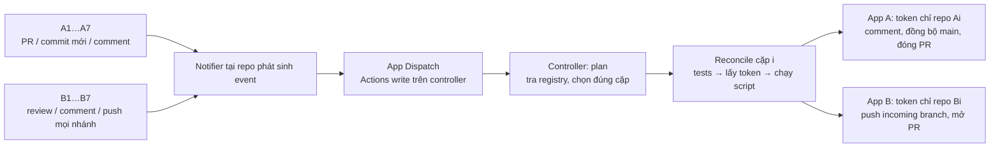

# Setup contribution bridge cho nhiều repo

Nếu B đã có code, A đã có repo rỗng cùng tên và máy có SSH hai bên, dùng [hướng dẫn setup bằng Bash](github-app-quick-setup.md). Thư mục [setup/](setup/) có 5 script riêng: `01-init.sh` → `02-prepare.sh` → cài App → `03-apply.sh` → B duyệt PR setup → `04-activate.sh` → `05-verify.sh`. Đã có sẵn 7 link repo B; apply tự đưa code B/main vào A/main rỗng và cấu hình các repo. Tài liệu dưới đây giải thích cấu trúc và cấu hình tương ứng, không cần làm lại thủ công những bước script đã thực hiện.

## 1. Kiến trúc dùng chung

Với **7 repo B có sẵn**, tạo **7 repo A private tương ứng**, dùng chung **3 GitHub App + 1 repo controller private + 1 bộ script**. A và B là hai organization; tên repo trong một cặp không cần giống nhau.

Developer chỉ làm việc tại A. **B quyết định review/merge và B/main là source of truth**. Controller chuyển contribution A → B, rồi đồng bộ đúng lịch sử B/main → A/main. Không cần fork hay thêm developer A vào B.

| Thành phần | Số lượng với 7 cặp | Cài đặt |
|---|---|---|
| App A — đồng bộ | 1 App | Chọn 7 repo A |
| App B — chuyển contribution | 1 App | Chọn 7 repo B |
| App Dispatch — gọi Actions | 1 App | Chỉ chọn repo controller |
| [Controller](templates/controller) | 1 repo, 1 workflow, 1 bộ script | Do B quản lý; registry chứa 7 mapping |
| [Notifier](templates/notifier/.github/workflows/notify-controller.yml) | Một file trên mỗi repo A/B | Cấu hình theo cặp tại B; bot đồng bộ cùng file về A |

GitHub App cung cấp identity/quyền; **Actions chạy script controller**. Cài App đơn thuần chưa tạo cơ chế đồng bộ.



Event chọn **một cặp**. Schedule hoặc Run workflow không nhập metadata chọn **tất cả cặp**; các cặp chạy song song, mỗi cặp có hàng đợi riêng. Key App dùng chung có quyền trên các repo đã cấp, nhưng token từng job được giới hạn đúng một repo.

Chỉ dùng **Create a merge commit** cho PR contribution để giữ nguyên SHA, author và committer. Bot ghi yêu cầu này trong PR body; không yêu cầu khóa phương thức merge tại B. Nếu B squash/rebase, A/main vẫn theo B nhưng controller không chấp nhận contribution thiếu lịch sử gốc.

## 2. Chuẩn bị và tạo ba App — làm một lần

Chuẩn bị admin hai org, Actions được bật, Git và Node.js 24 trên máy setup. Tải repo tài liệu này vào thư mục `bridge-docs`; các lệnh dưới đây dùng PowerShell. Mọi repo dùng nhánh chính `main`.

Tại org B: **Settings → Developer settings → GitHub Apps → New GitHub App**. Tạo ba App, tắt webhook; không cần callback/user authorization/device flow.

| Cấu hình | App A | App B | App Dispatch |
|---|---|---|---|
| Tên gợi ý | `<ORG>-Contribution-Sync` | `<ORG>-Contribution-Transport` | `<ORG>-Contribution-Dispatch` |
| Cho phép cài | Any account để cài ở org A | Only on this account của B | Only on this account của B |
| Only select repositories | Các repo A | Các repo B | Chỉ controller |
| Contents | Read and write | Read and write | No access |
| Pull requests | Read and write | Read and write | No access |
| Workflows | Read and write | No access | No access |
| Actions | No access | No access | Read and write |
| Metadata | Read-only | Read-only | Read-only |
| Quyền khác / org permissions | No access | No access | No access |

Với mỗi App: ghi **Client ID**, tạo private key PEM, cài vào đúng org và chọn repo. Admin A chấp thuận installation App A. Repo tạo sau thì thêm vào installation hiện có, giữ các repo đã chọn.

App A cần Workflows write để nhận workflow từ B. App B cần Contents write để đẩy branch ở B; quyền này **không giới hạn theo branch**, nên phải bảo vệ B/main ở mục 5. Controller chặn contribution sửa `.github/workflows/`; maintainer B xử lý riêng thay đổi đó.

### Credentials

Với **XBrainVN → TechX**, dùng [bảng secrets/variables cho controller và từng repo, kèm cách lấy giá trị](github-app-secrets-variables.md).

Đặt tại **Settings → Secrets and variables → Actions**:

| Nơi đặt | Loại | Tên | Giá trị |
|---|---|---|---|
| Controller | Variable | `SOURCE_APP_CLIENT_ID` | Client ID App A |
| Controller | Secret | `SOURCE_APP_PRIVATE_KEY` | PEM App A, gồm BEGIN/END |
| Controller | Variable | `BRIDGE_APP_CLIENT_ID` | Client ID App B |
| Controller | Secret | `BRIDGE_APP_PRIVATE_KEY` | PEM App B |
| Controller | Variable | `BRIDGE_ENABLED` | `false` khi setup; `true` sau kiểm tra |
| **Từng repo A và B** | Variable | `CONTROLLER_DISPATCH_APP_CLIENT_ID` | Client ID App Dispatch |
| **Từng repo A và B** | Secret | `CONTROLLER_DISPATCH_APP_PRIVATE_KEY` | PEM App Dispatch |

Hai key vận chuyển code chỉ ở controller; A/B chỉ giữ key dispatch. Không ghi key/token vào Git. Actions tự tạo installation token cho mỗi job và thu hồi khi kết thúc.

Tách App Dispatch để key tại A không có quyền vận chuyển code. Tuy nhiên, **Actions write áp dụng toàn repo controller**: người có quyền chạy workflow tại A có thể dùng secret để dispatch, cancel/disable workflow, đọc log và tiêu thụ minutes. Controller chỉ chứa workflow tin cậy, không nhận code/lệnh tùy ý và không ghi dữ liệu nhạy cảm B vào log. [Phạm vi installation token](https://docs.github.com/en/apps/creating-github-apps/authenticating-with-a-github-app/generating-an-installation-access-token-for-a-github-app).

## 3. Cấu hình controller cho 7 cặp — làm một lần

Tạo repo controller private do B quản lý. Từ thư mục cha chứa `bridge-docs`:

```powershell
git clone https://github.com/B_OWNER/CONTROLLER_REPO.git controller
Get-ChildItem -Force .\bridge-docs\templates\controller | Copy-Item -Destination .\controller -Recurse -Force
Set-Location .\controller
git checkout -B main
```

Copy cả `.github` và `.gitignore`. Bộ mẫu gồm [workflow](templates/controller/.github/workflows/controller.yml), [scripts](templates/controller/scripts), [tests](templates/controller/tests) và [registry](templates/controller/bridge.config.json). Script dùng Node built-in modules, không cần `npm install`.

### Registry các cặp repo

Điền `bridge.config.json` bằng tên thật:

```json
{
  "controllerRepo": "B_OWNER/CONTROLLER_REPO",
  "bot": "APP_B_SLUG[bot]",
  "sourceBot": "APP_A_SLUG[bot]",
  "pairs": [
    { "id": "project-1", "source": "A_OWNER/project-1", "target": "B_OWNER/project-1" },
    { "id": "project-2", "source": "A_OWNER/project-2", "target": "B_OWNER/project-2" },
    { "id": "project-3", "source": "A_OWNER/project-3", "target": "B_OWNER/project-3" },
    { "id": "project-4", "source": "A_OWNER/project-4", "target": "B_OWNER/project-4" },
    { "id": "project-5", "source": "A_OWNER/project-5", "target": "B_OWNER/project-5" },
    { "id": "project-6", "source": "A_OWNER/project-6", "target": "B_OWNER/project-6" },
    { "id": "project-7", "source": "A_OWNER/project-7", "target": "B_OWNER/project-7" }
  ]
}
```

`APP_A_SLUG` / `APP_B_SLUG` lấy từ URL `github.com/apps/<slug>`, giữ hậu tố `[bot]`. `id` duy nhất, ổn định, dùng chữ thường/số/dấu gạch ngang; mỗi repo chỉ thuộc một cặp và controller không nằm trong các cặp.

Chỉ thay cấu hình ở:

| File | Thay gì |
|---|---|
| `bridge.config.json` | Controller, danh tính bot và các mapping A/B |
| `.github/workflows/controller.yml` | Mọi `B_OWNER/CONTROLLER_REPO` |
| Notifier từng cặp ở mục 4 | A/B của cặp đó và cùng controller |

Giữ nguyên tên secrets, biến môi trường và `${{ ... }}`; không sửa script hay fixture tests theo từng project.

```powershell
Select-String -Path .\bridge.config.json,.\.github\workflows\controller.yml -Pattern 'A_OWNER|B_OWNER|CONTROLLER_REPO|APP_A_SLUG|APP_B_SLUG'
node --check scripts/pr-bridge.mjs
node --test tests/*.test.mjs
git add .github bridge.config.json scripts tests .gitignore
git commit -m "Configure multi-repository contribution bridge"
git push -u origin main
```

Kiểm tra không còn placeholder, **50/50 tests pass** và job `policy` trên GitHub thành công. Giữ `BRIDGE_ENABLED=false` cho đến khi các repo đã khai báo được bootstrap và cấp quyền.

## 4. Bootstrap và notifier — lặp cho mỗi cặp A–B

### 4.1. Khởi tạo A từ B có sẵn

Tạo A **private, trống**, không README/license/initial commit. Thêm A/B vào installation tương ứng. Trước khi copy lịch sử, guard các workflow deploy/CD của B theo mục 5 để chúng không chạy nhầm ở A.

Maintainer dùng credential được phép đọc B và ghi A, gồm quyền ghi workflow nếu có. Có thể dùng App token hoặc tài khoản đã được cấp quyền; cấu hình credential theo URL, không nhúng token vào lệnh và không đưa token B cho developer A.

Thay `A_OWNER/A_REPO`, `B_OWNER/B_REPO` bằng cặp đang setup; chạy trong một thư mục riêng cho cặp:

```sh
git clone --no-checkout --single-branch --branch main https://github.com/B_OWNER/B_REPO.git bootstrap
cd bootstrap
git remote rename origin b
git remote add a https://github.com/A_OWNER/A_REPO.git
git push a refs/heads/main:refs/heads/main
git ls-remote a refs/heads/main
git ls-remote b refs/heads/main
```

Hai SHA phải trùng. Lệnh giữ đầy đủ lịch sử main, không dùng `--mirror` và không cần fork. Git LFS/submodule cần chuẩn bị dữ liệu/quyền riêng. Controller yêu cầu A/main tồn tại, không tự bootstrap repo trống.

### 4.2. Bật controller sau bootstrap

Sau khi **mọi cặp trong registry** có main và installation đúng, đặt `BRIDGE_ENABLED=true`. Chạy **Actions → Contribution bridge controller → Run workflow → main**, để trống inputs.

Job `plan` phải tạo đủ các job `Reconcile <id>`, mỗi cặp thành công và A/main bằng B/main. Đây là kiểm tra khởi tạo; trigger tự động được nghiệm thu sau khi cài notifier.

### 4.3. Cài notifier tại B, đồng bộ về A

Với **XBrainVN → TechX**, xem [doc riêng: chỉ chạy CI dispatch tại A, giữ pipeline B và thêm reconcile khi bất kỳ nhánh B thay đổi](github-app-workflows-ab.md).

Đặt dispatch secret/variable ở **cả A và B** theo mục 2. Từ thư mục cha chứa `bridge-docs`, dùng thư mục làm việc riêng cho từng cặp:

```powershell
git clone https://github.com/B_OWNER/B_REPO.git B
New-Item -ItemType Directory -Force -Path .\B\.github\workflows
Copy-Item -LiteralPath .\bridge-docs\templates\notifier\.github\workflows\notify-controller.yml -Destination .\B\.github\workflows\notify-controller.yml
Set-Location .\B
git switch -c setup/notify-controller
```

Trong notifier, thay **mọi** `A_OWNER`, `A_REPO`, `B_OWNER`, `B_REPO`, `CONTROLLER_REPO`: condition, allowlist, token scope, URL API và summary. A/B là cặp đang setup; controller giống nhau cho cả 7 cặp. Không thay tên secrets.

```powershell
Select-String -Path .\.github\workflows\notify-controller.yml -Pattern 'A_OWNER|A_REPO|B_OWNER|B_REPO|CONTROLLER_REPO'
git add .github/workflows/notify-controller.yml
git commit -m "Notify contribution bridge"
git push -u origin setup/notify-controller
```

Kiểm tra không còn placeholder. Maintainer B mở PR và merge; push B/main tự gọi controller. Bot đưa **cùng notifier** về A/main, không tạo commit cấu hình độc lập tại A. Kiểm tra file đã có trên A/main trước khi developer mở PR.

Notifier không checkout/chạy code PR. PR/commit mới, review và comment từ người dùng tại A/B gọi controller; push mọi nhánh chỉ gọi controller ở B. Cài notifier mới trên mọi nhánh B đang hoạt động (push đọc workflow tại chính nhánh đó), xem [hướng dẫn nâng cấp](all-branch-reconciliation.md). Event do bot sao chép comment/đóng PR bị bỏ qua để tránh lặp. Push bằng `GITHUB_TOKEN` không tự kích hoạt workflow push tiếp theo: automation ghi B phải dùng App token phù hợp hoặc dispatch riêng. [Quy tắc trigger](https://docs.github.com/en/actions/how-tos/write-workflows/choose-when-workflows-run/trigger-a-workflow).

## 5. Quyền và guard trước khi sử dụng

App permissions không đủ để cưỡng chế quyền theo nhánh. Với repo private, dùng gói GitHub hỗ trợ [branch protection](https://docs.github.com/en/repositories/configuring-branches-and-merges-in-your-repository/managing-protected-branches/about-protected-branches); guard script không thay thế protection phía GitHub.

| Phạm vi | Thiết lập |
|---|---|
| **Từng B/main** | Require PR/review B, dismiss stale approvals, CI tin cậy; chỉ maintainer/team B được cập nhật; App B không có bypass; chặn force-push/deletion |
| **Từng A/main** | Chỉ App A được cập nhật; developer không push/merge. Cho App A direct push và force-push để recovery, không áp PR/linear history chặn lịch sử B. Nếu dùng ruleset, bypass chỉ App A cho rule cần thiết; chặn deletion ở rule riêng không bypass |
| **Controller/main** | Chỉ B quản lý; review thay đổi scripts/workflows, không cho A sửa/chạy code tùy ý |
| **CI contribution tại B** | Incoming PR cùng repo B có thể tiếp cận secrets nếu workflow truyền vào. Build/test code A với quyền tối thiểu, không key/token ghi; bảo vệ cả script mà workflow gọi |
| **Workflow ứng dụng B được sao sang A** | Guard job deploy/CD chỉ dành cho B bằng `if: github.repository == 'B_OWNER/B_REPO'`, áp dụng trước bootstrap. Notifier chủ động cho phép cả A/B |

Controller kiểm tra repo private và token chỉ thấy đúng repo của cặp; chỉ push incoming branch ở B, không force-push/merge B. Job có key không checkout/chạy contribution. Tests chạy trước khi tạo token; registry và controller lấy từ revision main tin cậy.

Nếu A/main lệch, bot lưu `recovery/a-main-<SHA>` rồi thay bằng B/main bằng **atomic push + force-with-lease**. Lease sai thì lượt chạy fail, không ghi đè thay đổi mới một cách mù quáng. Feature branch phân kỳ được báo lỗi, không tự sửa conflict.

Giữ nguyên Git metadata không xác thực người tạo commit: author/email có thể tự khai báo. Nếu cần chứng minh identity, yêu cầu ký commit và kiểm tra signer.

## 6. Nghiệm thu từng cặp

Developer clone repo A bằng tài khoản của mình, tạo feature branch và PR vào main; không merge tại A.

| Bước | Kết quả cần thấy |
|---|---|
| A mở PR → push thêm commit | Event chọn đúng `Reconcile <id>`; cùng một PR B được mở/cập nhật, giữ SHA đóng góp |
| B Request changes có nội dung/line comments | A nhận findings, file/dòng/SHA và nguồn review |
| A sửa code, comment findings đã xử lý | B nhận commit mới và bản sao Conversation comment |
| B approve/comment | A thấy bản sao; approval không tự merge |
| B **Create a merge commit** | Notifier B tự chạy; controller sync A/main đúng B/main; commit gốc giữ SHA/author/committer; PR A đóng |
| B đóng PR khác không merge, ghi lý do | A nhận lý do và đóng; không đưa contribution vào main, không tự tạo lại PR B |
| Chạy lại / thử cặp thứ hai | Không tạo trùng PR/comment, không ghi code sang cặp khác |

Comment **Conversation** đi hai chiều; review/inline findings chỉ B → A, native approval vẫn ở B. Developer A trả lời findings bằng Conversation. Không đồng bộ deletion/reaction. PR tạo trực tiếp tại B không tạo PR A, nhưng khi merge thì main A vẫn cập nhật.

Kiểm tra cả **notifier và controller**, không chỉ CI code hoặc HTTP dispatch. Thử quyền bị từ chối: developer không cập nhật A/main, App B không cập nhật/merge B/main. Nghiệm thu trigger bằng sự kiện thật, không dùng Run workflow để chứng minh tự động.

Sau khi bot sync, developer chạy:

```sh
git switch main
git pull --ff-only origin main
```

Nếu local main đã lệch, lưu công việc trên branch riêng, fetch rồi kiểm tra trước khi reset về `origin/main`.

## 7. Thêm repo và vận hành

**Thêm cặp thứ 8:** tạo A trống → cấp A/B cho hai installation hiện có → bootstrap A từ B → thêm mapping registry → policy pass → đặt dispatch credentials cả hai bên → cài notifier tại B → nghiệm thu. Không tạo App/controller/script mới.

| Tình huống | Cách xử lý |
|---|---|
| Notifier Success nhưng chưa có PR hoặc chưa sync | Mở controller run, xem `plan`, `Reconcile <id>`, summary và lỗi token/protection/lease. Dispatch Success chỉ là đã gửi yêu cầu |
| Cần chạy lại | Developer comment tại PR A để kích hoạt; `/bridge sync` chỉ là comment, không phải lệnh đặc quyền. Maintainer Run workflow không inputs để đối chiếu mọi cặp |
| Tạm dừng | `BRIDGE_ENABLED=false`; xử lý riêng các job đang chạy vì biến không hủy job đã bắt đầu |
| `blocked-workflow-change` / `incoming-diverged` | Maintainer xử lý thay đổi workflow; với feature history đã rewrite, phối hợp sửa hoặc mở PR mới từ A/main |
| B squash/rebase | `identity-not-preserved` khi thiếu commit gốc; A/main vẫn theo B, không accepted/đóng PR A còn mở. Guard không khôi phục lịch sử B đã viết lại |
| A có commit chưa được B nhận / merge chưa nằm trong B/main | `new-commits-pending` / `merge-result-not-in-main`; giữ PR A còn mở, đối chiếu revision và xử lý phần còn lại |
| A đã đóng, B mở lại | `source-closed`; bot không đóng lại B. Developer reopen A nếu muốn tiếp tục |
| Lỗi Git/API hoặc feedback quá dài | Run báo Fail nhưng tiếp tục phần việc khác; sửa lỗi hoặc chia nhỏ feedback rồi chạy lại |
| Xoay key / key lộ | Cập nhật secret rồi kiểm tra trước khi thu hồi key cũ; nếu lộ thì thu hồi ngay, dừng job liên quan và kiểm tra audit |

Controller đọc trạng thái thực tế, không dùng event SHA để ghi main. Nó chỉ accepted khi cả merge result và source head gốc thuộc B/main. Run Success có thể vẫn chứa `pending`, `rejected` hoặc contribution bị chặn; phải đọc summary.

Lượt reconcile xét PR mở và PR đóng cập nhật trong 7 ngày; cặp của PR A đang mở vẫn được tìm. PR đóng cũ hơn cần event trực tiếp, chẳng hạn Conversation comment từ người dùng. Nhiều event gần nhau có thể thay thế run đang chờ; run đang chạy không bị hủy. Lịch mỗi 6 giờ là dự phòng, event là đường chính; tốc độ phụ thuộc hàng đợi Actions.

Với 7 cặp, mỗi event dùng 1 job plan + 1 reconcile; lịch/manual toàn bộ dùng 1 plan + 7 reconcile. Nếu mỗi job dưới một phút, riêng lịch 4 lần/ngày khoảng **960 phút/tháng 30 ngày**, chưa tính notifier, event, policy hoặc job dài hơn. Theo dõi quota/budget chung của org. [Billing Actions](https://docs.github.com/en/billing/concepts/product-billing/github-actions).

Bàn giao cùng [templates](templates): version docs/controller, registry, danh sách App/installation, người quản lý và tên secrets. Giữ PEM trong kênh secrets, không đưa vào tài liệu.
